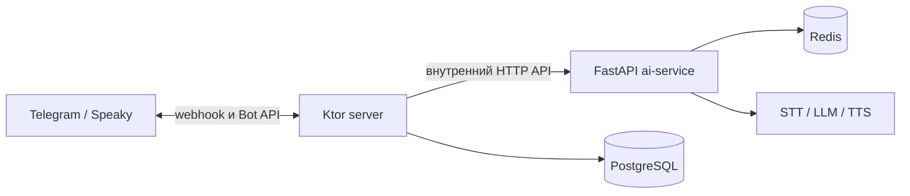

# Speaking Coach

Speaking Coach — проект для практики разговорного английского с AI-собеседником. Текущий основной сценарий — Telegram-бот **Speaky**: пользователь говорит голосом, получает ответ и краткую обратную связь по речи. Продуктовая идея — использовать каждый разговор для диагностики и подбора следующей практики; подробнее она описана в [product.md](ai_docs/product.md).

В Speaky реализованы голосовое знакомство, оценка уровня, практические звонки, исправления, цели и напоминания. История диалога и данные для персонализации сохраняются между разговорами.

В репозитории также есть **прототип приложения на Compose Multiplatform** для Android, iOS и Desktop. Некоторые пути, включая авторизацию, WebRTC-звонок и разбор, подключены к API, но значительная часть экранов и данных пока демонстрационная. Это не готовый второй пользовательский продукт. До 15 октября 2026 новые продуктовые правки в `cmp/app` не делаются: текущий продукт — бот в Telegram.

Это описание относится к коду в репозитории. Наличие функции на конкретном DEV или PROD окружении зависит от развернутой там версии.

## Как устроен проект



Ktor принимает Telegram webhook, управляет очередью голосовых сообщений и обращается к AI-сервису. AI-сервис распознаёт речь, генерирует ответ и исправления, синтезирует голос и хранит состояние диалога. API и WebRTC-путь прототипа приложения показаны отдельно в [архитектуре](architecture.md).

## Технологии

| Часть | Основные технологии |
| --- | --- |
| Ktor-сервер и Telegram | Kotlin, Ktor, tgbotapi, PostgreSQL, Flyway; JWT для API прототипа |
| AI-сервис | Python, FastAPI, Redis, Groq Whisper, OpenRouter, Deepgram (опционально); OpenAI Realtime для прототипа |
| Прототип приложения | Kotlin Multiplatform, Compose Multiplatform, Ktor Client, Koin, Navigation 3, WebRTC |
| Сборка и поставка | Gradle, Docker, GitHub Actions |

Точные версии зависимостей находятся в [`cmp/gradle/libs.versions.toml`](cmp/gradle/libs.versions.toml) и [`ai-service/requirements.txt`](ai-service/requirements.txt).

## Структура репозитория

| Путь | Назначение |
| --- | --- |
| [`cmp/server/`](cmp/server/) | Ktor API, Telegram webhook, очередь голосовых сообщений, аналитика |
| [`cmp/app/`](cmp/app/) | Прототип для Android, iOS и Desktop; общая Compose UI и клиент API |
| [`cmp/core/`](cmp/core/) | Общий Kotlin-код |
| [`ai-service/`](ai-service/) | FastAPI, распознавание речи, ответы, исправления, синтез речи, состояние диалогов |
| [`infra/`](infra/) | Docker и скрипты развертывания сервисов и хранилищ |
| [`ai_docs/`](ai_docs/) | Продуктовые решения, архитектура, контракты, планы и инструкции по развертыванию |
| [`.github/workflows/`](.github/workflows/) | CI и ручные workflow развертывания |

## Локальная разработка

**Gradle root — `cmp/`.** Из корня репозитория:

```bash
cd cmp
export GRADLE_USER_HOME="$HOME/.gradle"
./gradlew :server:test
./gradlew :app:shared:jvmTest
```

Из `cmp/` можно отдельно запустить Ktor командой `./gradlew :server:run` или Desktop-приложение командой `./gradlew :app:desktopApp:run` — каждый процесс занимает терминал. Без настроенного webhook Ktor работает локально в режиме HTTP для проверки `/health`; Telegram-боту нужен публичный HTTPS webhook. Для клиента адрес Ktor задаётся через `cmp/client.local.properties` по образцу [`cmp/client.local.properties.example`](cmp/client.local.properties.example). Сборка Android: `./gradlew :app:androidApp:assembleDebug`; iOS-приложение открывается из `cmp/app/iosApp` в Xcode.

AI-сервис запускается отдельно, также из корня репозитория. Перед `uvicorn` задайте `AI_INTERNAL_TOKEN`: без него сервис не стартует. Для речевого пайплайна нужны и ключи соответствующих провайдеров. Имена переменных приведены в [`.env.example`](.env.example), детали локального запуска — в [инструкции](ai_docs/integrations/2026-09-18-run-and-ci.md).

```bash
cd ai-service
python3 -m venv .venv
source .venv/bin/activate
pip install -r requirements-dev.txt
pytest
uvicorn app.main:create_app --factory --host 127.0.0.1 --port 8090
```

Не добавляйте значения секретов в репозиторий.

## Проверка и развертывание

CI проверяет Kotlin и Python код в [CMP](.github/workflows/cmp.yml) и [AI service](.github/workflows/ai-service.yml). Push и pull request сами по себе не выкатывают сервисы. DEV и PROD развертываются вручную через workflow **Redeploy DEV** и **Redeploy PROD**; Ktor и AI-сервис могут находиться на разных хостах. Порядок, сеть, хранилища и переменные описаны в [deploy.md](ai_docs/deploy.md).

Начальная точка для остальных документов — [ai_docs/README.md](ai_docs/README.md). HTTP-контракты Telegram-клипов и CMP-приложения описаны отдельно: [clip API](ai_docs/integrations/2026-09-18-clip-session-api.md) и [mobile API](ai_docs/integrations/2026-09-18-mobile-api.md).

## Где смотреть сбой

- Мониторинг живых людей — агрегаты в Redis (`metrics:*`, `metrics:v2:*`) и панели Prometheus / Grafana на машине Ktor.
- Журнал реплик — закрытая страница истории на Ktor. Это не общий доступ к аудио.
- Логи — технический след падения в Loki и в файле сервера: стадия и код ошибки, без текста человека.

Карта того, что уже работает, потолок провайдеров и размер машин: `ai_docs/architecture/2026-10-11-telegram-mvp-acceptance.md`.

## Метрики задания

Доска Grafana Speaky, файл `infra/monitoring/grafana/dashboards/speaky.json`. Только Telegram, московский день. Историческая метрика `speaking_dau` считает пользователей с завершённым ходом AI, а не всех отправителей голосовых. Активные пользователи по голосовым показаны на `/admin/metrics` с начала журнала PostgreSQL. Стоимость в Grafana включает только возвращённые цены моделей; STT без цены не входит.

| Метрика | Панель | Ряд |
| --- | --- | --- |
| Завершили ход AI | Завершили голосовой ход AI по дням | `speaking_dau{client="telegram"}` |
| Частотность взаимодействия | Частотность: ходов на завершившего ход AI | `speaking_turns{client="telegram"} / speaking_dau{client="telegram"}`; ноль, если в этот день никого не было |
| Ошибки сервисов | Ошибки сервисов по дням | `speaking_errors{client="telegram"}` |
| Известная стоимость на завершившего ход AI | Учтённые расходы / завершившего ход AI по дням, $ | `(speaking_cost_micro{client="telegram"} / 1000000) / speaking_dau{client="telegram"}`; ноль, если в этот день никого не было |

Инженерные решения лежат в `ai_docs/`, не в этом файле.
