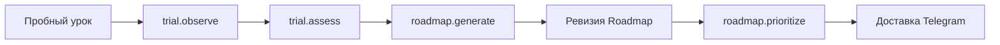

# Запись логов Speaky

Каждая значимая запись называет действие, этап, время, исход и известную причину. События связывают HTTP-запрос, фоновую задачу и доставку. PostgreSQL хранит подтверждённые изменения состояния и позволяет восстановить связь между задачами при пропуске строки.

## Писатели и владельцы

| Где | Что пишет |
| --- | --- |
| Ktor | `RuntimeDiagnostics.record(Event, …)` пишет исходы входов, команд Foundation, фоновых попыток и доставки Telegram. Код, который проверил правило или получил подтверждение транзакции, владеет записью результата. [RuntimeDiagnostics.kt](../../cmp/server/src/main/kotlin/com/eliteteam/speakingcoach/RuntimeDiagnostics.kt) |
| Python | `diagnostics.event(EventSpec, …)` пишет исходы HTTP, WebSocket, вычислений и внешних вызовов. Python подтверждает вычисление результата. Сохранение результата подтверждает Ktor. [diagnostics.py](../../ai-service/app/diagnostics.py) |
| Mini App | `reportDiagnostic` отправляет собственное наблюдение на `POST /miniapp/diagnostics`. Python проверяет Telegram-аутентификацию и разрешённые действия, этапы, коды и поля. Отчёт зависит от доступности сети. [api.js](../../mini-app/src/api.js) · [trial_api.py](../../ai-service/app/trial_api.py) |
| Эксплуатационные команды | Скрипты поставки и резервного копирования пишут `operation_event` с UTC-временем, этапом, исходом и кодом причины. Формат этих строк отличается от JSON сервисов. [Пример deploy](../../infra/ai-service/deploy-remote.sh) · [Backup](../../infra/backup/backup-remote.sh) |

## Формат записи

Запись сервиса состоит из маркера и [JSON v1](../../contracts/logging/v1/envelope.json). Основной маркер `runtime_event`. Адаптеры сохраняют `provider_call` и `tutor_tool` для действующих потребителей.

| Вопрос | Поля |
| --- | --- |
| Что произошло? | `event` для точного поиска, `operation` для действия, `stage` для этапа, `outcome` для наблюдаемого исхода. `message` читает человек. |
| Где? | `service`, `component`, `environment` и `release`. Для отдельных HTTP-входов `route_name` называет зарегистрированный маршрут или действие. |
| Когда? | `timestamp` в UTC и `duration_ms`, если длительность измерена. |
| Почему? | `reason_code` называет известную причину. Код HTTP и безопасные поля провайдера уточняют наблюдение. |
| С чем связано? | `trace_id` связывает записи операции. `request_id`, `operation_id`, `job_id`, `lesson_id` и `delivery_id` указывают на конкретные объекты и входы. |

Пример записи Ktor о таймауте отправки. Идентификаторы и время условные.

```json
{
	"schema_version": 1,
	"timestamp": "2026-11-21T14:02:17.030Z",
	"level": "WARNING",
	"service": "backend",
	"component": "initial",
	"environment": "local",
	"release": "unknown",
	"event": "initial_roadmap_delivery_unknown",
	"operation": "roadmap.deliver",
	"stage": "telegram_request",
	"outcome": "unknown",
	"reason_code": "telegram_request_timeout",
	"message": "The Telegram request timed out. Roadmap message delivery is unknown.",
	"trace_id": "19470d6faa624ed591c61f3312e6dc1a",
	"request_id": null,
	"error_id": "99dcf67a2a6042159ac2180f302488a8",
	"duration_ms": null,
	"delivery_id": "c0bd93b8-7b7b-49d8-903f-87f8e9a2d538",
	"provider": "telegram",
	"part": 0
}
```

## Транзакции, ошибки и повторы

- Ktor пишет факт сохранения после commit. Внутри транзакции `FoundationDatabase.recordAfterCommit` ставит запись в очередь до подтверждения commit. При rollback эта запись отбрасывается. [FoundationDatabase.kt](../../cmp/server/src/main/kotlin/com/eliteteam/speakingcoach/foundation/FoundationDatabase.kt)
- У первичной ошибки есть `error_id`. Следующий слой использует тот же ID или `upstream_error_id`, когда сообщает собственный исход. Кадры стека остаются у источника ошибки. Пример нового факта у следующего владельца — `failure_persisted` с сохранённым решением `retry_wait` или `failed`. [FoundationWorker.kt](../../cmp/server/src/main/kotlin/com/eliteteam/speakingcoach/foundation/FoundationWorker.kt)
- `replayed` означает выдачу уже сохранённого результата. `superseded` означает, что более новое состояние вытеснило результат этой попытки. `skipped` описывает осознанный пропуск, `rejected` подтверждённый отказ, `cancelled` отмену и `unknown` отсутствие подтверждения.
- При таймауте команды Python пишет `unknown`. Если код проверяет сохранённый результат, запрос результата виден по тем же `trace_id` и `operation_id`. Поле `receipt_present` показывает, вернул ли Foundation сохранённый результат. [foundation_client.py](../../ai-service/app/foundation_client.py)

## Связь между сервисами и задачами

В доверенных запросах Ktor и Python передают `X-Diagnostic-Trace`. HTTP-ответы диагностируемых входов возвращают `X-Request-ID` и, при ошибке, `X-Error-ID`. WebSocket получает один серверный `trace_id` на соединение. Клиентский `attemptId` пишется отдельно как `client_attempt_id`. Для нескольких подключений к одному уроку используйте `lesson_id`. Для одного эпизода используйте `call_session_id`.

У фоновой задачи собственный trace. Это первые 32 шестнадцатеричных символа SHA-256 от `job_id`. `attempt` показывает номер попытки. `fence` указывает, какой захват разрешил исполнителю сохранить результат. При смене исполнителя старый `fence` теряет право на запись. `source_job_id` связывает задачи с разными trace.

В цепочке первой Roadmap миграция V67 сохраняет конкретный источник доставки.



Доставка ждёт начальной приоритизации текущей ревизии. В `initial_roadmap_delivery` хранятся ID урока, ревизия Roadmap, `source_job_id` и `source_job_fence`. Последние два поля указывают на попытку генерации. Текущая или архивная ревизия хранит `generation_job_id` и `generation_fence`. Родительские ссылки в `foundation_job` ведут к Assessment и Observation. У записей до V67 ссылка на генерацию может отсутствовать. [Миграция V67](../../cmp/server/src/main/resources/db/migration/V67__roadmap_job_provenance.sql)

Telegram подтверждает каждую часть отдельно. После подтверждения Ktor сохраняет номер следующей части. После подтверждения последней части доставка становится `sent`. При таймауте доставка остаётся `unknown`, и worker автоматически её не повторяет. [InitialRoadmapDelivery.kt](../../cmp/server/src/main/kotlin/com/eliteteam/speakingcoach/foundation/InitialRoadmapDelivery.kt)

## Объём и приватность

- Успешные health probes и пустые опросы очереди проходят тихо. Успешные команды `voice.audio`, `voice.audio_stored`, `voice.heartbeat` и `voice.playback` обходятся без строк. Событие `trial_audio_state` содержит сводку аудиопотока. [Голосовая сессия](../../ai-service/app/realtime_voice/session.py)
- Worker считает успешные продления аренды в `renewals` в итоге попытки. Потеря аренды записывается отдельно на этапе `renew`.
- Для событий Ktor с `coalesce` повторные строки подавляются в окне 60 секунд. При следующей записи для того же ключа после окончания окна писатель сообщает `suppressed_count`. Писатель хранит до 128 ключей.
- Писатели допускают только разрешённые диагностические поля. В них нет ученических реплик, промптов, аудио, `initData`, токенов, подписанных ссылок, тел запросов и сырых сообщений исключений. Стек содержит до 16 кадров с именами и номерами строк.
- Отказ писателя сохраняет исход операции. После восстановления Ktor сообщает о потерях через `diagnostic_records_lost`, а Python добавляет `diagnostic_losses` к следующей записи.

## Подтверждённая работа

На DEV проверена V67. Сквозной тест использовал синтетический транскрипт. Telegram Bot API подтвердил восемь частей Roadmap. После совместной выкладки контрольный отказ авторизации проверяет общие `trace_id` и `error_id` в обоих сервисах без вызова модели. [Сквозная проверка DEV](https://github.com/greenblat17/1billion-dollar-startup/actions/runs/44952528909) · [Проверка после выкладки](https://github.com/greenblat17/1billion-dollar-startup/actions/runs/44953800896)

Локальные проверки покрывают rollback, retry, потерю аренды и неизвестный исход доставки. Последующие изменения из PR #58 проверены локально. Матрица хранит доказательства и открытые проверки. [Матрица покрытия](../audits/2026-11-21-logging-coverage.md) · [Состояние проекта](../status.md)

Команды поиска по stdout, Docker и Loki описаны в [эксплуатации](../integrations/operations.md#диагностика-speaky). Общий контракт применяется к записи сервисов независимо от инструмента поиска. [План реализации](../plans/2026-11-21-runtime-logging.md)
