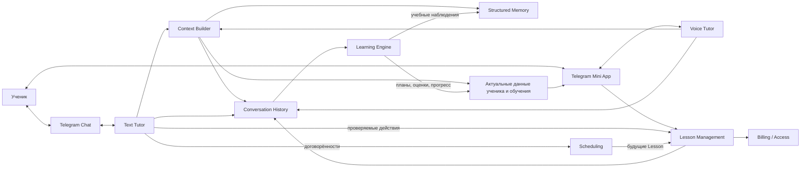
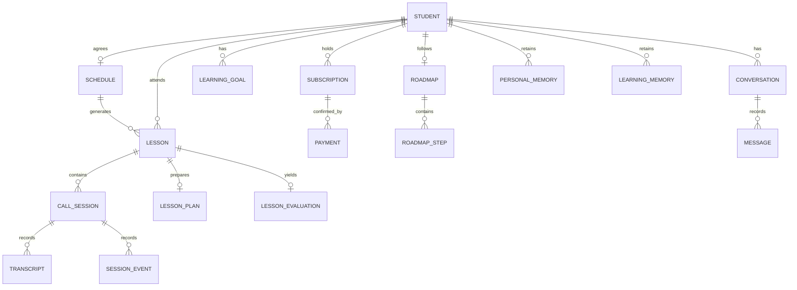
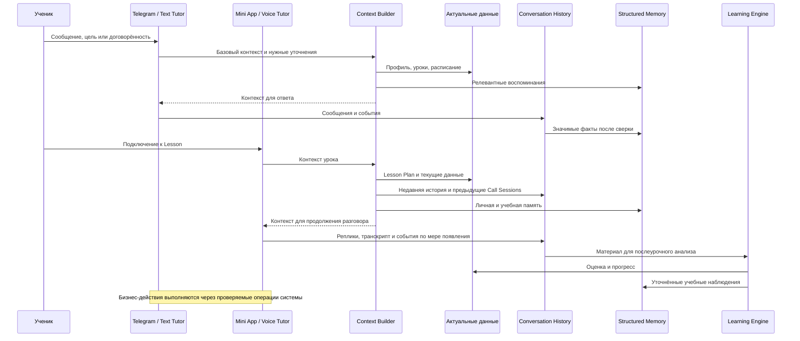
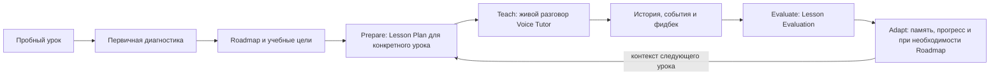
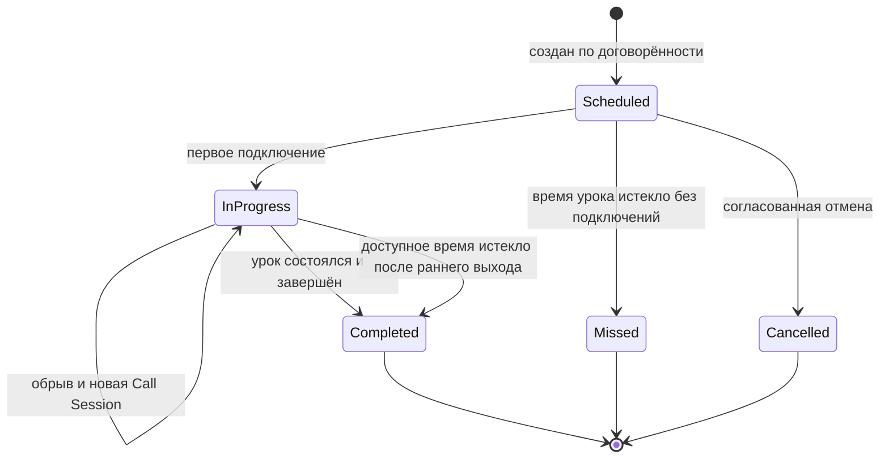
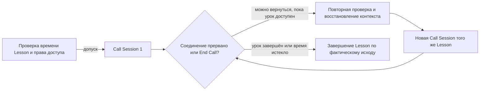
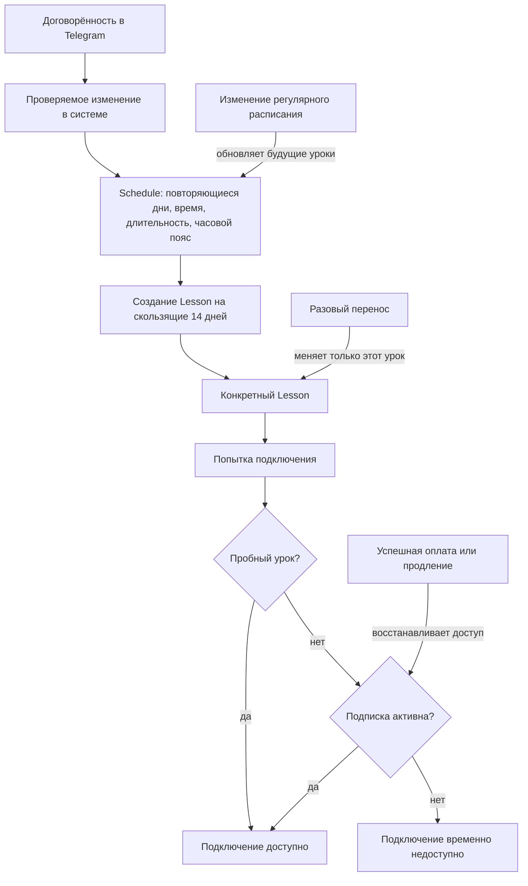

# Speaky MVP — High-Level Technical Architecture

**Version:** 1.0  
**Status:** Согласованная верхнеуровневая архитектура  
**Purpose:** Архитектурный контракт для реализации продуктовых задач SP-01—SP-08.  
**Source of product behavior:** Speaky AI Tutor Product Spec v0.5. При расхождениях в деталях UX использовать продуктовую спецификацию; этот документ определяет логические обязанности и взаимодействия.

> **Границы документа.** Здесь сознательно не фиксируются языки, фреймворки, облачные провайдеры, конкретные модели, схемы таблиц, API endpoints, классы и структура репозитория. Кодинговый агент выбирает реализацию после изучения существующего проекта. Логические блоки ниже **не означают отдельные сервисы или процессы**.

## 1. Архитектурные принципы

1. **Один репетитор, два канала:** Telegram Chat для общения вне уроков и Telegram Mini App для голосовых уроков и просмотра прогресса. Текстовый и голосовой AI используют одну идентичность репетитора и общие сведения об ученике.
2. **Состояние независимо от LLM:** ученики, расписание, конкретные уроки, подписки, roadmap и история сохраняются в системе, а не исключительно в контексте модели.
3. **Контекст по необходимости:** AI получает базовый контекст автоматически и может запрашивать дополнительные актуальные данные через инструменты. Не требуется отправлять всю историю каждому запросу.
4. **AI интерпретирует, backend исполняет:** изменения расписания, уроков, подписки и иных бизнес-сущностей проходят через контролируемые операции системы с проверками; подтверждать успех можно только после успешного изменения.
5. **Память обновляется в ходе общения и после него:** история поступающих сообщений и событий сохраняется по мере появления; значимые факты извлекаются своевременно, по завершении взаимодействия проводится дополнительный анализ.
6. **Обучение — замкнутый цикл:** Prepare → Teach → Evaluate → Adapt. Подготовка и оценка не вмешиваются в ход каждого голосового ответа.
7. **Структурированная память:** на текущем этапе используется Structured Memory; embeddings и семантический поиск не являются обязательной частью архитектуры.

## 2. Логические компоненты и ответственность

| Компонент | Ответственность | Не отвечает за |
|---|---|---|
| **Text Tutor** | Естественная переписка в Telegram: знакомство, организационные договорённости, реакции на пропуски и досрочные выходы; использует доступные инструменты | Проведение урока в переписке; непосредственное изменение данных без backend |
| **Voice Tutor** | Пробные и регулярные голосовые уроки: разговор, адаптация сложности, поддержка ученика, итоговая обратная связь, запрос фидбека | Расписание как источник истины; платежи; самостоятельное хранение долгосрочной памяти |
| **Context Builder** | Сбор и предоставление актуального контекста под тип взаимодействия; автоматический базовый контекст и дополнительные запросы по требованию | Принятие продуктовых решений от имени ученика; самостоятельное создание вымышленных фактов |
| **Structured Memory** | Хранение актуальных личных и учебных воспоминаний, их источников, уточнений и устаревания | Источник истины о расписании и оплате |
| **Learning Engine** | Диагностика после пробного урока; оценки, создание и адаптация roadmap; подготовка Lesson Plan; послeурочный анализ | Ведение живого голосового разговора и управление каждым его ходом |
| **Lesson Management** | Состояния Lesson, допуск к подключению, связи с Call Sessions, обработка подключений, обрывов и завершений | Педагогическая стратегия диалога |
| **Scheduling** | Регулярное расписание, создание будущих Lesson, разовые переносы/отмены, напоминания и обработка пропусков | Решение о качестве речи ученика |
| **Billing / Access** | Учёт подписки, приём результата платежа и проверка права подключения к регулярному уроку | Управление самим регулярным расписанием |
| **Conversation History** | Сохранение сообщений Telegram, транскриптов, событий разговоров и сводок для продолжения и последующего анализа | Автоматическое превращение каждой реплики в долговременный факт |

Все обозначения — **логические зоны ответственности**, а не требование выделять самостоятельные развёртываемые сервисы.

### Общая архитектура и потоки данных

Стрелки показывают логический обмен информацией и событиями, а не сетевые соединения или границы развёртывания.

## 3. Концептуальная модель данных

- **Student** — ученик: профиль, цели, уровень, предпочтения, часовой пояс.
- **Tutor Identity** — единый образ и правила поведения репетитора для Text Tutor и Voice Tutor.
- **Schedule** — повторяющаяся договорённость о днях, времени, длительности и часовом поясе.
- **Lesson** — конкретное пробное или регулярное занятие с датой, длительностью и состоянием.
- **Call Session** — фактическое голосовое подключение; **один Lesson может иметь несколько Call Sessions**.
- **Subscription / Payment** — период действия подписки и подтверждённые платежи, независимо от Schedule.
- **Learning Goal / Roadmap / Roadmap Step** — цель обучения, этапы и подтверждаемое освоение навыков.
- **Lesson Plan** — образовательная цель, тема и стратегия конкретного занятия.
- **Lesson Evaluation** — итоги, наблюдения и пять показателей: Fluency, Confidence, Speaking Autonomy, Grammar, Vocabulary.
- **Conversation / Messages / Transcript / Session Events** — последовательность общения в чате и в уроке, необходимая для истории и анализа.
- **Personal Memory / Learning Memory** — долговременные факты и учебные наблюдения с источником, актуальностью и возможностью изменения.

**Разделение источников истины:** Schedule и Lesson содержат действительные договорённости; Subscription — право на доступ; Roadmap — действующий учебный план; память — полезные сведения, но не замена перечисленным сущностям.

### Связи основных сущностей

Диаграмма концептуальная: кратности помогают читать модель, но не задают таблицы или способ хранения. Tutor Identity — общий для обоих каналов образ репетитора, а не отдельная запись на каждого ученика.

Subscription не владеет Lesson: право доступа проверяется при подключении к регулярному занятию.

## 4. AI и управление контекстом

### Контекст каждого взаимодействия

- **Core Context:** идентичность и правила репетитора; профиль, цели, уровень и ключевая актуальная память ученика.
- **Session Context:** тип взаимодействия, текущая история; для урока — Lesson Plan, ориентир завершения и сведения о недавних занятиях.
- **On-demand Context:** дополнительные воспоминания, актуальное расписание, сведения об уроках и подписке, получаемые через системные инструменты.

Context Builder автоматически готовит базовую часть перед новым взаимодействием. Text Tutor и Voice Tutor могут запросить дополнительные данные в ходе взаимодействия. Актуальные административные факты не должны определяться по устаревшей копии в AI-контексте.

### Долговременная память

- **Personal Memory:** интересы, предпочтения, события, контекст жизни ученика.
- **Learning Memory:** сильные стороны, трудности, повторяющиеся ошибки, освоенные навыки, динамика обучения.
- **Working Context:** недавние реплики текущей сессии (не тождественен долгосрочной памяти).
- **Conversation History:** сохранённые исходные взаимодействия, служащие источником для проверки и последующего извлечения памяти.

Поток: **Capture → Extract → Reconcile → Store → Retrieve**. Новые сведения сопоставляются со старыми, могут уточнять или заменять устаревшие. Неподтверждённые выводы отличают от фактов. Не превращать каждую реплику в отдельное долговременное воспоминание.

Сведения, необходимые для немедленных действий, сохраняются при их совершении; остальные могут обрабатываться позже. Обрыв голосового соединения не должен уничтожать уже полученную историю.

### Tool Calling

AI распознаёт намерение и вызывает разрешённое действие. Backend проверяет права, параметры, состояние и ограничения, выполняет операцию и возвращает результат. Только после этого AI сообщает об успешном изменении. Инструменты Text Tutor и Voice Tutor могут отличаться по назначению и полномочиям.

### Общая память и контекст между Telegram и Mini App

Оба канала читают актуальный контекст одного ученика. История сохраняется по мере взаимодействия; долговременная память уточняется своевременно и после разговора.

## 5. Образовательный цикл

1. **После пробного урока:** анализ речи и наблюдений → первоначальная оценка → персональный Roadmap; репетитор объясняет ученику выводы и путь к цели.
2. **Перед регулярным уроком:** Learning Engine использует Roadmap, предыдущие результаты и память → готовит Lesson Plan с целью, темой и рекомендациями.
3. **Во время урока:** Voice Tutor проводит Guided Conversation, не обязан следовать жёсткому сценарию, может естественно отклоняться от темы и не перебивает ученика ради коррекции.
4. **После урока:** Learning Engine обрабатывает историю и фидбек → обновляет Lesson Evaluation, Learning Memory и прогресс; при необходимости адаптирует Roadmap.
5. **Перед следующим уроком:** Context Builder передаёт Voice Tutor обновлённую информацию.

Roadmap представляет долгосрочный план, **а не расписанные заранее все будущие разговоры**. Lesson Plan создаётся для конкретного занятия. Освоение этапов определяется учебными результатами, а не количеством дней или уроков. Confidence включает самооценку ученика; оценка беглости должна учитывать доступные признаки речи, а не только текст.

### Цикл подготовки, проведения и анализа урока

Подготовка и оценка выполняются вокруг урока; Voice Tutor ведёт разговор гибко, опираясь на план и актуальный контекст.

## 6. Жизненный цикл урока

### Lesson и Call Session

- Lesson: `Scheduled`, `In Progress`, `Completed`, `Missed`, `Cancelled`.
- Call Session: отдельный эпизод подключения; несколько эпизодов могут относиться к одному Lesson.
- Причина завершения соединения и признак `Ended Early` фиксируются отдельно от основных состояний урока.

### Согласованные правила

- **Доступ к подключению:** не раньше запланированного времени начала.
- **Опоздание:** не сдвигает запланированное окончание.
- **Нормальное завершение:** Voice Tutor примерно за 2–3 минуты естественно переходит к итогам → фидбеку → подтверждению следующего урока → прощанию. Небольшой выход за лимит допустим; резкого обрыва на отметке времени нет.
- **Технический обрыв:** урок сохраняется; повторное подключение создаёт новую Call Session к тому же Lesson с сохранением контекста.
- **Кнопка End Call:** завершает соединение сразу, Mini App закрывается и возвращает в Telegram; при раннем необъяснённом уходе Text Tutor деликатно уточняет причину и сохраняет ответ. Возможность переподключения сохраняется, пока занятие доступно.
- **Досрочно закончившийся урок:** `Completed` с признаком `Ended Early`, если занятие состоялось, но дальнейшего подключения не было.
- **Неявка:** через 5 минут после начала Text Tutor отправляет одно ненавязчивое сообщение; после окончания запланированного времени при отсутствии подключений урок становится `Missed`; повторные пропуски — повод предложить пересмотр расписания.
- **Без автоматического отчёта после обычного урока:** итоги и фидбек обсуждаются голосом; послeурочный анализ выполняется внутри системы.

Переходы состояний выполняет бизнес-логика по фактическим событиям, а не по свободной интерпретации LLM.

### Состояния Lesson

### Эпизоды подключения к одному Lesson

`End Call` завершает текущий эпизод подключения, но само по себе не отменяет Lesson. Причина обрыва и `Ended Early` учитываются отдельно от основного состояния.

## 7. Schedule, Lessons и Subscription

- Schedule хранит повторяющиеся договорённости; конкретные Lesson создаются **на скользящий горизонт 14 дней**.
- Разовый перенос меняет **конкретный Lesson**, не меняя Schedule.
- Согласованное изменение регулярного расписания обновляет Schedule и соответствующие будущие занятия, не переписывая историю.
- Подписка и расписание независимы. Подписка начинается **в день успешной оплаты**; модель — фиксированная плата за согласованные регулярные занятия без лимита по их количеству.
- Истечение подписки **не удаляет и не отменяет** будущие Lesson и Schedule. Подключение к платным занятиям блокируется до возобновления доступа; после продления доступ восстанавливается без повторной договорённости о расписании.
- Пробный урок бесплатен и не требует действующей подписки.
- Управление расписанием происходит через переписку с репетитором, а не через самостоятельное редактирование календаря в Mini App.

### Расписание, конкретные уроки и доступ по подписке

Истечение подписки не меняет Schedule и не удаляет будущие Lesson. Проверка доступа происходит при подключении; прошедшие уроки и история сохраняются при изменении регулярного расписания.

## 8. Ключевые потоки данных и событий

| Сценарий | Последовательность |
|---|---|
| **Знакомство** | Telegram → Text Tutor + Context Builder → сбор целей/трудностей/уровня/опыта → Student и память → предложение бесплатного trial |
| **Назначение trial** | Договорённость в чате → проверяемая операция создания Lesson → приглашение в Mini App |
| **Подключение** | Mini App → проверка Lesson и доступа → создание Call Session → Voice Tutor получает подготовленный контекст |
| **Проведение урока** | Voice Tutor ↔ ученик → сохранение сообщений/событий по мере взаимодействия → необходимые запросы контекста по требованию |
| **Обрыв и возврат** | Сессия прервана → Lesson сохраняется → повторная авторизация → новая Call Session → восстановленный контекст разговора |
| **Завершение** | Итоги/фидбек/следующая встреча/прощание → фиксация Lesson → асинхронный анализ → память, оценки, roadmap |
| **Изменение расписания** | Telegram → Text Tutor → инструмент backend → проверка и изменение Schedule/конкретных Lesson → подтверждение результата |
| **Оплата** | Платёжный процесс → подтверждённое событие оплаты → Subscription активируется → проверка права доступа при подключении |
| **My Progress** | Кнопка в Telegram → Mini App читает Roadmap и статус этапов из актуальных данных |

## 9. Архитектурные требования к надёжности

- Не допускать создания дублирующихся уроков, повторного применения платежа или повторного переноса из-за ретраев.
- Сохранять историю и прогресс при переподключениях, ошибках клиента и повторных запусках анализа.
- Не подтверждать действия, которые backend не смог выполнить.
- Исключить использование данных другого ученика; проверять принадлежность и права при каждом доступе.
- Обеспечить согласованность обновлений расписания с уже созданными будущими Lesson.
- Различать факт, мнение ученика и вывод AI; сохранять происхождение значимых воспоминаний.
- Определить и реализовать правила доступа, хранения и удаления истории/транскриптов в соответствии с применимыми требованиями.

## 10. Что оставлено на усмотрение кодингового агента

Способы хранения и поиска, формат сообщений и событий, конкретный транспорт голоса, разделение на программные модули, очереди или фоновые задания, стратегия формирования контекста, схема базы данных, протоколы, библиотеки, модель развертывания и выбор провайдеров **не зафиксированы** этим документом.

При реализации агент должен изучить существующий Speaky, сохранить совместимые работоспособные компоненты и объяснить любые технические решения, которые заметно влияют на согласованное поведение.

**Итоговый критерий:** архитектура обеспечивает весь сценарий Product Spec v0.5 — от первого знакомства до повторяющихся персонализированных занятий, управления расписанием, подписки, памяти и отображения прогресса — без ручного вмешательства в штатных сценариях.
