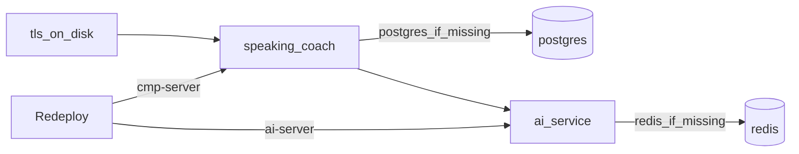

# Запуск, конфигурация и наблюдаемость

Контракты базовой поставки SP-01 и сохранённого legacy-кода. Новый фундамент SP-00 использует PostgreSQL;
legacy сохраняется отдельно, без переноса его Redis-хранилищ и без обязательного подключения старых функций к новому runtime.
Готовность изоляции и переключения текущего чата проверяется по [статусу](../status.md).
Описание legacy API ниже не означает, что эти маршруты доступны в новом runtime.

- [SP-00: новый runtime и перенос текущего чата](#sp-00-новый-runtime-и-перенос-текущего-чата)
- [Run locally, env, CI](#run-locally-env-ci)
- [Переменные окружения Speaky](#переменные-окружения-speaky)
- [Выкладка и восстановление](#выкладка-и-восстановление)
- [История взаимодействий и аудит](#история-взаимодействий-и-аудит)
- [Monitoring](#monitoring)
- [Логи вызовов LLM, STT, TTS и Telegram API](#логи-вызовов-llm-stt-tts-и-telegram-api)
- [PROD Telegram alerts](#prod-telegram-alerts)

## Run locally, env, CI

> Текущий продукт: [SP-01](tutor-chat.md#sp-01-постоянный-текстовый-чат-с-сашей). Локальные тесты, DEV readiness и живая приёмка — разные проверки. Метрики и reminders ниже относятся к сохранённому голосовому пути, не к trial-записям.

### Env (names only)

Configuration names, purpose and defaults: [`operations.md`](operations.md#переменные-окружения-speaky). Template: `.env.example`. Values stay out of docs.

Ktor webhook TLS keystore password in code is the literal `"ktor"` (not a user secret).

### Local commands

Gradle (from `cmp/`, `GRADLE_USER_HOME=$HOME/.gradle`):

```bash
export GRADLE_USER_HOME="$HOME/.gradle"
cd cmp
# Client API URL: copy client.local.properties.example → client.local.properties
./gradlew :server:test
./gradlew :server:run          # foundation: DATABASE_URL, internal config и import marker обязательны
./gradlew detekt
./gradlew :app:desktopApp:run
./gradlew :app:androidApp:assembleDebug
```

Python:

```bash
cd ai-service
python3 -m venv .venv
source .venv/bin/activate
pip install -r requirements-dev.txt
export AI_INTERNAL_TOKEN=... OPENAI_API_KEY=...
export FOUNDATION_BACKEND_URL=http://127.0.0.1:8080
# Адрес должен совпадать с доступным backend; перед стартом требуется import marker.
uvicorn app.speaky_main:create_app --factory --host 127.0.0.1 --port 8090
pytest
```

Unit tests: `:server:test`, `pytest`. SP-00 добавляет отдельный локальный PostgreSQL/HTTP harness; результаты — в [статусе](../status.md), команды — в разделе SP-00 ниже. DEV readiness остаётся отдельной проверкой.

`:server:run` запускает новый Speaky composition root. Подготовку БД, import marker и backend↔AI настройки см. в разделе SP-00. Не направляй локальную проверку на DEV без соответствующего поручения.

Telegram **cannot** use local HTTP polling; webhook needs public HTTPS + cert.

### CI

- `.github/workflows/cmp.yml` — detekt, Android/Desktop/iOS packages, `:server:test` + `buildFatJar`. **Деплоя нет.** Client packages bake `SPEAKING_COACH_API_BASE_URL=https://$DEV_CMP_SERVER_HOST` (PRs/feature; `PROD_CMP_SERVER_HOST` on `main`). Tests do not need the URL.
- `.github/workflows/ai-service.yml` — pytest, upload app. **Деплоя нет.** Redis не трогает.
- `.github/workflows/redeploy.yml` — **Redeploy DEV** (`workflow_dispatch`, `DEV_*`). Галки `cmp-server` / `ai-server` (обе default on). Выключенная — job skipped, workflow зелёный.
- `.github/workflows/redeploy-prod.yml` — **Redeploy PROD**, те же галки, secrets `PROD_*`. Ветка не выбирает хост: с `main` и с PR запуск одинаковый. Deployments: environment `deploy-dev` / `deploy-prod`, без approve. Concurrency на хост (`ktor-prod` / `ktor-dev` / `ai-prod` / `ai-dev`), `cancel-in-progress: false`.
- `.github/actions/setup-cmp` — Zulu JDK 21, Gradle cache.

Python 3.12. Dockerfiles install ffmpeg in ai-service image.

### STT / TTS implementation notes

- STT: Groq `verbose_json` + word timestamps; `no_speech` if empty text or `no_speech_prob >= 0.8`; retry via wav 16 kHz (`stt.py`, `audio.py`).
- TTS: OpenRouter/OpenAI speech API; `instructions` only if model starts with `openai/`; then `to_ogg_opus`.
- Retry helper: `app/retry.py` `once_on_retryable`.

### Проверка документационных изменений

Для docs-only не требуется запуск сервисов или runtime-тестов.
Проверить относительные ссылки, якоря, пути исходников, ссылки на удалённые документы и `git diff --check`.
Исходную v0.5 сохранять без изменений. Результаты прежних тестов не выдавать за новый запуск.
Реальные модельные evals из `ai-service/evals/` — отдельные платные проверки; HTTP 402 не обходить ретраями.

## Переменные окружения Speaky

Каталог ниже включает настройки сохранённого legacy/deploy кода. Для нового startup обязательные параметры перечислены в разделе SP-00; GROQ_API_KEY и Redis ему не нужны. Здесь имена, роль и вид значения. Сами секреты, пароли, токены и строки `GROQ_BASE_URL` / `OPENAI_BASE_URL` с хостов сюда не копируются.

Шаблон имён: [`.env.example`](../../.env.example). Чтение в коде: `cmp/server/.../AppConfig.kt` и `ai-service/app/config.py`. Выкат: `.github/workflows/deploy-cmp-server.yml`, `deploy-ai-server.yml`.

Каталог описывает назначение настроек; наличие и значения в живых окружениях здесь не утверждаются.

### Как это упаковано

На VPS два разных файла, не один общий:

| Файл на хосте | Откуда берётся при Redeploy |
| --- | --- |
| `/opt/speaking-coach/.env` | целиком из `DEV_CMP_SERVER_ENV` или `PROD_CMP_SERVER_ENV` |
| `/opt/ai-service/.env` | из `DEV_AI_SERVER_ENV` или `PROD_AI_SERVER_ENV`; Kora H дописывается отдельным секретом списка |

Секреты GitHub — repository Actions secrets, не Environment secrets. Отдельных ячеек `GROQ_API_KEY` или `TELEGRAM_BOT_TOKEN` в Actions нет: эти ключи живут внутри блоба. Исключение — `METRICS_PASSWORD`: это отдельная ячейка, и выкат CMP вырезает такую строку из блоба и дописывает значение из ячейки.

`AI_INTERNAL_TOKEN` по контракту выката один и тот же в блобе CMP и в блобе AI.

### Секреты GitHub Actions

Имена secrets, используемые схемой поставки:

| Имя | Куда попадает | Что лежит в ячейке |
| --- | --- | --- |
| `DEV_CMP_SERVER_HOST` | SSH на DEV CMP; пакеты CMP вне `main` склеивают из него `https://…` | хост, не строка внутри блоба |
| `DEV_CMP_SERVER_USER` | SSH на DEV CMP | логин |
| `DEV_CMP_SERVER_SSH_KEY` | SSH на DEV CMP | приватный ключ |
| `DEV_CMP_SERVER_ENV` | `/opt/speaking-coach/.env` на DEV | весь файл окружения CMP |
| `PROD_CMP_SERVER_HOST` | SSH на PROD CMP; пакеты CMP с `main` склеивают из него клиентский HTTPS | хост |
| `PROD_CMP_SERVER_USER` | SSH на PROD CMP | логин |
| `PROD_CMP_SERVER_SSH_KEY` | SSH на PROD CMP | приватный ключ |
| `PROD_CMP_SERVER_ENV` | `/opt/speaking-coach/.env` на PROD | весь файл окружения CMP |
| `DEV_AI_SERVER_HOST` | SSH на DEV AI | хост |
| `DEV_AI_SERVER_USER` | SSH на DEV AI | логин |
| `DEV_AI_SERVER_SSH_KEY` | SSH на DEV AI | приватный ключ |
| `DEV_AI_SERVER_ENV` | `/opt/ai-service/.env` на DEV | весь файл окружения AI |
| `PROD_AI_SERVER_HOST` | SSH на PROD AI | хост |
| `PROD_AI_SERVER_USER` | SSH на PROD AI | логин |
| `PROD_AI_SERVER_SSH_KEY` | SSH на PROD AI | приватный ключ |
| `PROD_AI_SERVER_ENV` | `/opt/ai-service/.env` на PROD | весь файл окружения AI |
| `DEV_KORA_H_ALLOWLIST` | дописывается в AI `.env` на DEV | Telegram ID через запятую; пусто = Kora H выключена |
| `PROD_KORA_H_ALLOWLIST` | дописывается в AI `.env` на PROD | Telegram ID через запятую; пусто = Kora H выключена |
| `METRICS_PASSWORD` | дописывается в CMP `.env` поверх блоба | пароль страницы `/admin/metrics` |

### CMP: `/opt/speaking-coach/.env`

Пустая строка для процесса равна отсутствию ключа.

| Ключ | Что задаёт | Что в значении | Если ключа нет |
| --- | --- | --- | --- |
| `TELEGRAM_BOT_TOKEN` | бот и вебхук | токен BotFather | вебхук не поднимается |
| `TELEGRAM_WEBHOOK_URL` | режим вебхука | публичный HTTPS URL, который зовёт Telegram | режим без вебхука |
| `TELEGRAM_WEBHOOK_SECRET` | проверка заголовка и `setWebhook` | общий секрет с Telegram | при заданном URL процесс не стартует |
| `AI_SERVICE_BASE_URL` | куда Ktor шлёт tutor и voice запросы | URL ai-service | `http://127.0.0.1:8090` |
| `AI_INTERNAL_TOKEN` | заголовок `X-Internal-Token` на `/v1/*` и `/internal/*` | общий секрет с AI-хостом | при вебхуке процесс не стартует |
| `SERVER_PORT` | порт Ktor; выкат требует число | номер порта | `8080`; скрипт мониторинга подставляет `443` |
| `TLS_CERT_PATH` | сертификат вебхука | путь к PEM на хосте | `/opt/speaking-coach/tls.crt` |
| `TLS_KEY_PATH` | ключ вебхука | путь к PEM на хосте | `/opt/speaking-coach/tls.key` |
| `JWT_SECRET` | HMAC Bearer для CMP-клиента | секрет подписи | маршруты `/v1/auth` не ставятся |
| `DATABASE_URL` | пользователи, сессии, журнал в Postgres | JDBC URL, пароль базы внутри строки | при токене бота процесс не стартует |
| `POSTGRES_USER` | роль при первом создании контейнера Postgres | имя роли | скрипт берёт `speaking` |
| `POSTGRES_PASSWORD` | пароль той роли | пароль | скрипт не создаёт контейнер Postgres |
| `POSTGRES_DB` | имя базы при создании контейнера | имя базы | скрипт берёт `speaking_coach` |
| `GRAFANA_ADMIN_PASSWORD` | пароль Grafana | пароль | Grafana не публикуется |
| `GRAFANA_ROOT_URL` | `GF_SERVER_ROOT_URL` | публичный origin, вид `https://хост:8443` | скрипт подставляет `https://127.0.0.1:8443` |
| `MONITORING_PORT` | localhost-порт `/admin/monitoring` | номер порта | `8081`; публичный TLS этот путь не отдаёт |
| `METRICS_PASSWORD` | вход на `/admin/metrics` | пароль; на диске побеждает ячейка GitHub | страница выключена |
| `OPENROUTER_RATES_FILE` | импорт исторических TPM/TPS на `/admin/metrics` | путь внутри CMP-контейнера | `/opt/speaking-coach/analytics/openrouter-llm-rates.json`; без файла блок не показывается |
| `AUDIT_AUDIO_DIR` | каталог голоса человека и ответа модели | путь на хосте | `/opt/speaking-coach/audit-audio` |
| `SPEAKY_ENV` | метка среды в мониторинге | короткое имя, например `dev` или `prod` | скрипт пишет `unknown` |
| `LOAD_TEST_TOKEN` | доступ к нагрузочным маршрутам CMP | отдельный случайный секрет, только на DEV вместе с `SPEAKY_ENV=dev` | маршруты отсутствуют |

`POSTGRES_*` читают скрипты `infra/postgres/deploy-remote.sh` и `infra/backup/backup-remote.sh`. Ktor ходит в базу по `DATABASE_URL`.

Токен бота требует `TELEGRAM_WEBHOOK_URL` и `DATABASE_URL`. URL вебхука требует `TELEGRAM_WEBHOOK_SECRET` и `AI_INTERNAL_TOKEN`.

### AI: `/opt/ai-service/.env`

Старт ai-service требует `GROQ_API_KEY`, `OPENAI_API_KEY` и `AI_INTERNAL_TOKEN`. `TTS_PROVIDER` бывает только `openrouter` или `deepgram`.

| Ключ | Что задаёт | Что в значении | Если ключа нет |
| --- | --- | --- | --- |
| `GROQ_API_KEY` | Whisper STT | ключ Groq | процесс не стартует |
| `GROQ_BASE_URL` | адрес STT | базовый URL OpenAI-совместимого API | `https://api.groq.com/openai/v1` |
| `STT_MODEL` | модель распознавания | id модели | `whisper-large-v3` |
| `SPEECH_TIME_ENABLED` | локальное измерение времени речи VAD для новых попыток онбординга и новых практических дней | `true`/`false` | `true` |
| `OPENAI_API_KEY` | чаты и TTS через OpenRouter | ключ OpenRouter; имя историческое | процесс не стартует |
| `OPENAI_BASE_URL` | адрес чатов и TTS | базовый URL | `https://openrouter.ai/api/v1` |
| `LLM_MODEL` | голосовой ответ | id модели OpenRouter | `openai/gpt-5.6-luna` |
| `NOTES_MODEL` | живые поправки | id модели | `openai/gpt-5.6-luna` |
| `ONBOARDING_REVIEW_MODEL` | оценка сохранённых звонков/reviews; имя env историческое | id модели | `openai/gpt-4o-mini` в текущем коде |
| `ONBOARDING_REVIEW_FALLBACK_MODEL` | вторая попытка оценки, если первая не разобралась | id модели | повтор идёт той же моделью, с большим потолком токенов |
| `CORRECTION_VERIFICATION_MODEL` | проверка сохранённых исправлений перед финалом | id модели | `openai/gpt-4o-mini` |
| `VOCABULARY_VERIFICATION_MODEL` | проверка подсказок Vocabulary перед финалом | id модели | `openai/gpt-5.6-luna` в локальном коде |
| `VOCABULARY_CONTEXT_WINDOW_TOKENS` | окно модели для полного контекста урока Vocabulary Builder | минимум 4096; обязательно проверить при смене модели урока | 1 000 000 для `anthropic/claude-sonnet-4.6` по [OpenRouter](https://openrouter.ai/anthropic/claude-sonnet-4.6), 8192 для других моделей до явной настройки |
| `PERSON_MEMORY_MODEL` | фоновое извлечение фактов о пользователе | id модели | `openai/gpt-4o-mini` |
| `TTS_PROVIDER` | кто озвучивает ответ | `openrouter` или `deepgram` | `openrouter` |
| `TTS_MODEL` | модель озвучки OpenRouter | id модели | код подставляет `hexgrad/kokoro-82m` |
| `TTS_VOICE` | голос OpenRouter | имя голоса | `af_heart` |
| `TTS_RESPONSE_FORMAT` | формат ответа OpenRouter до ffmpeg | `mp3` и затем OGG | `mp3` |
| `KORA_TTS_MODEL` | озвучка Kora и Kora H через OpenRouter | id TTS-модели | `google/gemini-3.1-flash-tts-preview` |
| `KORA_TTS_VOICE` | голос Gemini для Kora и Kora H | поддерживаемое имя голоса | `Leda` |
| `KORA_H_ENABLED` | разрешает ограниченный доступ к Kora H | `true` только при непустом отдельном секрете списка | `false` |
| `KORA_H_ALLOWLIST` | кому доступна Kora H | числовые Telegram ID через запятую из отдельного секрета | пусто |
| `TTS_OUTPUT_FORMAT` | формат прямого Deepgram | `ogg` или `mp3` | `ogg` |
| `TTS_SPEED` | скорость Aura-2; OpenRouter это поле игнорирует | число от 0.7 до 1.5 с шагом 0.05 | `0.9` |
| `DEEPGRAM_API_KEY` | прямой TTS Deepgram | ключ Deepgram | нужен только при `TTS_PROVIDER=deepgram` |
| `FFMPEG_BIN` | перекодирование в OGG | имя или путь бинарника | `ffmpeg` |
| `REDIS_URL` | диалог, метрики, звонки | URL Redis; пароль, если есть, внутри строки | память процесса, без Redis |
| `AI_INTERNAL_TOKEN` | проверка `X-Internal-Token` | тот же секрет, что на CMP | процесс не стартует |
| `AI_SERVICE_PORT` | порт, который скрипт публикует с хоста | номер порта; внутри контейнера остаётся 8090 | скрипт берёт `8090` |
| `OPENAI_REALTIME_API_KEY` | WebRTC mint и наблюдение звонка CMP | ключ platform.openai.com | realtime-маршруты выключены; голосовой ход Telegram от этого не зависит |
| `DIALOGUE_TTL_SECONDS` | срок ключа диалога | секунды | `2592000` в конфигурации; код ограничивает raw history семью днями |
| `DIALOGUE_MAX_MESSAGES` | сколько реплик держать в диалоге | число | `40` |
| `JOB_TTL_SECONDS` | срок задания клипа в памяти процесса | секунды | `600` |
| `PIPELINE_TIMEOUT_SECONDS` | потолок всего клипа | секунды | `60` |
| `LOG_LEVEL` | уровень логов процесса | имя уровня | `INFO` |
| `LOG_FILE` | копия логов в файл рядом со stdout | путь внутри контейнера | пусто, только stdout |
| `LOKI_PUSH_URL` | выгрузка логов AI в Loki | HTTPS URL push | если в блобе пусто, `deploy-alloy.sh` читает `/opt/ai-service/monitoring/loki.url` |
| `SPEAKY_ENV` | метка `environment` у Alloy | короткое имя среды | если в блобе пусто, скрипт читает `/opt/ai-service/monitoring/speaky-env`, иначе `unknown` |

`AI_SERVICE_PORT` читает `infra/ai-service/ai-service-port.sh`, не `Settings`. `LOKI_PUSH_URL` и `SPEAKY_ENV` читает `deploy-alloy.sh`.

Для `STT_MODEL=assemblyai/universal-3-5-pro` через OpenRouter задайте `GROQ_BASE_URL=https://openrouter.ai/api/v1` и ключ OpenRouter в исторически названном `GROQ_API_KEY`. Код переводит входящий Telegram OGG в WAV до первого STT-запроса; для Groq остаётся прежняя отправка исходного файла с переводом в WAV только после HTTP 400. Изменение требует перевыката AI-сервиса; одной смены `.env` для этого поведения недостаточно.

`TTS_PROVIDER` на обоих хостах в итоге `openrouter`: на PROD ключа нет, и срабатывает дефолт. `DEEPGRAM_API_KEY` есть только на DEV и в этом режиме не используется. Живая озвучка — `x-ai/grok-voice-tts-1.0`, это не дефолт кода `hexgrad/kokoro-82m`.


### Не в этих блобах

| Имя | Где живёт | Что в значении |
| --- | --- | --- |
| `SPEAKING_COACH_API_BASE_URL` | клиент CMP: env или `cmp/client.local.properties` (`speakingCoach.apiBaseUrl`) | базовый URL Ktor; CI подставляет `https://` и хост из `DEV_CMP_SERVER_HOST` / `PROD_CMP_SERVER_HOST` |
| `TEST_POSTGRES_URL` | только локальные тесты Ktor | JDBC URL тестовой базы; пусто — тест пропускается |
| `cmp` файл `8090.allow` | `/opt/ai-service/8090.allow`, не ключ `.env` | список адресов, которым скрипт оставляет доступ к опубликованному порту AI |

### Конфигурация SP-01

`main.py` создаёт voice pipeline при запуске всего приложения, поэтому требуются `GROQ_API_KEY`,
`OPENAI_API_KEY` и `AI_INTERNAL_TOKEN`, даже для текстового tutor-чата.
Сам tutor-ход не вызывает STT/TTS. Без `REDIS_URL` TutorStore хранится в памяти процесса и теряется при рестарте.

При OpenRouter base URL TutorModel использует `KoraHModel` и `KORA_MODEL`
(дефолт `anthropic/claude-sonnet-4.6`). При другом base URL используется общий LLM с характером Kora H.
Доступ к текстовому tutor runtime не проверяет voice allowlist. В deploy workflow `KORA_H_ALLOWLIST`
для старых голосовых возможностей допускает числовой список или `*`; пустой список выключает их флаг.
`ONBOARDING_REVIEW_MODEL` и fallback не управляют моделью Саши.
Текущий [контракт SP-01](tutor-chat.md#sp-01-постоянный-текстовый-чат-с-сашей) и [история DEV](../status.md) отделены от каталога env.

## Monitoring

Status: `/admin/metrics` is the product analytics home; the former draft summary is at `/admin/metrics/details`. The operator page is `/admin/monitoring`. Definitions for the new home are in [analytics.md](analytics.md#главная-страница-аналитики-adminmetrics).

`/admin/monitoring` is Ktor HTML on the CMP host. It reads `GET /internal/metrics` from ai-service. The `v2` object is the client cut. Telegram, Android, iOS, and desktop are separate columns. A session without `android`, `ios`, or `desktop` is `unknown`. There is no combined mobile total and no ruble-per-turn card. Empty provider money is a dash.

The public TLS connector does not serve `/admin/monitoring`. Ktor listens for it on `127.0.0.1` and `MONITORING_PORT` (default 8081). Every route is hidden from OpenAPI. There is no `MONITORING_PASSWORD`. `METRICS_PASSWORD` still guards the draft.

Grafana is the outside HTTPS door, on port 8443, with anonymous access off and one admin login. Nginx checks `GET /api/user` and then proxies `/admin/monitoring` to the localhost Ktor port. Prometheus and the blackbox exporter stay on localhost. Blackbox probes `/health` every 15 seconds. Prometheus scrapes `metrics:v2` every 15 seconds and sends `AI_INTERNAL_TOKEN` as `Authorization: Bearer`. The service accepts that header on internal routes as well as `X-Internal-Token`. Its TSDB retention is 185 days, configured in `infra/monitoring/deploy-remote.sh`; there is no smaller size-based retention limit. The persistent Docker volume survives monitoring container recreation, but older deleted samples cannot be recovered and the host needs enough free disk space. Day metrics are not stored in Prometheus as a second database; the scrape is the chart history. `speaking_llm_requests` is the day's LLM call count from Redis `metrics:v2:day:*` (`llm|*|calls`). STT and TTS calls are not included. The scrape also emits the previous 14 Moscow days so Grafana has history immediately after deploy; earlier history accumulates only after scraping.
The older `/admin/metrics` navigation links to **История** on the same host's Grafana HTTPS port `8443`. Its metrics login does not authorize history access; Grafana asks the operator to sign in when needed.

The **Speaky** Grafana dashboard filters existing product series to `client="telegram"`. The provider-call graphs are an explicit exception: they count STT, LLM and TTS attempts from all real traffic, plus all outbound Telegram Bot API calls from CMP. It omits the shared availability panel and the link to the all-client operator page. Collection and the separate `/admin/monitoring` page still retain the other clients.

The spend panel converts stored micro-USD into USD in its Prometheus query and formats the result as dollars with six decimal places.

The errors panel uses the Telegram DAU series as a zero fallback because `speaking_errors` has no series until an error occurs. It shows zero while Prometheus receives Telegram metrics; if the scrape is unavailable, it still shows `No data`.

The scaling row uses the existing blackbox `/health` probes, `up` for the AI and Ktor metrics jobs, and the age of the latest Telegram DAU sample. Freshness means a successful scrape, not a recent user action. Ktor exposes `/internal/telegram-metrics/prometheus` only on its localhost `MONITORING_PORT`; Prometheus scrapes it every 15 seconds. AI metrics use the same 15-second scrape. Ktor and AI stage counters are process-local monotonic counters; Prometheus preserves their history across process restarts.

The TPM graph sums input and output LLM tokens added over the previous 60 seconds for Telegram. The source is daily monotonic gauges, so the 15-second scrape makes short-window counts approximate. The TPS graph is output generation throughput: it divides completion tokens by provider-reported generation seconds for Telegram LLM requests completed over the previous 60 seconds. OpenRouter returns `openrouter_metadata.generation_time` (milliseconds) when the request opts into `X-OpenRouter-Metadata: enabled`; no follow-up HTTP request is needed. Requests with missing or invalid generation time are excluded from both sides of the TPS ratio. The TPS series starts after the version with this instrumentation is deployed; it has no historical backfill.

The `Входящие запросы Telegram · RPS` graph uses `sum(rate(telegram_webhook_requests_total{client="telegram"}[5m]))`. The counter increments once for each HTTP webhook request with a valid Telegram secret header, before decoding the update. It includes duplicate updates and malformed payloads, but excludes unauthenticated requests, health checks, metrics scrapes, and AI internal calls. The graph is requests per second averaged over five minutes, with a 15-second Prometheus scrape; short bursts may be smoothed. The counter starts at zero after a Ktor restart, and a missing scrape is not treated as zero traffic. It is displayed next to the cumulative voice-user number in the `Трафик Telegram` row.

For Telegram voice replies, `telegram_voice_response_duration_seconds` measures from Ktor accepting the update to Telegram acknowledging the final voice or text. `telegram_voice_queue_wait_seconds` adds the waits in `TelegramChatActions` and `SessionClipQueue`. Histograms include only successfully delivered responses; p50 and p95 use the past 15 minutes. The dashboard displays the response sample count separately. `telegram_voice_requests_total` also counts failed and queue-full outcomes, including failures before STT.

`speaking_stage_attempts_total` counts one logical operation after internal retries for STT, LLM, TTS, and reply delivery. LLM includes reply, notes, and onboarding operations; these are stage-level rates, not the percentage of user turns that failed. A no-speech clarification is a successful STT operation. The Grafana failure share is `failure / (success + failure)` for each stage over 15 minutes and has no value when the stage had no attempts. The 5- and 15-minute failure panels use these monotonic counters. The older `speaking_errors` panel remains a daily breakdown and is not an exhaustive HTTP or log error count.

`speaking_provider_calls_total{type,result}` separately counts each external STT, LLM, TTS, or Telegram API attempt, including failed and cancelled attempts and explicit retries. AI's three types exclude flagged load tests. CMP's `telegram_api` type covers every outbound Bot API request, including file downloads, chat actions, callbacks and setup calls. Grafana shows four separate graphs and one sum as calls per minute averaged over five minutes. The sum spans both Prometheus scrape jobs; each request is counted by its owning service once. These process-local counters start at deployment; Prometheus preserves scraped history across restarts. The counters do not depend on logs reaching Loki.

`speaking_review_verification_total{flow,outcome}` counts one final correction check per assessment with at least one saved correction candidate. `flow` is `onboarding` or `call`; `outcome` is `success`, `partial`, `timeout`, `error`, or `cancelled`. Candidates are checked in groups of five, with at most three concurrent requests inside the shared 10-second deadline. A successful group can supply examples even if another group fails or times out. `partial` means some groups failed and none timed out; `timeout` includes checks that returned some verified examples before the deadline. A completed assessment with no candidates does not attempt verification and is absent from the denominator. `speaking_review_verification_duration_seconds` is a histogram of the same assessments, including partial results and timeouts. The Grafana row shows 24-hour assessment counts by outcome, timeout share (`timeout / all attempts`) by flow, and p50/p95 duration of fully successful checks. The successful latency plot excludes partial results and timeouts; read it together with the outcome counts. No candidates, transcripts, or identifiers appear as metric labels. These process-local metrics start when the instrumented AI service is deployed, with no historical backfill; Prometheus retains scraped samples across restarts.

The `Стоимость голосового обмена` row divides provider-reported STT/LLM/TTS costs during Telegram clip jobs by successfully delivered voice replies to recognized incoming clips. It also shows the share of provider calls with a known price. The daily chart samples trailing 24-hour windows at one-day intervals. See `analytics.md` for the exact denominator and missing-price limits.

`Ходов на активного пользователя сегодня` divides today's completed Telegram turns by today's Telegram DAU, only when DAU is positive. `Действия за день` remains a daily action count. D1 cohort retention is calculated from activation and daily user events on `/admin/metrics/streaks`, not from Grafana's 24-hour time series.

New counters use the Redis prefix `metrics:v2` on the AI host. Old `metrics:day` and `metrics:dau` are left as they are and are not shown as a client column. Money is OpenRouter `usage.cost` and TTS `total_cost`, stored as micro-units plus currency. Realtime usage is tokens from `response.done`. Groq stays seconds. A missing cost increments the call count only.

The CMP app sends `platform` on `POST /v1/sessions`. Telegram action names are posted to `POST /internal/metrics/action`. Journal text and voice objects are not in this cut.

The operator page also shows a cumulative Telegram voice journey, stored in Redis under `metrics:v2:telegram:journey`. `Только Start, без ГС` counts users with a recorded `/start` and no recorded incoming voice. The other cards count distinct users who sent at least 1, 3, 5, 10, or 20 Telegram voice messages; these thresholds overlap. The event is counted when Ktor receives the message, including one that is later rejected by the queue or fails processing. Ktor supplies the Telegram message ID to `/internal/metrics/action`; the AI service deduplicates the same ID per chat with a seven-day receipt. The per-user voice count and aggregate milestone counters have no TTL. The first event date is shown on the page. The at-least-one voice count is backfilled from each Telegram chat’s legacy `metrics:funnel:user:*` `activated_day`, starting 2026-09-24; it is unioned with journey users without double counting. On the checked PROD data, this was 78 distinct chats: 52 already in the journey and 26 additional legacy-only chats. Counts for 3/5/10/20 voices and Start still begin on 2026-10-06 because old per-chat voice counts cannot be reconstructed reliably. Grafana shows the at-least-one count as a single current value, `speaking_telegram_voice_users`; the other journey cards remain on the operator page. This metric counts unique Telegram chat IDs, so a group chat counts once.

The legacy `/admin/metrics/details` **Чаты** table includes users recorded by `/start` even when they have zero completed turns. `Только /start` means the legacy funnel has a start but no incoming voice and no completed turn; a voice without a completed turn is labeled `Без завершённых ходов`. The table shows at most 200 chats by last recorded turn or first start, with username/name from the latest Telegram profile. Existing start-only users are indexed from the retained Redis funnel records on the first snapshot after an AI service restart; their start time is known only to the Moscow day, while newly recorded starts have an exact timestamp. The index preserves a later completed-turn timestamp. This table is available only through the existing metrics session and does not change the aggregate monitoring journey or its history boundary.

### Историческая проверка dashboard

Для расширения Telegram Grafana на ветке PR #31, 2026-10-04, прошли 267 Python tests
и Kotlin server tests/detekt. Это локальные результаты того изменения; DEV/PROD rollout ими не подтверждался.

## Логи вызовов LLM, STT, TTS и Telegram API

Статус: реализовано в коде; выкат и проверка появления записей на DEV остаются отдельными действиями.

AI-сервис пишет одну строку `provider_call` в stdout для **каждой фактической попытки** HTTP-вызова LLM, STT или TTS. CMP пишет строку того же формата для каждого исходящего вызова Telegram Bot API через `TelegramBot.execute`: отправка и редактирование сообщений, загрузка файлов, ответы на кнопки, индикаторы и служебные вызовы. Если запрос повторён после ошибки, в журнале остаются обе попытки. CMP-логи собирает локальный Alloy в Loki на CMP-сервере. AI-записи уходят в Loki через Alloy только там, где настроен `LOKI_PUSH_URL` или сохранён `monitoring/loki.url`; на PROD AI в деплое 14 октября 2026 отправка логов была отключена из-за отсутствия адреса. Отдельная база не добавляется.

Операционный счётчик `speaking_provider_calls_total{type,result}` считает каждую попытку независимо от доставки логов: `type` — `stt`, `llm`, `tts` или `telegram_api`, `result` — `success`, `error` или `cancelled`. AI экспортирует первые три типа через `/internal/metrics/prometheus`; CMP экспортирует Telegram API через `/internal/telegram-metrics/prometheus`. Оба endpoint уже опрашивает Prometheus. Счётчики хранятся в памяти соответствующих процессов и обнуляются при рестарте, а Prometheus сохраняет собранную историю. Нагрузочные запросы с `X-Speaky-Load-Test: 1` в AI-счётчик не входят, хотя остаются в логах. Тесты через CMP не обращаются к Telegram API. Исторические вызовы до выката счётчиков не восстанавливаются.

Grafana Speaky показывает пять графиков: STT, LLM, TTS, Telegram API и сумму. Каждый показывает среднее число попыток в минуту за последние пять минут, включая ошибки и повторы. Суммарный график складывает четыре типа; OpenAI Realtime в эти графики не входит.

В строке находится JSON с полями `timestamp` (UTC), `source` (`telegram`, `android`, `ios`, `desktop`, `load_test` или `unknown`), `user_id` (обезличенный), `type` (`llm`, `stt`, `tts`, `telegram_api`), `purpose` (для Telegram API — метод запроса), `provider`, `model`, `result` (`success`, `error` или `cancelled`), `http_status`, `error_code`, `duration_ms` и `cost_micro_usd`. У HTTP-ошибки AI `http_status` содержит фактический статус, когда он доступен из исключения. Telegram SDK предоставляет код ошибки Bot API, он записывается как `error_code=telegram_<код>`; точный HTTP-статус SDK не предоставляет, поэтому `http_status=null`. У успешного ответа SDK статус также недоступен и поле равно `null`; успешный результат явно указан в `result`. При сетевой ошибке статуса тоже нет; `error_code` содержит тип исключения. `cost_micro_usd` заполняется для LLM и STT из `usage.cost`, если провайдер вернул поле; отсутствующая цена остаётся `null`, а не нулём. Поздняя цена TTS не переписывает строку лога: она сохраняется в PostgreSQL по [новой схеме](analytics.md#стоимость-успешного-голосового-обмена). Стоимость Telegram API здесь не рассчитывается.

`user_id` — первые 20 символов HMAC-SHA256 от нормализованного Telegram chat ID или ID пользователя приложения. Ключ — обязательный `AI_INTERNAL_TOKEN`, значение которого в лог не попадает. CMP и AI используют одинаковый ключ и формат для Telegram chat ID. Сессии одного Telegram-чата или аккаунта приложения дают один псевдоним; при смене токена псевдоним меняется. Там, где вызов не несёт chat ID (например, получение файла или регистрация webhook), поле равно `null`. Платформа мобильной сессии берётся из уже сохранённой привязки, а для внутреннего запроса обзора передаётся вместе с ID сессии.

Запись не содержит исходный ID, аудио, текст реплики, запрос к модели, ответ или API-ключ. Прежние продуктовые агрегаты `metrics:*` и `metrics:v2:*` не меняются. Срок хранения Loki — 30 дней по действующей настройке. Старые записи не дополняются задним числом. Объединённый OpenAI Realtime вызов не раскладывается на отдельные STT/LLM/TTS попытки: эти внутренние операции провайдера не видны AI-сервису как отдельные HTTP-запросы.

## PROD Telegram alerts

Status: prepared, not deployed. The recipient is the private chat of @alexgusev93 with @speaky_alerts_bot. A direct Bot API test message reached that chat on 2026-10-30. This proves the bot-to-chat path, not Grafana alert delivery.

Grafana on the CMP host evaluates the rules in `infra/monitoring/alerts/speaky.yml` every minute. PROD provisions these rules and one Telegram contact point. DEV does not. The contact point sends firing and resolved notifications, groups by rule, and repeats a continuing alert no more often than every four hours. Messages contain the rule and job labels, not user content, tokens, or provider responses.

Rules:

- Ktor or AI `/health` blackbox probe is unsuccessful for two minutes.
- Either Ktor or AI metrics scrape is unsuccessful for three minutes.
- At least three Telegram voice requests fail or hit a full queue in five minutes, sustained for one evaluation minute. This is an operational threshold, not the user-visible failure rate on `/admin/metrics/errors`.

The repo Actions secrets `TELEGRAM_ALERT_BOT_TOKEN` and `TELEGRAM_ALERT_CHAT_ID` supply the contact point. The PROD CMP deploy writes them to `/opt/speaking-coach/monitoring/alerts.env` with mode 600. Only the Grafana, daily-report, and credit-monitor containers receive this env file. Do not put either value in Git, logs, or chat. A missing secret stops the PROD deploy before SSH.

Grafana 11.3.1 requires the Telegram contact point's `chatid` to be a string. Grafana expands a numeric environment variable before parsing the YAML, even when the placeholder is quoted. The monitoring deploy validates the numeric ID from `alerts.env` and renders it into the quoted YAML field before starting Grafana. An unrendered numeric ID makes Grafana fail at startup and the monitoring proxy return 502.

Grafana, Prometheus, and blackbox run on the CMP host. If the whole host or its network fails, this stack cannot send an alert. An independent external uptime check is a separate later step. Before calling the rollout complete, verify Grafana loaded all three rules, test the contact point from Grafana, and trigger and recover one rule in a controlled way.

### Daily audience message

The same PROD bot sends one report to the same chat at 23:00 Europe/Moscow. `infra/monitoring/reporter/daily_report.py` reads the existing authenticated AI `/internal/metrics/overview` endpoint for the current Moscow date and the six preceding dates. It uses `habits.days` from the shared HabitAnalytics calculation, not the older `speaking_dau` chart series. DAU is unique normalized Telegram chats with a completed AI turn today, preliminary at 23:00. WAU is the union of those chats over the seven dates ending today. The message shows both dates and states that the values are for completed AI turns; Telegram delivery is not part of this measure. See [технический контракт](analytics.md#регулярность-speaky) for the population and history limits.

The reporter runs in a separate container on the CMP host. It receives the alert bot credentials, the OpenRouter management key, the AI URL, and a read-only AI internal token file. Immediately before sending, it requests the current OpenRouter account balance and includes the check time in Moscow time. If that check fails, the report says `Баланс OpenRouter: данные недоступны` and still sends DAU and WAU. It stores the last successfully sent Moscow date in a persistent Docker volume to avoid a second report after restart. If the habit source is unhealthy or a value is unavailable, it sends an explicit `данные недоступны` message rather than a zero. A Telegram send failure is retried every five minutes; a crash between a successful send and saving the date can duplicate that day's message. A whole-host outage also stops this report.

### OpenRouter credit alert

A separate PROD container checks [OpenRouter account credits](https://openrouter.ai/docs/api/api-reference/credits/get-credits) every five minutes. Available USD is `total_credits - total_usage` from `GET /api/v1/credits`. The endpoint requires a management key. `OPENROUTER_MANAGEMENT_KEY` is a separate repository Actions secret, staged as `/opt/speaking-coach/monitoring/openrouter.env` with mode 600 and passed to the credit-monitor and daily-report containers. It must belong to the billing account used by the PROD OpenRouter inference key. The inference key's own spending limit is a separate measure and is not inferred from the account balance.

The bot sends one warning when the observed balance first falls below $5. It sends a recovery message after a later check reaches at least $5, which arms the next warning. State persists across container restarts. After three failed credit checks, the bot sends one technical warning and later a recovery message when checks work again. An invalid or missing response is never treated as a zero balance. A five-minute polling interval and network latency bound detection time; a full CMP-host outage prevents delivery.

## Выкладка и восстановление

Ниже сохранена схема поставки SP-01. Новый shipping graph SP-00 запускает Speaky roots без Redis; его cutover описан отдельно в разделе SP-00. Эта схема не описывает переключение на SP-00.

### Что крутится на машине

Четыре основных Docker-контейнера (мониторинг разворачивается отдельно). **Prod** может использовать один сервер (Ktor host-сеть + AI/Redis на той же машине). **DEV** — два независимых VPS: так моделируем прод, где Ktor и AI **не** обязаны быть у одного провайдера и без LAN датацентра.

| Контейнер | Образ | Сеть | Назначение |
| --- | --- | --- | --- |
| `speaking-coach` | `speaking-coach:local` | **host** | Ktor, порт из `SERVER_PORT` в `.env` (обычно 443), Telegram webhook |
| `postgres` | `postgres:16-alpine` | loopback | пользователи app API, **127.0.0.1:5432**, volume `speaking-coach-postgres` (хост Ktor) |
| `ai-service` | `ai-service:local` | `speaking-coach` | FastAPI, порт **8090** на всех интерфейсах |
| `redis` | `redis:7-alpine` | `speaking-coach` | диалог, **127.0.0.1:6379**, volume `speaking-coach-redis` |

Ktor смотрит на ai-service через `AI_SERVICE_BASE_URL` — адрес, который виден **с машины Ktor** (публичный IP/DNS другого провайдера), не `127.0.0.1` и не VPC Timeweb. Хост-порт FastAPI — `AI_SERVICE_PORT` в `.env` на AI (по умолчанию 8090); скрипт делает `-p $AI_SERVICE_PORT:8090`. В URL Ktor тот же порт. Docker публикует его на всех интерфейсах, а `restrict-8090.sh` режет чужие source в `DOCKER-USER` / `INPUT`: пускает loopback и адреса из `/opt/ai-service/8090.allow`. Без файла снаружи порт закрыт. Общий LAN между хостами не делаем: он не переживёт разъезд по провайдерам. Позже вместо голого HTTP — TLS или туннель (WireGuard и т.п.). Redis остаётся на AI-хосте, наружу и на Ktor не публикуем. `REDIS_URL=redis://redis:6379/0`.

На диске:

- `/opt/speaking-coach/` — fat JAR, `Dockerfile.runtime`, `deploy-remote.sh`, `.env`, **`tls.crt` / `tls.key` (кладёт человек, CI их не генерирует)**
- `/opt/ai-service/` — `app/`, Dockerfile, requirements, deploy-скрипты, `.env`, **`8090.allow` (кладёт человек: IPv4 Ktor, по одному в строке; CI не пишет)**

Рестарт `ai-service` **не** должен `docker rm redis`. Скрипт `infra/redis/deploy-remote.sh` если контейнер `redis` уже есть — только `start` + connect к сети, volume не трогает.
Рестарт `speaking-coach` **не** должен `docker rm postgres`. Скрипт `infra/postgres/deploy-remote.sh` создаёт контейнер, если его нет; иначе `start`. Без `POSTGRES_PASSWORD` в `.env` Postgres не поднимается (бот без app API).



**Имена:** семейство хостов — `cmp-server` и `ai-server` (галки Redeploy DEV / Redeploy PROD). SSH и `.env` — repo secrets `DEV_*` или `PROD_*`. Каталог и Docker-имя AI остаются `ai-service`. URL в Ktor — ключ `AI_SERVICE_BASE_URL` внутри блоба `.env`, не отдельный secret.

### Тесты авто, выкат только Redeploy

`push` / `pull_request` по path: **CMP** (`cmp/**`, `infra/server/**`) и **AI service** (`ai-service/**`, `infra/ai-service/**`, `infra/redis/**`) — package и тесты. На сервер не едут.

Выкат — два `workflow_dispatch`, ветка раннер не выбирает:

- [`.github/workflows/redeploy.yml`](../../.github/workflows/redeploy.yml) — **Redeploy DEV**, `destination: dev`, secrets `DEV_*`
- [`.github/workflows/redeploy-prod.yml`](../../.github/workflows/redeploy-prod.yml) — **Redeploy PROD**, `destination: prod`, secrets `PROD_*`

У каждого две галки `cmp-server` и `ai-server` (обе default on). Снятая галка = job skipped, workflow зелёный. Обе сняты = fail до SSH. С `main` и с PR выкат один и тот же, его запускают эти два workflow. В Deployments попадают только `deploy-prod` и `deploy-dev` (имя environment у deploy-джобы, без required reviewers). Секреты — repository Actions secrets, не Environment secrets.

Concurrency: `ktor-prod` / `ktor-dev` / `ai-prod` / `ai-dev`, `cancel-in-progress: false` (очередь, не cancelled).

Имена DEV/PROD secrets и состав env приведены в [каталоге конфигурации](#переменные-окружения-speaky).

Для прямого Deepgram добавьте `TTS_PROVIDER=deepgram` и `DEEPGRAM_API_KEY` в AI env соответствующего окружения. `TTS_SPEED` по умолчанию равен `0.9` (слегка замедленная речь Aura-2); `TTS_SPEED=1.0` возвращает обычную скорость после нового деплоя AI. Первый AI-деплой можно сделать с `TTS_OUTPUT_FORMAT=ogg`: контракт для старого Ktor сохранится. Чтобы убрать ffmpeg, сначала разверните новый `cmp-server`, принимающий `audio/mpeg`, затем установите `TTS_OUTPUT_FORMAT=mp3` и разверните `ai-server`. Откат: `TTS_PROVIDER=openrouter` и повторный деплой AI; Ktor продолжит принимать OGG. Не кладите значение ключа в документацию или репозиторий.

Пустой блоб — fail на раннере до SSH. TLS на DEV кладёт человек.

CMP Android / iOS / Desktop на сервер не едут. Jobs ai-service в памяти при рестарте пропадают; Redis-диалоги остаются.

Если Docker Hub отвечает `429 Too Many Requests` при проверке базового образа, DEV/PROD deploy-скрипты могут собрать новую версию из локального `ai-service:local` или `speaking-coach:local`. Контейнеры заменяются только после успешной сборки. Для AI запасной путь разрешён лишь при точном совпадении `requirements.txt` с установленным образом; он заменяет каталог `app` целиком. Если локального образа нет или зависимости изменились, деплой завершается ошибкой без замены работающего контейнера. Такой путь нужен для кратковременного лимита Docker Hub и не скрывает другие ошибки сборки.

### Ручной деплой (если файлы уже на хосте)

Положить `.env`, вызвать скрипт. Env на хост не передаём.

```bash
bash /opt/speaking-coach/deploy-postgres.sh
bash /opt/speaking-coach/deploy-remote.sh
bash /opt/ai-service/deploy-redis.sh
bash /opt/ai-service/deploy-remote.sh
```

Проверка: `docker ps` — четыре имени выше; с хоста Ktor `curl -k https://127.0.0.1/health`; с хоста AI или с Ktor `curl http://<ai-server>:8090/health`.

### Проверка DEV после SP-01

Redeploy DEV поддерживает `verify_only`: он проверяет без пересборки и рестарта.
`verification_ref` — ревизия проверяющего скрипта, а не доказательство ревизии работающего приложения.
SSH использует сохранённые host keys из `infra/dev/known_hosts`.
Workflow сравнивает digest артефактов, проверяет контейнеры, startup markers, AI/CMP health,
CMP→AI auth и learner context. Предыдущие image IDs записываются до замены контейнеров.

Опциональный `tutor_smoke` вызывает платную модель. Он не является обычной health-проверкой;
в документационной задаче его не запускают. На degraded-ответе smoke останавливается без ретраев.
Зелёный readiness не означает приёмку диалога или Telegram UX.
[Последнее зафиксированное состояние DEV](../status.md) хранятся отдельно от инструкции.

## Режимы Ktor и техническая диагностика

`usesWebhook` определяется непустым TELEGRAM_WEBHOOK_URL; token без webhook URL отклоняется конфигурацией.
Webhook использует SSL connector на SERVER_PORT и PEM tls.crt/tls.key. Локальный HTTP-режим нужен для health/API.
`GET /health` открыт. Clip API не является публичным proxy Ktor; внутренние запросы защищены токеном.
`SessionClipQueue` допускает три клипа на session вместе с обрабатываемым; лишние получают QueueFull.
`HttpClipClient` ждёт job до 90 с с polling 1.5 с. Старый JobStore — in-process, TTL по умолчанию 600 с.

Технические логи не содержат текста ученика и секретов. Файлы app.log на обоих хостах
ротируются ежедневно: семь архивов, copytruncate. Docker local logging ограничен 10 МиБ × 3.
Alloy AI отправляет stdout в Loki Ktor; адрес — LOKI_PUSH_URL либо monitoring/loki.url, сертификат — loki-ca.crt.
Пользовательские реплики и аудио доступны только через закрытую историю, не через обычные технические логи.

## История взаимодействий и аудит

Это контракт сохранённого Telegram audit. Durable inbox нового tutor описан отдельно в [плане SP-00](../plans/2026-11-10-sp00-foundation.md).

Входящее audit event сохраняется в PostgreSQL до HTTP 200, с идемпотентным идентификатором.
Это подтверждает запись события, но не завершение handler, model/tool операции или доставки ответа.
В новом пути durable inbox должен дополнительно обеспечивать восстановление обработки после ACK.
Outbound audit использует ограниченную очередь 1024 событий и три попытки записи; crash может потерять ожидающие события.
Telegram acceptance не доказывает прочтение сообщения или прослушивание аудио.

| Данные legacy audit | Хранение | Срок |
| --- | --- | --- |
| Исходный голос и голос ответа | Закрытый audit-audio; ссылки в PostgreSQL | 7 суток от получения входа |
| Транскрипт и generated reply | Закрытые content records; промежуточные AI artifacts | Тот же абсолютный семидневный deadline |
| Метаданные событий и chat index | PostgreSQL | 30 дней |
| Технические логи | Loki | 720 часов |

Read endpoints скрывают истёкший контент сразу; cleanup удаляет записи и аудио.
Legacy dialogue/call данные очищают raw turns и excerpts при чтении/записи и часовым sweep;
untimestamped legacy turns удаляются, derived facts и scores имеют отдельный жизненный цикл.
Для нового SP-00 согласовано 30 дней исходной истории; это не автоматическое продление legacy audit.
Backups и восстановление истёкших данных требуют отдельной проверки: наличие cleanup не доказывает её прохождение.

Закрытая страница `/admin/monitoring/history` показывает события, delivery outcomes, audio Range playback и ссылки на Loki.
Chat index: 50 последних активных чатов, поиск name/ID и keyset pagination; имена старых событий могут отсутствовать.
HTML, audio и downloads проходят Grafana login через Nginx; общая учётная запись не позволяет установить личность читающего оператора.
Аудио не имеет публичных URL. Факт генерации текста отделён от принятия Telegram.
AI artifacts импортируются Ktor и сверяются по недавним attempts; Redis RDB может потерять последние записи legacy audit.

`DATABASE_URL` обязателен при TELEGRAM_BOT_TOKEN. Тексты и аудио не попадают в Loki или metric labels;
attempt_id используется в полях логов, а не как Loki label.
Наблюдаемые ошибки записи видны оператору, но не доказывают полноту всех downstream events после crash.
Живая проверка login gate, Range requests, полноты истории и restore не подтверждена документационной правкой.

## SP-00: новый runtime и перенос текущего чата

Статус: инструкции к локально проверенному коду. DEV/PROD переключение не выполнено.
Legacy calls, Vocabulary Builder, reminders и dashboards сохранены в исходниках, но новый runtime их не запускает.
Redis и его серверные данные не удалять. Перенос этих legacy namespaces отменён.

### Composition roots и конфигурация

- Kotlin `Application.kt` запускает `SpeakyApplication.kt`: foundation, durable private-text webhook, worker и `/health`.
- AI Docker запускает `app.speaky_main:create_app`: `/health`, `/internal/foundation/tutor/turn`, `/internal/foundation/compute`.
- Backend требует `DATABASE_URL`, общий `AI_INTERNAL_TOKEN`, `AI_SERVICE_BASE_URL`; webhook требует прежние Telegram/TLS настройки.
- AI требует `FOUNDATION_BACKEND_URL`, тот же `AI_INTERNAL_TOKEN`, `OPENAI_API_KEY`; model/base URL настройки сохраняются.
- `FOUNDATION_BACKEND_URL` должен быть доступен из AI-контейнера. Loopback мониторинга backend доступен только в его сетевом namespace.
- Для DEV адрес — `https://72.56.85.251:443`, без API path. При самоподписанном TLS сертификат CMP копируется через проверенный SSH в `/opt/ai-service/foundation-backend-ca.pem` на AI. Deploy монтирует его read-only и задаёт `FOUNDATION_BACKEND_CA_FILE`; Python добавляет его к системным CA только для backend HTTP-клиента. Проверка hostname/TLS остаётся включённой. При смене сертификата обновить этот файл до redeploy.
- `requirements.txt` не содержит Redis. Только offline export и сохранённый legacy используют `requirements-legacy.txt`.
- Старый `app.main` не запускать одновременно с новым текстовым путём. Автоматического возврата к Redis при ошибке нет.
- Старые PG adapters и промежуточные legacy-таблицы не зарегистрированы в новом runtime. Их перенос не является условием запуска.

### Offline TutorStore cutover

Процедура требует отдельного разрешения на работу с выбранным сервером. Ниже — команды для оператора, не выполненный deploy.

1. Остановить приём старых текстовых updates и старых writers; завершить текущие ходы. Зафиксировать UTC freeze instant.
2. Сделать защищённый backup источника. Не изменять Redis и не удалять его volumes.
3. Из `ai-service/` в отдельном tooling окружении установить `requirements-legacy.txt`. Передать `REDIS_URL` через защищённое окружение.
4. Экспортировать только `tutor:v1:*` после остановки writers:

```bash
python scripts/export_tutor_state.py \
  --source-frozen-at '2026-11-10T00:00:00Z' \
  --output /secure/frozen-tutor-manifest.json
```

Дата в примере заменяется фактическим freeze instant. Exporter сам writers не останавливает.
Он сверяет два чтения, проверяет identity aliases, пишет новый файл с правами 0600 и SHA-256 каждой записи.
Файл содержит личную переписку: не добавлять в git, логи или CI artifacts.
При alias/malformed/checksum конфликте остановить переключение; не исправлять источник вслепую.
Проверенные записи `tutor:v1:synthetic-sp01-dev-<12 hex>` можно исключить повторяемым `--exclude-key` с точным ключом. Это явно согласуемый список synthetic probes; Telegram identity исключить нельзя. Исходник остаётся в Redis.

5. При остановленном новом backend, из `cmp/`, с `DATABASE_URL` целевого PostgreSQL:

```bash
GRADLE_USER_HOME=$HOME/.gradle ./gradlew :server:foundationImport \
  --args='/secure/frozen-tutor-manifest.json'
```

Импорт сохраняет profile/facts, goal, текущие trial IDs, сообщения, replies, receipts и cards.
Срок исходных копий из старого TutorStore остаётся исходным (7 дней), не продлевается до новых 30 дней.
Подтверждённые текущие факты сохраняются; неизвестный alias не объединяется автоматически.
После прерывания повторить **тот же файл**: per-student import receipts служат checkpoints.
Marker появляется только после сверки полного manifest с импортами и количеством Students.
Пустой manifest допустим только для действительно пустой новой базы. Нельзя использовать его вместо существующего профиля.
Приложение откажется стартовать без marker. Изменённый manifest после завершения отвергается.

6. Проверить импортированные состояния и настройки внутренней связи до включения webhook.
   Запуск с настоящим Telegram token регистрирует webhook и команды; это часть отдельно разрешённого deploy.
   Не возвращать старых writers после новых записей: автоматического обратного переноса нет.

### Задачи и диагностика

Из `cmp/`, с защищённым `DATABASE_URL`:

```bash
GRADLE_USER_HOME=$HOME/.gradle ./gradlew :server:foundationMaintenance \
  --args='diagnostics STUDENT_ID'
GRADLE_USER_HOME=$HOME/.gradle ./gradlew :server:foundationMaintenance \
  --args='retry-job STUDENT_ID JOB_ID'
```

Диагностика показывает состояние/ошибки без вывода сырой переписки. Retry проверяет состояние и deadline.
Lease/fence блокируют старый worker после повторного claim; invalid source/epoch нельзя обойти повтором.
`delivery_unknown` нельзя повторять автоматически: сначала установить внешний исход доставки.
Для Telegram reply неизвестная доставка также не означает «не отправлено».
Production lesson analyzer/planner, календарный materializer и reminder sender пока не подключены:
контракты и test adapters работают, production handler возвращает unavailable, без фиктивного успеха.
При отсутствии нужной evaluation/актуального Lesson Plan admission блокируется. Платёжные сроки и grace автоматически не выводятся.

### Удаление и восстановление backup

Deletion ledger хранить отдельно от восстанавливаемого backup, с доступом только оператора.
Перед backup и после новых удалений экспортировать его в новый защищённый файл:

```bash
GRADLE_USER_HOME=$HOME/.gradle ./gradlew :server:foundationMaintenance \
  --args='export-deletions /secure/deletions.json'
```

После восстановления PostgreSQL, **до запуска приложений**, применить наиболее свежий внешний ledger:

```bash
GRADLE_USER_HOME=$HOME/.gradle ./gradlew :server:foundationMaintenance \
  --args='restore-deletions /secure/deletions.json'
```

Ledger из самого старого backup недостаточен: он не знает о последующих удалениях.
Импорт ledger и replay выполняются транзакционно; конфликт блокирует завершение.
Forget консервативно очищает сырую историю и производные копии нового пути, включая предыдущие значения цели.
Другие подтверждённые факты остаются. Epoch отзывает старые scopes/jobs.
Эта процедура относится к новому фундаменту; исторические legacy backups не очищаются этим механизмом.

### Локальная проверка

Нужны отдельный PostgreSQL, pg_dump/pg_restore совместимой версии, Python dev environment и Gradle.
`TEST_POSTGRES_URL` — JDBC URL исключительно тестовой базы. Fixtures содержат только синтетические данные.
Из git root:

```bash
GRADLE_USER_HOME=$HOME/.gradle scripts/test-foundation.sh
```

При необходимости задать `FOUNDATION_TEST_PYTHON` абсолютным путём к Python.
Runner запускает обязательные PG-тесты и отдельный Ktor test harness, затем HTTP-сценарии Python↔Ktor.
Основной suite не требует Redis. Отдельная rehearsal-проверка требует изолированный Redis:

```bash
FOUNDATION_TEST_SUITE=migration \
SP00_IMPORT_REDIS_URL=redis://127.0.0.1:56379/0 \
GRADLE_USER_HOME=$HOME/.gradle scripts/test-foundation.sh
```

Migration suite не пропускается молча при отсутствии Redis. Не передавать production URL.
Модели и медиапровайдеры в этих тестах заменены детерминированными адаптерами.
Локальные проверки не доказывают качество диалога, доставку Telegram, реальный voice transport или DEV readiness.

## SP-02: Mini App и пробный голосовой урок

Trial включён без feature flag. Голосовой путь — OpenAI Realtime; текстовый tutor/analyzer остаются на своих моделях.
Текущая поставка — в [статусе](../status.md). Существующий DEV SeaweedFS/bucket/сеть не пересоздавать.

| Компонент | Конфигурация |
| --- | --- |
| Ktor | `MINI_APP_URL=https://<host>/miniapp`, прежние Telegram/internal token/PostgreSQL |
| AI speech-to-speech | `OPENAI_REALTIME_API_KEY`: серверный OpenAI API project key; никогда не frontend env |
| Модель/голос | `TRIAL_REALTIME_MODEL=gpt-realtime-2.1`, `TRIAL_REALTIME_VOICE=marin` — согласованный голос |
| Text/analyzer | Прежние `OPENAI_API_KEY`, `OPENAI_BASE_URL`, `KORA_MODEL`; это отдельный клиент |
| Архив | Прежние AWS credential chain/region, `TRIAL_AUDIO_BUCKET`, `TRIAL_S3_ENDPOINT` |
| DEV storage | `speaky-trial-audio-dev`, `http://speaky-storage:8333`, Docker network `speaky-storage` |

Realtime соединяется только с `wss://api.openai.com/v1/realtime`; `OPENAI_BASE_URL` не переиспользуется.
Groq/AssemblyAI, Kora TTS и `STT_MODEL` не участвуют в новом trial. Входная транскрипция OpenAI
`gpt-4o-mini-transcribe` работает параллельно ради истории; она не стоит перед генерацией ответа.
ChatGPT subscription не заменяет API key и разрешение расходов. Наличие ключа не доказывает доступ к модели.

### DEV-переход

1. Получить отдельное разрешение на commit/push/DEV и платные вызовы. При необходимости принять новый ключ через secrets skill.
   Не читать и не переносить существующие секреты в чат; не менять SeaweedFS credentials без причины.
2. Установить realtime env в AI через существующий защищённый механизм. Backend schema не меняется;
   новый backend нужен для пагинации аудиоархива. `verify-tutor.py` проверяет наличие ключа и S3 list versions без вызова модели.
3. Поставить backend, AI и `mini-app` согласованной ревизии. Клиент передаёт `protocol=realtime-pcm-v1`;
   старый frontend отклоняется до admission. В окне смешанных версий звонки не принимать; открыть Mini App заново.
4. Проверить HTTPS/WSS edge, readiness и release SHA. Зелёная readiness не проверяет голос.
5. Только после разрешения бюджета выполнить матрицу приёмки SP-02. При 402/quota stop не повторять платные запросы.
6. Откат требует согласованной предыдущей AI/frontend/backend ревизии; автоматического fallback на старый голос нет.

### Архив и восстановление

PCM16 mono 24 kHz в обе стороны. `TrialJournal` резервирует metadata, сохраняет private S3 object,
подтверждает stored receipt; только после этого relay пересылает аудио. Вход — batches по 100 ms,
выход — provider deltas. Это повышает количество S3/DB операций и добавляет latency: измерить на DEV.
Не обещать запись потерянных до сервера данных или ещё не подтверждённых буферов при аварии.
S3 backup и lifecycle DEV ещё требуют операторской проверки; запись объектов сама по себе не доказывает disaster recovery.

`POST /miniapp/api` action=`audio`, `initData`, `lessonId`, optional `cursor` возвращает до 200 objects
и `nextCursor`. Читать страницы до null; старый лимит 2000 больше не обрезает архив.
Сортировать воспроизведение по call_session_id/direction/sequence, внутри реплики учитывать offsetBytes.
Ссылки действуют 60 секунд; доступ только владельцу. `playbackComplete`/`playedMs` — ограниченный отчёт клиента,
не доказательство человеческого восприятия. Не проигранные окончания не попадают в историю как услышанные.
Фоновая очистка удаляет аудио/версии через 30 дней; [S3 lifecycle](../../infra/miniapp/audio-lifecycle.json) — дополнительная страховка.

Reconnect получает новый Call Session/provider session в том же Lesson. ContextBuilder переносит только сохранённые события.
Natural goodbye требует server tool + архив + audio.done/response.done + playback report + входные транскрипты.
End button не равен technical_disconnect; оба сохраняют возможность продолжить in_progress Lesson.
50 минут — защитный лимит одного транспорта, не отметка об успешном уроке. Модель ориентируется на trial около 15 минут.

### Проверки и наблюдаемость

Из `ai-service/`: `python -m pytest`. Из `mini-app/`: `npm test && npm run build` (Node 22+).

### SP-03/SP-04: совместная поставка

Регулярный голосовой урок и исполняемое расписание поставляются совместно: backend с V40,
AI с regular planner/policy и scheduling tools, Mini App с поддержкой executable regular.
Старые preliminary placeholders не активируются автоматически; требуется новое явное
согласование расписания. Demo-оплата не включает подписку и не является проверкой доступа.
Новых provider credentials не добавлено; используется существующий Realtime/LLM/S3.

До поставки проверить объединённые PostgreSQL-тесты: schedule.agree, подготовку плана,
voice-scoped lesson.next и гонку admission/cancel. После поставки проверить согласование
через Telegram, перенос/отмену, вход по реальной встрече, урок, feedback и следующую встречу.
Отдельно проверить длительный урок с автоматической сменой provider-сессии, напоминания,
DST-уточнения и отсутствие повторной отправки. Локальные mock-тесты этого не доказывают.
Текущая стадия поставки — в [status.md](../status.md).
Из `cmp/`: `GRADLE_USER_HOME=$HOME/.gradle ./gradlew :server:test :server:buildFatJar detekt`.
Отдельный PostgreSQL и `scripts/test-foundation.sh` проверяют ownership/fencing/retention/pagination и HTTP boundary.

`trial_realtime_response` содержит status и token usage/details, `trial_realtime_first_audio` — серверную оценку задержки,
`trial_client_metric first_audio` — от получения turn-complete до запланированного browser playback, не акустический замер.
Provider errors проходят безопасный formatter; сообщения/ключи/полные транскрипты не журналируются.
Собирать usage всех responses, включая cancelled, и отдельный расход транскрипции. Стоимость trial пока не измерена.
Живая приёмка: несколько RU/EN обменов, паузы, настоящий barge-in, динамик/наушники, mute/reconnect/end,
контекст в Telegram, полный архив, p50/p95 первого слышимого звука и стоимость примерно 15 минут.

### DEV HTTPS edge SP-02 — проверено 2026-11-11

По поручению пользователя настроен адрес:
`https://speaky-miniapp-dev.109.71.241.224.sslip.io/miniapp`.
Использован существующий Caddy на DEV AI, без перезапуска AI/backend или voice-lab.
Отдельный hostname сохраняет авторизацию voice-lab. Caddy выпустил публично доверенный сертификат.
[Конфигурация маршрута](../../infra/miniapp/Caddyfile.dev.example) добавлена в
`/opt/speaky-voice-lab/Caddyfile`; reverse_proxy поддерживает WebSocket Upgrade.

Контейнер `speaky-voice-lab-proxy-1` подключён к внешней Docker-сети `speaking-coach`.
В `/opt/speaky-voice-lab/compose.yaml` для `proxy` сохранены обе сети: `default` и `speaking-coach`,
последняя объявлена `external: true`. Это сохраняет доступ к `ai-service:8090` после пересоздания proxy.
Порт AI и его firewall не менялись. Публичны только `/miniapp` и `/miniapp/*`; остальные пути дают 404.

Проверены `docker compose config --quiet`, `caddy validate`, reload и внешний HTTPS без отключения TLS-проверки:
`/miniapp` → 401 от текущего AI; `/internal/foundation/tutor/turn` → 404;
старый voice-lab → 401 (его защита осталась). HTTP 401 Mini App — не успешная поставка SP-02:
обновлённое приложение ещё не развёрнуто. WebSocket handshake 101 и голосовой звонок пока не проверены.

Резервные копии Caddyfile/compose находятся на AI-хосте:
`/opt/speaky-voice-lab/backups/sp02-proxy-20261111T092612Z/`.
Для будущей поставки задать `MINI_APP_URL` указанным HTTPS URL в DEV backend env/CI secret.
Значение в env/секретах в этой задаче не менялось. BotFather не настраивался.
Тестовый hostname использует sslip.io; для постоянного продукта нужен собственный домен.

### Разделение Kotlin-проверок SP-02

`:server:test` запускает обычные тесты без PostgreSQL. `FoundationIntegrationTest` и `TrialIntegrationTest`
запускаются только через `:server:foundationIntegrationTest` с обязательным `TEST_POSTGRES_URL`.
Их выполняет workflow Foundation integration и `scripts/test-foundation.sh`; отсутствие базы там остаётся ошибкой.
Это исправляет падение шести trial-тестов при package-server в Redeploy DEV run 43196289189.


## Поиск причины сбоя SP-02

События `runtime_event` содержат trace_id; голосовые — также lesson_id/call_session_id.
`provider_failed` и неуспешный `provider_stream` содержат безопасные поля provider_error,
HTTP status, request ID и Retry-After, если провайдер их вернул. `error_id` связывает экран ошибки с серверной записью.
В Loki ищите сначала error_id или lesson_id, затем trace_id среди обоих сервисов:

```logql
{service_name=~"ai-service|speaking-coach"} |= "runtime_event" |= "<trace_id>"
```

На хосте без Loki:

```sh
docker logs --since 15m ai-service 2>&1 | rg 'runtime_event|provider_call|tutor_tool'
docker logs --since 15m speaking-coach 2>&1 | rg 'runtime_event'
```

`miniapp_failed` — клиентский отчёт с проверенной Telegram auth, но его code описывает наблюдение браузера,
а не доказанную причину сервера. Он доставляется отдельно от WebSocket; при полном отсутствии сети доставка невозможна.
Не включайте HTTP debug с заголовками/телами для расследования: initData, scopes и API keys не должны попадать в логи.


## Самостоятельный Mini App frontend

Исходники UI находятся в `mini-app/src`; сборка — `cd mini-app && npm test && npm run build` (Node 22+).
`mini-app/dist` не входит в AI image. Отдельный контейнер `mini-app` раздаёт артефакт через nginx:8080
в Docker network `speaking-coach`; наружу порт не публикуется, secrets в frontend отсутствуют.

Workflow **Deploy Mini App DEV** обновляет только frontend. В **Redeploy DEV** появился `mini_app`;
при совместной поставке frontend и переключение edge завершаются до обновления AI.
Первая миграция обязательна до выкладки AI без static routes. Public URL и MINI_APP_URL не меняются.
Caddy направляет HTML/assets в mini-app, а `/miniapp/api`, `/miniapp/diagnostics`, `/miniapp/voice` — в AI.
`install-edge.py` проверяет конфигурацию и меняет только собственный DEV vhost, сохраняет backup и
возвращает конфигурацию при ошибке reload. Остальные сайты и auth не изменяются.

Версия UI: `docker exec mini-app cat /usr/share/nginx/html/version.json`.
Откат UI — запуск frontend workflow на предыдущем git ref; откат edge — сохранённый Caddyfile.before-mini-app-*.
Frontend workflow использует существующие DEV_AI_SERVER_HOST/USER/SSH_KEY только для доставки.
PROD frontend ещё требует отдельной схемы поставки; этот workflow работает только с DEV.


### Realtime latency diagnostics

Semantic VAD использует `eagerness=medium` (раньше low). Проверять паузы ученика и ложные перебивания при живой приёмке.
`trial_realtime_first_audio` содержит `turn_id` и `item_id`, а также миллисекунды:
- `stop_to_commit_ms`: между обработкой provider speech_stopped и committed.
- `commit_to_request_ms`: ожидание разрешения следующего ответа сервером.
- `request_to_audio_ms`: от response.create до обработки первого audio delta; включает сеть и очередь обработчика, не чистое время модели.
- `first_chunk_archive_ms`: сохранение первого фрагмента до отправки браузеру.
- `commit_to_forward_ms`: весь серверный интервал от committed до отправки первого звука.

Для приветствия отсутствующие этапы равны null; не включать его в среднее ответов на реплики.
`trial_audio_state.archive` раз в клиентский ping содержит count/mean_ms/max_ms архивных операций по направлению за интервал.
`trial_turn_stopped.provider_audio_end_ms` — позиция конца речи на шкале аудио провайдера, не wall-clock timestamp.
Клиентская `first_audio` по-прежнему измеряет receipt user_turn_complete→запланированный playback.
Эти значения не измеряют акустическое последнее слово→слышимый звук и не должны складываться между разными часами.
Серверное архивирование до пересылки сохранено; изменение eagerness не ослабляет гарантии архива.


## SP-05: тестовая подписка

Backend включает только mock-провайдер при `SPEAKY_BILLING_PROVIDER=mock`.
Обязательны `SPEAKY_BILLING_AMOUNT` (положительное целое), `SPEAKY_BILLING_CURRENCY`
(3–8 заглавных латинских букв) и `SPEAKY_BILLING_PERIOD_DAYS` (1–366 суток).
Значений тарифа по умолчанию нет. В локальных тестах используются исключительно fixture
`100 TEST / 1 сутки`, это не коммерческое предложение.
Без provider checkout возвращает `billing_not_configured`; regular admission всё равно требует entitlement.
Отключение mock останавливает автоматическое тестовое продление, но не отзывает выданные периоды.

Нужна новая миграция V41. Telegram webhook secret обязателен для callback; новый платёжный
секрет не нужен, поскольку внешнего платёжного API пока нет. Мок денег не списывает.
Первое нажатие «Тест: оплатить и включить автопродление» создаёт тестовый entitlement;
«Тест: платёж отклонён» сохраняет отказ. Модель не может нажать эти кнопки или подтвердить оплату.
После отказа попросите Сашу прислать новую оплату. Статус и отключение автопродления доступны в чате.
Mock worker продлевает due периоды раз в 30 секунд, с новой датой от фактического mock success;
пропущенные при остановке периоды не начисляются задним числом. Проверка failed renewal доступна
локальному тестовому адаптеру; автоматических повторов failed charge нет.

Доставка карточки: `pending → unknown → sent`. Unknown требует ручного разбора доставки;
повторная отправка вслепую исключена. Payment callback может повторяться: финансовый переход
применяется один раз. Ответ Telegram может потеряться; актуальный статус читается у Саши.
Не включать mock на PROD как платную подписку. Реальный провайдер, webhook verification,
refunds и reconciliation требуют следующей реализации и отдельной приёмки.

Для DEV workflow `Redeploy DEV` имеет opt-in `billing_mock=true`: он подставляет
синтетические `100 TEST / 1 сутки` только в staging `.env`, не меняет GitHub secrets
и проверяет конфигурацию после рестарта. PROD запрещён этой опцией. Последующий deploy
без опции снова использует env secret; для продолжения DEV-теста передавайте опцию явно.
