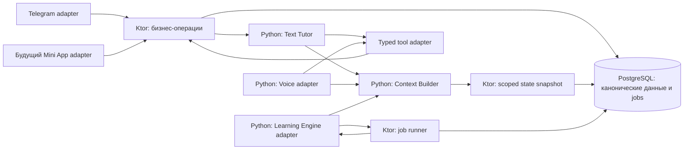

# SP-00: общий архитектурный фундамент Speaky

Статус: **согласован пользователем 2026-11-10; реализация начата**.
Дата: 2026-11-10. Пользователь поручил реализацию; актуальный объём legacy — сохранение и изоляция без переноса.

Основание: [архитектура v1](../architecture/speaky-mvp-high-level-architecture-v1.md),
[исходная продуктовая v0.5](../product/2026-11-08-ai-tutor-experience-v0.5.md)
и текущее поручение пользователя. Исходные документы сохраняются без переписывания.
Родитель-оркестратор: `thr_r344yzk33f`.

## Граница legacy

Legacy calls, Vocabulary Builder, reminders и их аналитика сохраняются в коде с прежними контрактами,
но не подключаются к новому composition root. Их перенос в PostgreSQL не входит в SP-00.
Новый Speaky не запускает старые routes/workers и не требует Redis.
Импортируется только состояние текущего текстового репетитора TutorStore перед включением нового чата.
Существующие серверные данные и инфраструктура не удаляются; remote cutover/deploy не разрешён.
Неиспользуемые новые legacy adapters не являются обязательным результатом; применённые миграции не переписываются.

## Рамки

Подготовить работающий фундамент для SP-01–SP-08: владельцы данных, связанные сущности,
общие состояние, память и контекст, контролируемые бизнес-операции tools,
устойчивые фоновые задания и интеграционные проверки на реальных хранилищах.
Старое исключение общего профиля из SP-01 не ограничивает новую задачу SP-00.

Полное поведение репетитора, проведение уроков, продуктовые сценарии регулярного
расписания, платежи и UI не входят в SP-00. Платные модели для проверки фундамента не нужны.
Разрешены реализация и локальные проверки. Commit/push/deploy, платные вызовы и Telegram-отправки не разрешены.

## Решения интервью

### 1. Подключение существующего чата — принято пользователем

К завершению SP-00 текущий текстовый чат использует общий профиль, память и Lesson.
Отдельный фундамент с отложенным переключением чата не выбран.
Voice и Learning используют рабочие адаптеры и интеграционные тесты без настоящего урока.
Это предполагает реальный рефакторинг зависимостей, а не только добавление новых классов.

### 2. Личные выводы AI — принято пользователем

Неподтверждённые личные выводы остаются кандидатами вне обычного контекста до подтверждения ученика.
Они не становятся автоматически актуальными личными фактами.
Прямо сообщённые сведения не требуют повторного подтверждения только ради сохранения.
Кандидаты доступны только отдельной операции обсуждения/подтверждения, не обычному Context Builder.
Полный диалог подтверждения не входит в SP-00; backend проверяет источник подтверждения и версию кандидата.

### 3. Учебные наблюдения — принято пользователем

Можно автоматически сохранять и использовать наблюдения с источником в реплике/уроке
и явной неопределённостью. Они не меняют самооценку, цель и личные факты.
Выводы о характере и психологическом состоянии не считаются учебными наблюдениями.

### 4. Исходная история — принято пользователем

Для нового фундамента сообщения и транскрипты хранятся **30 дней**.
Очистка охватывает копии исходного текста в evidence и результатах операций.
Подтверждённые факты и учебные результаты имеют отдельный жизненный цикл.
После очистки исходной истории полный повторный анализ старого разговора невозможен.
Это изменение прежнего семидневного срока для нового пути; автоматическое расширение
сроков всех legacy-подсистем не согласовано.

### 5. Недоступность сохранения — принято пользователем

Обычный ответ не выдаётся без надёжного сохранения входящего хода.
При сбое — техническое сообщение и приостановка; бизнес-операции без записи запрещены.
Для будущего voice требуется ограниченный буфер и приостановка при его исчерпании.
SP-00 проверяет контракт приёма/подтверждения событий и отказа, не поведение реального медиаканала.

### 6. Готовность подготовки — принято пользователем

Нельзя начинать следующую встречу до успешного завершения необходимого анализа
прошлого урока и подготовки актуального Lesson Plan.
Fallback на старый план или неполный контекст не выбран.
Сбой фонового анализа может блокировать занятие; нужны наблюдаемые состояния
ожидания/ошибки и безопасное восстановление задания.
SP-00 реализует и проверяет контракт готовности, а не полный сценарий проведения урока.

### 7. Полномочия Learning Engine — принято пользователем

Автоматически менять тактику уроков и ближайшие шаги можно в рамках согласованной цели.
Существенную смену направления сначала обсуждают с учеником.
Версия и причина изменения сохраняются. Методика оценки освоения остаётся будущей работой.

### 8. Главные риски — выбраны пользователем

Приоритеты: **скрытое расхождение данных** и **сложность поддержки**.
Поэтому обязательны один владелец каждой записи, версии входов анализа, защита от поздних записей,
прослеживаемые операции, видимые состояния фоновых задач и безопасный ручной повтор.

### 9. Изоляция legacy — окончательное решение пользователя

Старые функции не обязаны оставаться доступными в новом runtime. Код сохраняется отдельно;
перенос legacy данных, parity на PostgreSQL и подключение уже написанных adapters отменены.
Новый путь использует PostgreSQL и проходит тесты без Redis. Отдельный importer TutorStore
может читать Redis как источник, но не является fallback нового runtime.
Это решение применяется ко всем этапам, тестам и DoD ниже.

## Проверенные основания в коде

- `ai-service/app/main.py`: модель чата получена через `clip_pipeline.characters`,
  Redis — через приватное поле `learner_store._redis`.
- `ai-service/app/tutor_store.py`: единый изменяемый aggregate содержит память,
  историю, встречи, операции, receipts и события. `context()` берёт lock и сохраняет aggregate.
- `ai-service/app/tutor.py`: lock удерживается на протяжении model/tool loop;
  контекст собирается внутри runtime.
- `ai-service/app/tutor_tools.py`: есть строгие схемы, evidence, версии и сохранённые результаты операций.
- `ai-service/app/learner_store.py`: профиль старых звонков хранится отдельно от TutorStore.
- `ai-service/app/memory_jobs.py`: есть сохраняемая очередь, leases и повторы;
  ошибка постановки в runner логируется без гарантированной доставки задания.
- `ai-service/app/jobs.py`: clip jobs находятся в памяти процесса.

Эти наблюдения подтверждают необходимость SP-00. Существующие механизмы пригодны для
переиспользования после проверки соответствия новым контрактам; фундамент ещё не выполнен.

Дополнительно проверено:

- `realtime.py` собирает инструкции из прежней persona и topic, без общего StudentContext.
- `TelegramWebhook.kt` передаёт update асинхронному обработчику; подтверждение webhook
  само по себе не доказывает сохранение нового хода tutor. Дедупликацию audit нужно согласовать с durable inbox.
- `TutorTelegramChat.kt` использует chat-based session ID. В новом ядре идентичность ученика
  должна происходить из проверенного Telegram user, а chat ID остаётся адресом доставки.
- PostgreSQL уже подключён через JDBC/Hikari/Flyway. Существующие PostgreSQL-тесты,
  например `PostgresCallAnalyticsTest`, возвращаются без проверки, если отсутствует `TEST_POSTGRES_URL`.
  Такой режим не подходит для обязательной приёмки SP-00.

## 1. Целевая конструкция и зависимости

Сохраняем два существующих приложения: Ktor и Python/FastAPI. Новых deploy-сервисов и брокера не добавляем.
Новые логические компоненты не означают отдельные процессы.



**Выбор хранения:** каноническое состояние нового пути, история, память, результаты операций и задания — PostgreSQL.
Ktor владеет транзакциями. Python не пишет таблицы напрямую и не поддерживает вторую актуальную копию профиля.
Redis исключается из нового runtime. Legacy-код со своими хранилищами остаётся изолированным и не запускается.
Redis допускается только как источник переноса и отдельная зависимость migration tests, не как кеш или очередь нового runtime.
Это осознанно больше, чем перенос Lesson: общая память должна участвовать в тех же проверках версий и удаления.

**Цена выбора:** появляется обратный внутренний вызов Python → Ktor.
Нужны адрес backend, сервисная аутентификация, ограниченные таймауты и доступность между существующими хостами.
Ни DB-транзакция, ни блокировка всего ученика не удерживаются во время сетевого/model-вызова.
Такой вызов не должен занимать единственный worker Ktor: HTTP обработчики асинхронны, JDBC — на выделенном dispatcher.
Тесты запускают оба приложения и проверяют этот обмен, а не только DTO в одном процессе.

### Владельцы и интерфейсы

| Компонент | Владеет | Основные операции | Не делает |
| --- | --- | --- | --- |
| Identity / Student | Student, channel identities, профиль, пользовательская цель и self-report | resolve principal, read/update profile, set goal | Не объединяет аккаунты по имени/email |
| Tutor Identity | Версия общей личности Саши/Kora H и channel overlays | read identity, bind version | Не копирует free-call prompt в урок целиком |
| Conversation History | Conversation, append-only events, входы/ответы, delivery state | accept input, append events, read bounded history | Не превращает реплики автоматически в факты |
| Structured Memory | Факты, кандидаты, подтверждения, наблюдения, revisions/tombstones | record fact, propose/confirm/reject candidate, apply observation, forget | Не владеет временем встреч, платежами и целью как второй копией |
| Lesson Management | Lesson, Call Session, execution snapshot, readiness | create/reschedule/cancel, register episode, append/end episode, check preparation | Не оценивает речь и не выбирает grace |
| Scheduling | Schedule revision, occurrence identity, исключения | store agreement, persist explicit occurrence, record exception | Не запускает полную регулярную генерацию в SP-00 |
| Billing / Access | Subscription, Payment receipt, entitlement periods | record verified result, read/check entitlement | Не принимает оплату по словам LLM |
| Learning state | Roadmap revisions/steps, Lesson Plan, Evaluation | apply versioned result, propose/activate revision, read readiness | Не владеет заявленной целью ученика |
| Context Builder | Только сборка typed context и ограничения объёма | build text/voice/learning context, read on demand | Не меняет состояние при чтении |
| AI runtimes | Model/tool loop, channel behavior | interpret, call permitted operation, render answer | Не обходят бизнес-операции прямой записью в store |
| Jobs | Durable intent, leases, attempts, dependencies, diagnostic outcomes | enqueue/claim/renew/complete/fail/retry | Не обещают exactly-once внешнюю доставку |

Общие сервисы содержат транспорт, хранение, clock, модельные adapters и повторяемые механики.
Use cases содержат права, допустимые переходы и правила применения результатов.
Не создаём универсальный CRUD endpoint и общий изменяемый `StudentState` со всеми данными.

## 2. Минимальная модель хранения

Названия ниже концептуальные; реализация может объединить близкие таблицы, сохранив ограничения.
Новые Flyway-миграции добавляются после последней фактически существующей версии. Применённые файлы не меняются.
У mutable-сущностей: ID, owner, version, created/updated timestamps. У ревизий — неизменяемый payload и provenance.

| Группа | Минимальные записи и поля | Связи / инварианты |
| --- | --- | --- |
| Student | `student`, `student_identity(provider, subject)`, profile, timezone, self-assessment | Уникальная внешняя identity → один Student; chat ID не удостоверяет пользователя |
| Goal | `learning_goal(student, text, desired_result, source_event, revision, active)` | Один текущий вариант основной цели; история ревизий; память ссылается на него |
| Tutor | `tutor_identity(id, version, persona_ref)`; student tutor binding | Одна общая persona для text/voice; версия доступна в контексте |
| Conversation | `conversation(student, channel)`; `conversation_event(id, seq, role, source, body, occurred_at, received_at, expires_at)` | Уникальные source event IDs; server sequence; source и автор проверяются |
| Ingress / runs | `inbox`, `conversation_run(input_id, status, lease, fence)`, `delivery_receipt` | Повтор входа не создаёт второй ход; ответ сохраняется до доставки |
| Memory | `memory_fact(key, value, kind, source_ref, revision, confirmed_at)`; `memory_candidate`; `memory_observation`; tombstone | Разделены user report, self-assessment, AI observation и candidate; нет второй копии Goal |
| Schedule | `schedule(student, revision, timezone, effective_from, agreement)`; `schedule_exception` | Версионированная договорённость; исключение привязано к исходному occurrence |
| Lesson | `lesson(student, kind, starts_at, duration, timezone, status, version, schedule_id?, occurrence_key?, launch_mode)` | Встреча независима от Subscription; уникальный occurrence; одна активная trial-запись по текущему контракту |
| Call Session | `call_session(lesson, attempt_id, status, start/end, end_reason, provider_ref?)`; transcript/events | Несколько эпизодов на Lesson; повтор attempt не создаёт новый эпизод; нет чужих student связей |
| Access | `subscription(student, status)`; `entitlement(subscription, from, until, source)`; `payment(provider, external_id, result, subscription)` | Уникальность внешнего события; период не вычисляет LLM; истечение не удаляет Schedule/Lesson |
| Roadmap | `roadmap(student, goal_revision, active_revision)`; `roadmap_revision`; `roadmap_step` | Одна активная версия; изменение направления требует подтверждения; старые версии сохраняются |
| Learning artifacts | `lesson_plan(lesson, revision, inputs, status, content)`; `lesson_evaluation(lesson, source_revision, analyzer_version, status, observations)` | Цель урока отдельно от темы; пять dimensions могут быть unknown; нет обязательных придуманных баллов |
| Operations | `operation_receipt(actor, key, input_digest, entity_refs, result_code, result_version)` | Тот же key + другие параметры → conflict; бизнес-изменение и receipt атомарны |
| Jobs / deletion | `job(kind, key, target, input_refs, status, due_at, lease, fence, attempts)`; `job_attempt`; `student_data_epoch` | Уникальный semantic key; старый worker не коммитит; удаление инвалидирует старые результаты |

Foreign keys и составные ограничения ownership запрещают связать Lesson одного ученика с Call Session,
планом или наблюдением другого. Не полагаемся только на проверку Python.
Структурированные core-поля получают фиксированные имена; расширяемые личные факты остаются типизированными значениями.
JSONB допустим для содержимого плана/наблюдения и версии схемы, но не заменяет ключи, связи и уникальность.

## 3. Контракт состояния и безопасных tools

### Идентичность и полномочия

Ktor разрешает проверенного Telegram user в Student. Новый tutor path поддерживает личный чат;
групповой chat ID не превращается в общий ученический профиль.
Для будущего Mini App нужен adapter проверки Telegram init data и такой же resolver; UI не нужен.
Поддельные, просроченные данные и чужой Lesson должны отклоняться интеграционными тестами.
Старый email/app account автоматически не связывается с Telegram.

Внутренний запрос AI получает ограниченный execution context: student, conversation/lesson, run/job ID,
роль, разрешённые действия, срок и fencing token. Контекст выдаёт backend, не LLM и не клиент.
Сервисная аутентификация и execution scope проверяются вместе. Один общий internal token без scope недостаточен.
Полномочия text/voice/learning различаются. Learning не может создать оплату или изменить заявленную цель.

### Формы контрактов

```text
StateSnapshot(scope, purpose)
  -> student + canonical goal + tutor version + confirmed memory
     + learning observations + relevant history + lesson/plan + revisions

Command(scope, operationId, expectedVersion, sourceRef, typedPayload)
  -> success(entityId, newVersion, result) | typed failure

AppendEvents(scope, sourceEventIds, callSessionId?, events)
  -> committed sequence / duplicate result

ApplyLearningResult(jobId, fence, inputRevisions, resultSchemaVersion, result)
  -> applied | already_applied | stale | blocked | rejected
```

Ошибки различают `not_owned`, `version_conflict`, `invalid_state`, `not_ready`,
`storage_unavailable`, `operation_conflict`, `source_expired`, `scope_expired` и `invalid_result`.
Transport error не означает, что операция не выполнена: результат перечитывается по operation ID.
Перед новым действием проверяется текущее состояние, даже если snapshot модели старый.

Tools остаются узкими бизнес-операциями: чтение/запись факта, подтверждение кандидата,
create/read/reschedule/cancel trial. Новые административные возможности не появляются в model tool list,
пока соответствующий продуктовый сценарий не реализован.
Существующие strict schemas, evidence и intent contract сохраняются.
Evidence проверяется по сохранённому входу backend; строка, присланная моделью, сама по себе не подтверждение.
Это проверяет происхождение, но не доказывает правильность семантического понимания моделью.

### Атомарность и конкурентность

- Бизнес-изменение, receipt и обязательное job intent сохраняются одной PostgreSQL-транзакцией.
- Сериализация нужна на conversation run, а не на весь Student: voice context не ждёт конца генерации text.
- Версии отдельных сущностей защищают memory/goal/lesson от конкурирующих изменений.
- Lease имеет fencing token. После потери lease старый runtime не может продолжить запись tools/ответа.
- Для повторов используем стабильный command ID, переживающий повтор model call; семантические ограничения
  дополнительно запрещают вторую активную trial-запись и второй occurrence.
- Перенос «на час позже» разрешается один раз в конкретный момент и записывается как проверяемая команда.
  Сетевой retry не пересчитывает смещение от уже перенесённого времени.
- Чтение контекста не сохраняет aggregate и не меняет revision.

## 4. Structured Memory, история и Context Builder

### Общая память

Цель, self-assessment и предпочтения из прямого сообщения сохраняются синхронной операцией.
Подтверждённое сообщение не требует повторного согласия ради записи.
Личный вывод AI создаёт candidate; обычные text/voice contexts его не получают.
Отдельная операция может получить кандидата для уместного обсуждения и подтвердить его по новому сообщению.
Reject/forget оставляют техническую отметку, чтобы старый extractor не предлагал то же повторно автоматически.

Учебные observations применяются без подтверждения при валидном source, rubric/analyzer version,
границах наблюдения и неопределённости. Self-report Confidence остаётся отдельным типом данных.
AI не может записать психологический диагноз под видом учебного наблюдения.
Повторяющиеся выводы имеют semantic identity и source set; повтор job не наращивает число доказательств.

Применение фонового результата проверяет data epoch и версии входов.
Старое наблюдение можно сохранить как историческое свидетельство, если источник ещё допустим,
но оно не становится текущим фактом и не возвращает прежнюю цель.
Нельзя считать время завершения job временем появления факта: используются occurred_at и source revision.

### Retention и удаление — техническое предложение к согласованию плана

| Класс данных нового пути | Политика |
| --- | --- |
| Сообщения, транскрипты, цитаты evidence, сырые model inputs/outputs | 30 дней от приёма исходного события; копия не начинает новый срок |
| Derived conversation summary и неподтверждённые кандидаты | Не переживают срок исходного содержания; не служат обходом retention |
| Подтверждённые факты, цель, учебные результаты и договорённости | Сохраняются до исправления/удаления; не содержат скрытых полных копий транскрипта |
| Provenance после очистки текста | ID источника, тип, время, версия и отметка `source_content_expired`; без исходной цитаты |
| Job payload / operation receipts / diagnostics | Ссылки, версии, коды, технические параметры; текстовые копии очищаются по исходному deadline |
| Аудио | Новый фундамент не добавляет долговременное хранение; media buffer относится к будущему voice runtime |

После очистки evidence наблюдение остаётся историческим результатом анализа, но исходную реплику нельзя показать
или повторно проверить. Контекст явно различает результат и доступное доказательство.
Сырые prompts/ответы нового пути не попадают в бессрочные audit/provider logs.
При подключении чата нужно проверить все существующие аудиторы и исключить обход 30-дневного срока.

В SP-00 входят backend-операции забыть факт и удалить данные нового Student без пользовательского UI.
Исправление факта сохраняет допустимую историю; просьба забыть удаляет содержимое и его производные копии,
сохраняя только минимальную техническую отметку удаления.
Удаление инвалидирует jobs/runs и очищает результаты, summaries и caches; поздний worker не восстанавливает данные.
Обычный контекст не читает скрытые записи даже до физической очистки.
Удаление из резервных копий требует отдельной эксплуатационной политики перед выпуском.
SP-00 документирует и тестирует повторное применение deletion ledger при восстановлении тестового backup;
не заявляет очистку реальных серверных backups. Неподдерживаемые legacy-копии должны быть перечислены явно.

### Сборка контекста

Backend выдаёт scoped snapshot согласованным чтением PostgreSQL. Context Builder в Python:

1. Добавляет общее ядро persona и правила канала.
2. Выбирает core profile/goal, подтверждённую память и допустимые учебные observations.
3. Добавляет ограниченную историю; voice получает события всех эпизодов своего Lesson.
4. Добавляет актуальный plan и readiness metadata; learning получает входы конкретного анализа.
5. Возвращает версии, причины отсутствия данных, общий лимит и сведения об усечении.

Core facts не теряются из-за большого количества второстепенных воспоминаний.
Порядок отбора детерминирован: core → текущий Lesson → недавние релевантные данные.
On-demand чтение использует тот же scope. Кандидаты и данные другого ученика не попадают ни в одну обычную проекцию.
Новые запросы читают актуальные данные; cache может использоваться только с проверкой revision.
В уже отправленный model prompt изменения не добавляются магически: новый snapshot доступен следующему ходу/tool read.

## 5. Lesson, готовность и минимальные смежные операции

### Lesson / Call Session

Сохраняем основные состояния v1: Scheduled, InProgress, Completed, Missed, Cancelled.
Результат анализа и доступ к началу — отдельные состояния, не новые синонимы Completed.
Call Session хранит подключение, disconnect/end reason и provenance событий.
Регистрация эпизода не доказывает состоявшийся урок и не расходует trial автоматически.

В SP-00 действуют create/read/reschedule/cancel trial из текущего чата с прежними продуктовыми ограничениями.
Запись получает Lesson ID; прежняя карточка использует совместимый DTO и остаётся заглушкой запуска.
`launch_mode=placeholder` исключает автоматические Missed/Completed и расход trial по прошедшему времени.

Для внутренней интеграции работают операции регистрации/завершения эпизода и фиксации исхода Lesson
с явным проверенным событием. End Call закрывает эпизод; сам по себе не закрывает Lesson.
Публичного запуска настоящего урока эти операции не дают.
В тестах используются отдельные исполнимые Lesson fixtures и явные policy inputs.

### Готовность

`PreparationStatus`: pending, running, ready, failed, stale, blocked.
`checkLessonPreparation` возвращает причины, требуемые job IDs и версии зависимостей.
Наличие строки Lesson Plan недостаточно: план должен соответствовать актуальной цели,
действующей версии Roadmap и требуемым результатам анализа.

Для следующего урока незавершённый обязательный анализ предыдущего урока блокирует начало.
Успешный анализ может честно вернуть `insufficient_evidence`: это завершённая обработка,
а не выдуманная оценка. План должен явно учитывать недостаток данных; ошибка выполнения анализа остаётся блокером.
При отсутствии предыдущего урока такой зависимости нет; нужна подготовка первого урока.
Первый trial может иметь стартовый план без ещё не существующей диагностики/roadmap.
Смена существенного входа делает будущий plan stale и ставит новую подготовку атомарно.
Влияющие на план поля перечисляются явно; новое приветствие в чате не запускает бесконечную переподготовку.

На первом допуске фиксируется execution snapshot данного Lesson.
Reconnect текущего Lesson не ждёт анализа этого же незавершённого урока; иначе возникает цикл зависимостей.
Исправленные личные факты остаются доступны следующему чтению контекста, при сохранении версии плана выполнения.
Время подключения, право доступа и preparation readiness — независимые проверки, все обязательны для будущего запуска.
Готовность анализа не подменяет оплату и не разрешает раннее подключение.

### Scheduling / Billing / Learning: работающая основа без полного поведения

| Область | Реализовать в SP-00 | Оставить последующим этапам |
| --- | --- | --- |
| Schedule | Сохранение/чтение версии договорённости; связь с Lesson; запись одного явно заданного occurrence и исключения; повтор не воскрешает отменённое | Разбор всей регулярности, календарный генератор, DST policy серии, массовое изменение будущих встреч, реальные reminders |
| Subscription / Payment | Сохранение подтверждённого результата доверенной операцией; идемпотентность; явный период entitlement; проверка доступа | Платёжный provider, checkout, тариф, продление, refund policy; tools репетитора не выдают себе entitlement |
| Roadmap | Версии/шаги; операции локальной адаптации и отдельного предложения смены направления; activation с подтверждением | Полная методика генерации, mastery thresholds, автоматический progress UI |
| Lesson Plan / Evaluation | Versioned storage, schema validation, input revisions, применение результата и readiness | Полные педагогические prompts, проверенное качество диагностики, реальная генерация всех типов уроков |

Доверенные внутренние операции проверяются синтетическими событиями и не доступны публичному клиенту.
В test fixture entitlement предоставляется явным test adapter; production default не превращает тестовый путь в оплату.
Для local roadmap adaptation разрешаем только ограниченный набор изменений ближайших шагов,
без изменения goal ID/текста, целевого направления и учебного outcome. Существенные изменения требуют подтверждённой proposal.
Backend проверяет структуру прав; смысл педагогической эквивалентности позже проверяется модельной приёмкой.

## 6. Фоновые задачи и поддержка

### Один durable механизм нового пути

Используем PostgreSQL job table как транзакционный outbox и очередь заданий.
Не требуется отдельный брокер: worker в Ktor забирает due-задания короткой транзакцией,
вызывает обработчик вне транзакции и атомарно сохраняет результат с receipt.
AI-обработчик вычисляет результат в Python; применяет его backend после повторной проверки версии и lease.

Job contract включает kind/schemaVersion, semantic dedup key, student/target, input refs/revisions,
dueAt, deadline, status, attempt, leaseUntil, fencing token, correlationId, typed error.
Статусы: queued, running, succeeded, retry_wait, failed, superseded, cancelled.
Исчерпание попыток видно как failed; не исчезает из очереди без диагностического результата.
Backoff и лимиты настраиваются по виду задания; provider budget exhaustion не запускает автоматические платные ретраи.

At-least-once выполнение допускает повтор вычисления. Результат применяется не более одного раза
за semantic identity/input revision. Exactly-once model billing или Telegram send не обещается.
Unknown delivery хранится отдельно; бездумный повтор внешнего сообщения запрещён.

### Контракты и минимально работающие обработчики

| Вид | Вход / выход | Глубина SP-00 |
| --- | --- | --- |
| `memory.extract` | source event refs → candidates / observations | Рабочий adapter к существующему extractor, новый reconciliation и durable apply; тесты с детерминированной моделью |
| `lesson.evaluate` | lesson + transcript revision → evaluation + observations | Выполняемый pipeline со schema validation и внедряемым analyzer; полная педагогическая модель позднее |
| `lesson.prepare` | goal/roadmap/evaluation revisions → Lesson Plan | Выполняемый pipeline с внедряемым planner и readiness; без обещания качества production lesson |
| `schedule.materialize` | schedule revision + horizon → occurrence commands | Контракт, handler registration и проверка передачи; календарный алгоритм не реализуется |
| `notification.reminder` | lesson/version + due/deadline → delivery outcome | Контракт, проверка отмены/устаревания и test delivery adapter; реальных отправок нет |
| `retention.prune` | cutoff/data class → cleanup receipt | Настоящий обработчик для нового пути |

Незарегистрированный production handler возвращает `handler_unavailable`, а не фиктивный успех.
Тестовый analyzer/planner подменяет только вычисление модели, не queue, HTTP, backend validation или store.
Отключённая генерация уроков не открывает ученику неготовый урок: readiness остаётся blocked.

### Диагностика без отдельного UI

- Единые correlation/run/operation/job/lesson IDs через Ktor и Python; логи без сырой переписки и credentials.
- Список задач по статусу и возрасту, последние попытки и причины, expired leases и blocked preparation.
- Метрики: backlog/oldest age, failures/retries, stale results, conflicts, readiness blocks, storage errors.
- Защищённая внутренняя операция retry failed job повторно проверяет source retention, data epoch и актуальность входов.
- Read-only inspection Student/lesson возвращает версии и ссылки, а не копии секретов или полный dump.
- Runbook: как отличить недоступность AI, DB, истёкший source, stale plan и потерянный ответ операции.

## 7. Подключение текущего кода и legacy

| Объект | Действие |
| --- | --- |
| `tutor.py` | Сохранить естественный dialogue/tool loop; внедрить State/Context/Command adapters; убрать владение общим JSON и lock на весь Student |
| `tutor_tools.py` | Сохранить модельные схемы/смысл; вынести авторитетные проверки/изменения в backend use cases; не поддерживать две версии бизнес-правил |
| `tutor_store.py` | Перестать использовать как источник истины активного чата; временно оставить узкое чтение старого состояния для переноса |
| `main.py` | Явный composition root для backend clients, model factories и adapters; убрать Redis connections, приватное заимствование stores и получение модели через clip pipeline |
| `kora_personality.py`, model adapters | Переиспользовать личность и provider transport; разделить core persona и правила канала |
| `TutorClient.kt`, `TutorTelegramChat.kt` | Сохранить внешнее поведение/карточки; подключить durable intake, общий Student, operations и delivery receipts |
| `realtime.py` | Добавить отдельный lesson-oriented adapter, который действительно использует общий context; прежний app topic gateway изолировать |
| `memory_jobs.py`, `personalization.py` | Переиспользовать extractor и идеи leases/CAS; новые обязательные задания перевести на общий durable contract |
| `learner_store.py`, старые calls/reviews/vocabulary | Сохранить код и данные изолированно; не переносить Redis-хранилища и не подключать к новому runtime. Legacy-профиль не сливается с каноническим |
| Старые app users/sessions/reviews | Сохранить код и данные отдельно; не подключать старые API к новому runtime, не переименовывать сущности в Student/Lesson |
| Reminders, analytics, migrations | Не переписывать исторические данные и применённые миграции; старые handlers/workers изолировать; новые продуктовые рассылки не включать |

### Переход текущего чата

Подключение не должно молча сбрасывать знакомство и trial-запись.
Предлагается узкий идемпотентный перенос состояния существующего TutorStore для проверенной Telegram identity:
profile/facts, активная и исторические записи, пригодная по retention история, совместимые operation/delivery receipts.
Старые booking IDs сохраняются или получают стабильное отображение на Lesson ID.
Неполные/неоднозначные записи не дополняются выдуманными данными; формируется диагностический conflict.
Перенос оставшихся Redis-данных legacy входит в SP-00 по решению интервью №9.
Объединение старых профилей с новым Student и связывание email-аккаунтов по-прежнему не входят в задачу.

Новый владелец определяется backend import receipt. После cutover текущий чат пишет только в PostgreSQL;
обратной синхронизации и dual-write нет. Переключение требует остановить/дождаться старых tutor writers,
чтобы импорт не конкурировал с последним Redis update. Исходные Redis-данные не удаляются этим переносом.
Возврат к старой версии, пишущей только Redis, после новых записей небезопасен: запрещён как автоматический fallback.
Фактический выпуск и его окно переключения требуют отдельного разрешения; здесь проверяется механизм на fixtures.

### Надёжный вход и ответ

Для нового tutor-текста webhook подтверждает принятие после durable inbox insert.
Повтор update находит тот же inbox item; существующий audit dedup не должен подавить ещё не обработанный ход.
Legacy-команды и handlers не регистрируются в новом runtime и не становятся tools репетитора.
При недоступности БД новый вход не получает ложного durable ACK и не запускает обычный model response.
Техническое сообщение о сбое возможно best effort, без обещания сохранённого входа.
Ответ модели и его связь с committed operations сохраняются до Telegram send.
Ошибка доставки не откатывает уже выполненное действие; unknown outcome остаётся явным.

### 7.1. Изоляция legacy и импорт текущего TutorStore

**Composition roots:** новый Ktor/Python runtime запускает только новый Speaky, scoped backend,
Text Tutor, Context Builder и необходимые jobs. Старые voice/calls/vocabulary/reminder handlers,
routes и workers не регистрируются. Их сохранённый код не требует проверки parity на PostgreSQL.

**Импорт:** переносится только актуальный TutorStore текущего текстового чата.
Перед включением чата нужны stable source snapshot, запрет конкурирующих старых writers,
manifest импортируемого состояния, checkpoints, receipts, сохранение исходных deadlines и сверка результата.
Повтор/возобновление не создают дубли; malformed TutorStore record или mismatch блокирует success.
Неизвестные legacy namespace не импортируются и не блокируют эту ограниченную миграцию.
Незавершённый import marker не допускает включения нового чата с пустым профилем.
После новых PostgreSQL-записей автоматического fallback на устаревший Redis нет.

**Поставка:** новый startup/deploy graph не запускает Redis и не требует REDIS_URL.
Redis reader и его зависимости изолированы в tooling импорта; legacy package не импортируется новым composition root.
Старые Redis volumes, backups и серверные данные не удаляются. Разработка и rehearsal на fixtures
не разрешают чтение production данных, реальный deploy или cutover.

**Проверка:** оба приложения стартуют без Redis и без legacy routes/tasks;
текущий chat lifecycle и восстановление после restart проверяются через реальный PostgreSQL.
Проверка importer отдельно использует реальный Redis-источник и PostgreSQL; источник после проверки сохраняется.

## 8. Этапы согласованной реализации

Каждый этап заканчивается работающей проверкой. Следующий начинается после проверки предыдущего.
Этапы не означают отдельные deploy; весь SP-00 принимается после переключения чата и сквозных тестов.

| Этап | Изменения | Проверяемый выход |
| --- | --- | --- |
| A. Контракты и тестовый стенд | Версионированные DTO/error codes, execution scopes; обязательный runtime runner Ktor+Python+Postgres; Redis только в отдельном migration runner; сетевые модели/Telegram запрещены | Оба приложения стартуют; миграции работают на пустой и существующей test DB; отсутствие реальной БД делает integration suite красным |
| B. Владельцы и связанные сущности | Новые миграции, Identity/Student/Goal/Tutor, memory/history, Lesson/Call Session и минимальные Schedule/Access/Learning repositories/use cases | Реальные операции и foreign keys; cross-student доступ запрещён; restart сохраняет данные; один occurrence/payment result не дублируется |
| C. Operations, inbox и jobs | Receipts, leases/fencing, transactional job intent, retries, диагностика | Crash между commit и ответом; два workers; истёкший lease; повтор с другими параметрами; queue survives restart |
| D. Общая память и контекст | Context Builder, reconciliation, candidate confirmation, retention/deletion, text/voice/learning projections | Цель одинакова в каналах; кандидаты скрыты; старый анализ не затирает исправление; 30-day purge и late-job deletion protection |
| E. Переключение text path | Явный DI, thin tools, controlled import, durable webhook intake, compatible reply/card contract | Существующие create/reschedule/cancel/rebook, /start, отказ и исправление цели работают через новый backend; Redis больше не источник новых записей |
| F. Voice/Learning adapters и readiness | Lesson context реально передаётся в voice adapter; event capture API; compute/apply job pipeline, plan/evaluation versions, preparation gate | Центральный сценарий через реальные границы; multiple episodes; stale plan blocks; restart/retry без дублей; нет платных вызовов |
| G. Изоляция legacy | Отдельные composition roots; старые routes, handlers, workers и Redis зависимости не подключаются | IT-11: новый путь не запускает legacy; сохранённый код и данные не удаляются |
| H. Импорт TutorStore и переключение | Ограниченный manifest, checkpoint, reconciliation, import marker; Redis-free startup/deploy graph | IT-12–IT-13: повторяемый импорт текущего чата и новый runtime без Redis; серверные данные не меняются |
| I. Полная приёмка и документация | Failure matrix, runbook, архитектура/статус фактической реализации, regression suite | Все AC покрыты и выполнены; нет silent skipped integration tests; ограничения live acceptance и будущих policy перечислены |

Этап B не завершается набором CRUD-классов: каждый тип сущности имеет сохранение, проверяемую связь,
операцию чтения и хотя бы один бизнес-инвариант. Этап F не заменяется mock-only проверкой общей функции.

## 9. Матрица Acceptance Criteria → результат → интеграционный тест

| AC | Конкретный результат SP-00 | Обязательная проверка |
| --- | --- | --- |
| Понятные backend-компоненты и согласованные интерфейсы | Владельцы из §1, typed adapters, явный wiring, contract version/errors | IT-01: Ktor↔Python contract roundtrip; scope/ошибки; неизвестная версия отклоняется; новые runtime не импортируют private legacy store |
| Базовые сущности и связи в реальном хранилище | Миграции и операции для всех групп §2 | IT-02: создать Student→Schedule/Lesson→Call Session, Subscription/Payment, Goal→Roadmap→Plan/Evaluation, Memory; restart/read; чужие FK/дубли отклоняются |
| Text/Voice/Learning используют единое состояние | Подключённый Text Tutor и исполнимые voice/learning adapters | IT-03: сквозной сценарий ниже, через два приложения и реальный PostgreSQL; Redis не содержит независимую актуальную цель |
| Действующие Structured Memory и Context Builder | Общие projections, confirmation policy, provenance, reconciliation | IT-04: скрытый candidate→подтверждение→видимость обоим каналам; observations с evidence; stale result, unknown level, ограничение контекста |
| Безопасные tools | Backend commands, scoped identity, expected version, receipt | IT-05: чужой student/lesson, forged scope/source, stale version, unknown tool, permission escalation; lost response/retry дают один результат |
| Механизм фоновых задач | Durable job table/runner, compute/apply, retries/dependencies/diagnostics | IT-06: commit без ACK, restart, два workers, потеря lease, failed→manual retry, cancelled/stale jobs; результат применён один раз |
| Последующие SP не пересматривают базовые принципы | Отдельные Lesson/Call, Schedule/Access, цель/оценка, версии и policy boundaries | IT-07: смена subscription не удаляет schedule; второй эпизод использует тот же lesson; перенос сохраняет occurrence; подготовка ждёт требуемый анализ; смена goal делает plan stale |
| Решение №9: сохранить и изолировать legacy | Отдельный новый runtime, importer только TutorStore | IT-11: isolation; IT-12: повторяемый импорт текущего чата; IT-13: работа без Redis |
| DoD: фундамент проверен взаимодействием | Обязательный интеграционный suite и отчёт с ревизией/командами | IT-01–IT-13 проходят без paid models; основной runtime проверен только с PostgreSQL, источник миграции — с реальным Redis; отсутствие требуемых stores не считается success |

Дополнительные обязательные проверки:

- **IT-08 retention/deletion:** управляемые часы, граница 30 дней, очистка всех текстовых копий нового пути;
  подтверждённый факт остаётся без просроченной цитаты; forget удаляет производные копии;
  late job и восстановление test backup не воскрешают удалённое.
- **IT-09 text regression/cutover:** imports повторяемы, booking IDs и карточки согласованы;
  явное поручение не требует профиля; /start не сбрасывает память; сбой model после tool commit возвращает фактический результат;
  два одновременных inputs не теряются; audit dedup не теряет pending inbox.
- **IT-10 readiness/capture/failure:** исход сохранения unknown разрешается по event ID;
  DB outage запрещает обычный ход; append ACK выдаётся после commit;
  plan absent/failed/stale блокирует новый урок; восстановленная preparation снимает только свой блок;
  reconnect не требует оценки собственного текущего урока; позднее событие инвалидирует неполный анализ.

- **IT-11 legacy isolation:** новый Ktor/Python composition root не регистрирует старые
  calls/vocabulary/reminder routes, handlers и workers; не создаёт Redis clients и не требует legacy env.
  Сохранённый legacy-код остаётся вне нового пути; перенос его данных не тестируется.
- **IT-12 TutorStore import rehearsal:** реальные Redis и PostgreSQL; прервать импорт и продолжить,
  повторить полностью; проверить профиль, память, историю, встречи, receipts и исходные deadlines.
  Malformed импортируемая запись и mismatch блокируют success; незавершённый marker блокирует чат.
  Legacy namespace не входят в manifest; исходник не удаляется.
- **IT-13 Redis-free runtime:** запустить оба новых приложения без Redis-пакета, env и контейнера;
  выполнить новый сквозной сценарий, перезапустить и повторить чтение. Legacy handlers/tasks отсутствуют;
  startup/deploy graph нового пути не содержит Redis. Import tooling проверяется отдельно.

### Центральный сквозной сценарий IT-03

1. Проверенный Telegram test update проходит настоящий Ktor intake и создаёт durable вход.
2. Text runtime с deterministic model adapter вызывает tool сохранения цели «рабочие встречи».
3. Backend сохраняет цель, source и receipt; voice adapter через Context Builder получает эту цель и общую persona.
4. Для test Lesson регистрируются два Call Sessions. События сохраняются по ходу с ACK и dedup.
5. Завершение тестового источника анализа фиксирует source revision и атомарно создаёт job.
6. Worker вызывает Python analyzer adapter; тот возвращает наблюдение с source refs и uncertainty.
7. Backend применяет наблюдение; следующий text context его видит без повторного знакомства.
8. Повтор/рестарт задачи не создаёт вторую evaluation/observation и не удваивает evidence.
9. Между compute и apply ученик исправляет цель на «переезд». Старый result не возвращает «рабочие встречи».
10. Будущий Lesson Plan со старой goal revision становится stale; новый план разрешается только после требуемого анализа.

Модель и медиапровайдер подменяются; хранилища, HTTP-границы, сериализация, права,
операции, worker и применение результатов остаются настоящими.


### Локальные доказательства реализации

Результаты относятся к рабочему дереву поверх `60d4085`, проверенному 2026-11-10.
Внешние Telegram/model/media boundary заменены; PostgreSQL, HTTP, import Redis и backup/restore настоящие.
Это не серверный cutover и не живая приёмка. Сводка результатов — в [status.md](../status.md).

| Критерий | Тестовое доказательство |
| --- | --- |
| Компоненты/интерфейсы, IT-01 | `test_shipping_python_app_uses_real_backend_scope_and_native_tools`; `capabilitiesVersionsAndReceiptsPreventCrossStudentWritesAndRepeatedChanges` |
| Сущности/связи, IT-02 | `confirmedPaymentIsIdempotentAndDoesNotOwnTheSchedule`; `scheduleHandlerMaterializesOneOccurrenceAndCannotResurrectACancellation`; центральный state test |
| Общий state, IT-03 | `test_text_tool_commits_in_ktor_and_voice_reads_same_goal`; `test_learning_result_returns_to_chat_without_reverting_a_new_goal`; `chatGoalAndLessonObservationShareStateWithoutAllowingAnOldJobToRewriteTheGoal` |
| Memory/Context, IT-04 | `personalCandidatesRemainHiddenUntilAUserConfirmsTheirSource`; `test_memory_extraction_commits_only_hidden_candidates_from_its_durable_source`; центральный state test |
| Tools, IT-05 | `capabilitiesVersionsAndReceiptsPreventCrossStudentWritesAndRepeatedChanges`; `recoveredRunReturnsCommittedBookingInsteadOfRepeatingTheInstruction` |
| Jobs, IT-06 | `expiredWorkerCannotCommitAndRetentionDoesNotRenewSourceDeadlines`; `workerRenewalExtendsOnlyItsLiveFencedCapability`; `workerUsesBoundCapabilityAndCommitsPreparationOutsideTheClaimTransaction` |
| Schedule/reminder contracts, IT-07 | `scheduleHandlerMaterializesOneOccurrenceAndCannotResurrectACancellation`; `reminderTestAdapterRunsOnceAndRecordsItsDeliveryReceipt`; `reminderContractSkipsCancelledLessonsAndNeverResendsUnknownDelivery` |
| Retention/delete, IT-08 | `expiredWorkerCannotCommitAndRetentionDoesNotRenewSourceDeadlines`; `forgettingGoalErasesHistoricalRevisionsAndInvalidatesOldScopes`; `realBackupRestoreReplaysDeletionLedgerBeforeServingContext` |
| Chat/cutover, IT-09 | `telegramBridgePersistsInputAndDeliveryAndRejectsAGroupIdentity`; `telegramIntakeIsDurableOrderedAndRecoverableAfterAnExpiredDispatch`; `uncertainTelegramDeliveryIsNotRetriedBlindly`; recovered booking test |
| Readiness/capture, IT-10 | `test_voice_transport_receives_context_only_after_backend_admission`; центральный state test; worker preparation test |
| Isolation, IT-11 | `isolatedShippingRuntimeRequiresCutoverAndRegistersNoLegacyRoutes`; `tests/test_speaky_runtime.py` |
| TutorStore import, IT-12 | `integration/test_tutor_import_redis.py`; `cutoverRejectsCorruptManifestAndCompletesOnlyAfterAllTutorImports` (включая прерывание после per-student receipt до marker) |
| Redis-free, IT-13 | Fresh runtime-only venv + `test_speaky_runtime.py` с запретом любого Redis import; 5 HTTP tests; Kotlin isolation test; runtime/deploy graph изменён |

Kotlin: `FoundationIntegrationTest.kt`; Python: `integration/test_foundation_http.py`.
Runner: `scripts/test-foundation.sh`; CI: `.github/workflows/foundation.yml` (удалённый CI в этой проверке не запускался).

## 10. Полный DoD

- Все выбранные компоненты имеют рабочие взаимодействия, а текущий чат переведён на общий источник истины.
- Все базовые сущности реально сохраняются и связаны; нет второго активного владельца профиля/цели.
- Voice adapter использует собранный контекст при подготовке session instructions; learning adapter применяет результат через backend.
- Scoped authorization, optimistic versions, receipts, source provenance и data deletion проверены негативными сценариями.
- Общий job механизм переживает restart, показывает failed/blocked и допускает безопасный повтор.
- AC-матрица и IT-01–IT-13 выполнены без внешних платных вызовов. Основной runtime suite использует реальный PostgreSQL без Redis; migration suite — реальные Redis и PostgreSQL.
- Legacy-код сохранён и изолирован; старые функции не запускаются новым runtime. Redis отсутствует в новом startup/deploy graph; importer TutorStore изолирован.
- Импорт TutorStore имеет ограниченный manifest, checkpoint, сверку и rehearsal; чат закрыт до успешного marker. Legacy namespace исключены. Серверные данные и volumes не удаляются.
- Python suite; из `cmp/` с `GRADLE_USER_HOME=$HOME/.gradle`: `./gradlew :server:test :server:buildFatJar detekt`.
  Новый обязательный integration target запускается отдельно и в CI; отсутствие DB приводит к failure, а не early return.
- Есть воспроизводимый local runner, синтетические fixtures, команды запуска, runbook и отчёт с фактической ревизией.
- Документация текущего устройства обновлена по реализованному коду; исходные v0.5, v1 и прошлый review сохранены как источники.
- Local integration не объявляется DEV readiness, живой приёмкой модели, Telegram или voice UX.

## 11. Риски и компромиссы

| Риск | Решение / предел |
| --- | --- |
| Расхождение данных | Один PostgreSQL owner; нет Redis↔PG dual-write; snapshots и команды используют revisions |
| Поддержка двух приложений | Единые IDs, typed errors, inspection/retry, runbook; тесты реального обратного HTTP-вызова |
| Медленный/упавший анализ блокирует урок | Это выбранное правило; readiness reasons, bounded retries и failed state обязательны; тихого fallback нет |
| Дополнительная сетевая задержка | Один bounded snapshot на ход; дополнительные чтения по нужде; никаких DB locks на время AI |
| Реальный голос может не поддержать требуемый capture/backpressure | SP-00 доказывает backend/adapters; transport acceptance остаётся будущим обязательным тестом, не заявляется готовым |
| Подтверждение личных выводов превращается в анкету | Кандидаты не вставляются в обычный контекст; в SP-00 только controlled operations, без автоматического вопросника |
| Неясный смысл существенной смены Roadmap | Ограниченные типы auto-изменений; изменение цели/outcome только через proposal; семантическая педагогическая проверка позднее |
| Повтор модели стоит денег даже при dedup результата | At-least-once compute, bounded retries; billing exactly-once не обещается; paid checks отдельно разрешаются |
| Retention расходится с аудитом/backup | Инвентаризация текстовых копий нового пути, реальные purge tests, deletion restore contract; реальные backups требуют эксплуатационной проверки |
| Cutover чата теряет последние Redis updates | Drain старых writers, stable import receipt, тест гонки; нет автоматического отката на устаревший store |
| Формальный запрет любых будущих изменений схемы невыполним | SP-01–SP-08 добавляют поля/операции/policy без смены ownership и базовых связей; это критерий устойчивости фундамента |

## 12. Отложенные продуктовые решения и non-goals

Следующие значения не фиксируются молча и не блокируют интеграционную проверку SP-00:

- Grace, критерий состоявшегося trial, ранний уход, повтор бесплатного trial после техсбоя.
- Доступ при истечении подписки внутри урока, пропуски при blocked access и реакция на задержавшуюся подготовку.
- Тариф, период, renew/cancel/refund; частота до семи раз в неделю против формулировки «без лимита».
- Реальный горизонт материализации: 14 дней из v1 остаётся будущей policy, не инвариантом хранения.
- Поведение при изменении серии с исключениями и календарные DST-конфликты.
- Педагогические рубрики, mastery, числовые шкалы и полные prompts генерации уроков.
- Окончательный voice transport, browser turn-taking и качество поведения в Telegram webview.

Вместо неутверждённых значений используются explicit policy inputs в тестах и `not_configured` на неподключённом пути.
Текущая trial-заглушка сохраняет свой прежний контракт и не превращается в проводимый урок.

Не входят: полный MVP; новый UI/Mini App; настоящие занятия; платёжный gateway;
полный новый scheduler/reminder workflow; перенос хранилищ или продуктовое переосмысление legacy и Vocabulary Builder;
слияние старых профилей и аккаунтов; удаление исторических данных;
embeddings/knowledge graph; новый брокер; отдельные микросервисы; универсальный workflow designer;
платные eval; реальные Telegram-отправки; commit/push/merge/deploy без отдельного поручения.

## 13. Согласование

Ответы интервью 1–9 и технический план §§1–12 согласованы пользователем:
PostgreSQL/Ktor ownership, Python adapters, минимальные операции, контролируемое подключение текущего чата,
сохранение и изоляция legacy, импорт текущего TutorStore, этапы A–I и актуализированная матрица приёмки. Реализация разрешена явным поручением пользователя от 2026-11-10.
Согласование плана не разрешает commit/push/merge/deploy, платные вызовы или сообщения пользователям.
