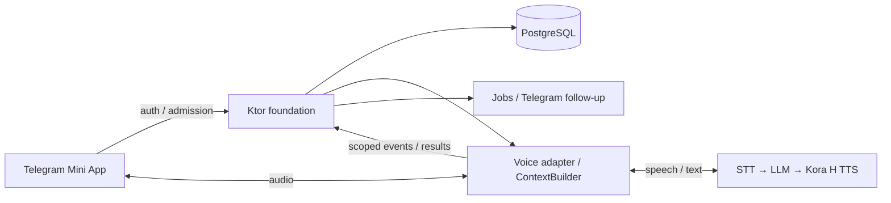

# SP-02 — бесплатный пробный голосовой урок

Дата: 2026-11-11. **Реализация одобрена пользователем и выполнена в рабочем дереве; локальная проверка завершена.**
Поручение: «погнали реализовывать план», затем локальные тесты. Живую функциональность проверяет пользователь.
Платные вызовы, реальные Telegram-сообщения, deploy и commit/push не выполнялись.
Родитель — оркестратор; исправление и поставка SP-00 принадлежат `thr_vn4p42jeij`.

## Источники и границы доказательств

- [Продукт v0.5](../product/2026-11-08-ai-tutor-experience-v0.5.md), особенно разделы 6–7 и lifecycle.
- [Целевая архитектура v1](../architecture/speaky-mvp-high-level-architecture-v1.md).
- [Реализованная архитектура](../../architecture.md), [status](../status.md).
- [SP-00](2026-11-10-sp00-foundation.md), [SP-01](2026-11-09-sp01-text-onboarding.md).
- [Стайлгайд и макет звонка](../design/README.md) — пользовательские HTML-источники, сохранены без изменений 2026-11-11.

Проверены документы и исходники рабочего дерева. Живой DEV не проверялся. Status сообщает о завершённом
импорте и необходимости совместного redeploy, а также прежнем блокере CI `postgresql-client-16`.
Это документальный срез, а не проверка состояния серверов. В status.md обнаружены чужие изменения;
их содержание сохранено при обновлении текущего среза SP-02. GBrain недоступен из-за lock другого процесса; его решения не были прочитаны.

## Зафиксированный продуктовый контракт

Саша с характером Kora H продолжает знакомство из Telegram. Бесплатный trial — консультация примерно
на 15 минут, преимущественно на доступном ученику английском, с русским для понимания и комфорта.
Diagnose и Demonstrate идут внутри естественного разговора. Prescribe — устные персональные выводы
и объяснение дальнейшего пути. Нет голосовой анкеты, обязательного блока упражнений или экзамена.

Пять измерений v0.5: Fluency, Confidence, Speaking Autonomy, Grammar, Vocabulary.
Это направления наблюдения, а не утверждённые числовые шкалы. Confidence требует self-report.
Примерный уровень и трудности сообщаются только в пределах услышанного; неизвестное остаётся неизвестным.
После звонка разговор продолжается в Telegram. Оплата внутри звонка не появляется.

## Интервью

### Блок 1 — ответы пользователя, 2026-11-11

1. После trial: «согласовать предварительное расписание и сэмитировать оплату».
   В SP-02 добавляется демонстрационный переход к оплате; реальное списание этим не разрешено.
   Вид имитации, результат и связь с будущими Lesson определены в блоке 2.
2. Ниже A2: бережно провести доступную беседу, объяснить ограничения формата
   и не продавать неподходящие занятия. Не заканчивать урок только из-за уровня автоматически.
3. Пользователь предоставил UI Mockups 2026-11-11; оригиналы сохранены в `ai_docs/design/`.
   Конкретный макет звонка исключает субтитры и AI-status. Детали ниже обновлены по этому источнику.

### Блок 2 — ответы пользователя, 2026-11-11

1. Демо-кнопка «Оплатить»: явно без списания, затем тестовое подтверждение.
   Настоящая подписка не включается; sandbox платёжного провайдера не нужен.
2. Результат: сохранённое расписание и видимые будущие встречи-заглушки.
   Подключение к ним недоступно. Работающие регулярные уроки остаются SP-03+.
3. При речи ученика Саша сразу уступает слово. Шум и эхо не должны останавливать ответ.
   Это обязательный критерий живой проверки, а не обещание качества на основании VAD-конфига.

Не смешивать demo success с подтверждённым платежом в данных, аналитике и репликах Саши.

### Блок 3 — ответы пользователя, 2026-11-11

1. Без фиксированного запаса: Саша сам выбирает момент завершения.
   15 минут остаются ориентиром; опоздание не переносит плановое окончание.
2. Если технический сбой сорвал trial и восстановиться не удалось, Саша предлагает новую
   бесплатную встречу примерно на 15 минут, сохранив контекст. Не ограничивать её остатком времени.
3. Даёт подумать; при затруднении мягко предлагает подсказку, без фиксированного порога секунд.

### Блок 4 — ответы пользователя, 2026-11-11

1. Использовать текущий голос Kora H. Не заменять его готовым голосом другого realtime-провайдера.
2. Живую приёмку пользователь проведёт сам. Список устройств не выбран;
   фиксировать фактически проверенные устройства, не объявлять остальные проверенными.
3. «Я бы сохранял все»: планируем сохранение аудио всех уроков.
   Срок и пользовательское уведомление определены в блоке 5.

### Блок 5 — ответы пользователя, 2026-11-11

1. Аудио хранится 30 дней, затем удаляется; учебные выводы сохраняются отдельно.
2. На уведомление/согласие перед звонком: «без этого сейчас».
   В текущем объёме SP-02 не добавлять отдельное уведомление или экран согласия на запись.
   Это решение об интерфейсе текущего этапа, не утверждение о выполнении юридических требований публичного запуска.
3. Только устные рекомендации и сохранённые наблюдения. Roadmap — позже;
   отдельный персональный план и этапы освоения в SP-02 не создаются.

### Блок 6 — ответы пользователя, 2026-11-11

1. После технического обрыва разрешён возврат в тот же Lesson, пока Саша не завершил его,
   без фиксированного окна возврата, в том числе после плановых 15 минут.
2. После обычного завершения Саша сам пишет вскоре после возвращения в Telegram:
   коротко связывает предложение с разговором, без повторного отчёта.
3. Бюджетного предела нет. Приоритет — текущий голос Kora H и качество диалога.
   Это не разрешение платных вызовов в текущей задаче; запрет из исходного поручения сохраняется.

### Следующие небольшие блоки после разбора ответов

- Проверка задержки с текущим голосом Kora H и оценка стоимости выбранной схемы.
- Измеримые пороги задержки предложить после проверки возможностей голосового пути;
  пользователь проводит живую приёмку, фактические устройства входят в отчёт.
- UI Mockups, окончательная схема голосового транспорта и оставшиеся результаты технического исследования.

Не переспрашивать закреплённое: вход не раньше встречи; опоздание не переносит окончание;
End Call сразу закрывает соединение; повторный вход относится к тому же Lesson.

## Проверенное переиспользование SP-00 и конкретные пробелы

| Часть | Что есть в коде | Что нужно SP-02 |
| --- | --- | --- |
| Профиль/память | Ktor/PostgreSQL, scopes, provenance, revisions, epoch; `context_builder.py` объединяет bounded context | Использовать ту же identity; добавить голосовые evidence и self-report без второй базы профилей |
| Lesson | `LessonManagement.kt`: trial, versions, create/change; text создаёт только placeholder на 15 минут | Разрешить исполняемый trial через проверенную capability; решить судьбу старых placeholder без автоматического расходования trial |
| Call Session | attemptId, один connected episode, append sourceId, endEpisode | Публичный admission сейчас возвращает `admission_not_configured`; нужны auth, время, heartbeat/lease, конкурентный вход |
| Контекст голоса | `lesson_voice.py` проверяет in_progress/execution_snapshot и добавляет прошлые эпизоды | Подключить адаптер и реальный lifecycle; проверить восстановление слышимой части ответа |
| Подготовка/анализ | Jobs, fencing, apply; протоколы planner/analyzer | В `speaky_main.py` production planner/analyzer не внедрены; без готового плана вход блокируется |
| Tools | Backend commands, ownership, receipts | Минимальные полномочия voice; модель не получает operator и не решает сама об оплате/доступе |
| Telegram | Durable intake/delivery в новом runtime | Рабочая ссылка Mini App и follow-up с guard на reconnect/отказ/свежий диалог |
| Legacy realtime | `realtime.py`: SDP exchange, `start_lesson`, semantic_vad, выбор голоса | Изолированный кандидат на перенос; нет полного server control, durable событий и admission |
| Legacy calls | Клипы/STT/LLM/TTS, Redis, review и числовые оценки; CMP WebRTC-прототип | Не подключать старые routes/workers; числовые review и старое состояние не переносить |
| Mini App | Пользовательского пути нет | Отдельный web-клиент, Telegram auth, разрешения микрофона, UI состояний |

## Предлагаемый путь ученика

1. В чате согласована встреча; backend сохраняет Lesson и показывает вход в Mini App.
2. До начала — экран времени встречи. При отмене/переносе старая ссылка показывает актуальное состояние.
3. По макету: Join Lesson в Telegram открывает Mini App; после admission и разрешения микрофона
   подключение начинается автоматически, без второй кнопки Join. Отказ в разрешении — отдельное состояние ошибки.
4. Саша продолжает известную тему, помогает заговорить. Экран звонка: аватар, имя Саша,
   прошедшее время, mute и End Call; без субтитров, waveform и AI-status.
5. При обрыве UI честно показывает потерю связи. Reconnect восстанавливает текущий Lesson и историю.
6. Примерно за 2–3 минуты до конца Саша естественно подводит итоги, спрашивает о комфорте,
   слышит ответ и объясняет переход в Telegram. Это ориентир, не переключение учебных блоков таймером.
7. End Call немедленно останавливает микрофон и звук, возвращает в Telegram. Если время ещё доступно,
   ученик может вернуться. Технический обрыв не выдаётся за успешный урок.
8. Telegram продолжает разговор по фактическому исходу. Для подходящего ученика — предварительное
   расписание и демо-кнопка оплаты. После тестового подтверждения видны сохранённое расписание
   и будущие встречи-заглушки без возможности подключиться.

## Голосовая архитектура — предварительная рекомендация

После ответа блока 4 предпочтительный кандидат — новый lesson-oriented STT → LLM → TTS путь
с текущим голосом Kora H. Это изменение прежней предварительной рекомендации speech-to-speech.
Личность и общий контекст берём из foundation; транспорт и turn-taking строим отдельно от legacy runtime.

Проверено по `config.py`, `gemini_speech.py`, legacy wiring в `main.py` и справочнику voice:
Kora H озвучивается через `GeminiKoraSpeech`/OpenRouter; defaults —
`google/gemini-3.1-flash-tts-preview`, голос `Leda`, параметры `KORA_TTS_MODEL`/`KORA_TTS_VOICE`.
Действительные overrides работающего окружения не проверены: перед реализацией сверить только
несекретные параметры с владельцем окружения. Текущий адаптер получает полный PCM через `aread()`,
затем конвертирует в OGG; это не доказательство пригодности для малой задержки в звонке.
Нужны проверка потоковой выдачи, отмены синтеза/воспроизведения и сохранения манеры Kora H.
Повторно используем узкие speech/personality компоненты, не legacy calls/Redis/review.

Провайдер STT, транспорт до браузера и схема server control пока не утверждены.
Текущие API, VAD, управление сессией, события воспроизведения и ограничения необходимо проверить
по первичным документам до окончательного выбора. Здесь не утверждается актуальная поддержка этих возможностей.

Альтернативы:

| Вариант | Выигрыш | Цена/риск |
| --- | --- | --- |
| Realtime speech-to-speech | Потенциально естественнее очередность и меньше промежуточных шагов | Не выбран: соответствие текущему голосу Kora H не доказано; смена голоса требует нового решения пользователя |
| Новый STT → LLM → Kora H TTS | Сохраняет выбранный голос и контроль текстовой политики | Основной кандидат; потоковость TTS не подтверждена, риск задержек и новая сборка turn-taking |
| Полный legacy runtime | Повторное использование старых endpoint | Отвергнут: неверные lifecycle/Redis/UX, возвращение изолированных функций |

Резервная архитектура не включается автоматически после ошибок: отдельное решение по результатам сравнения.
Голос и скорость проверяются на русском и английском. Prompt «не перебивай» сам по себе недостаточен.

### Техническое исследование и предлагаемые defaults, 2026-11-11

- [OpenRouter TTS](https://openrouter.ai/blog/tutorials/text-to-speech/) документирует
  `/api/v1/audio/speech` и потоковое чтение ответа. Это основание изменить полное буферизование
  текущего адаптера, но не доказательство времени первого аудиофрагмента конкретной Gemini-модели.
- [Документация Google TTS](https://ai.google.dev/gemini-api/docs/speech-generation)
  теперь показывает более новые модели и отдельный migration path. Не обновлять модель автоматически:
  контракт пользователя — текущий голос. Доступность и потоковость используемого model ID проверяются отдельно.
- STT: существующий `GroqSpeechToText`, прежние `GROQ_API_KEY`, `GROQ_BASE_URL`, `STT_MODEL`.
  Mini App передаёт PCM; `GroqTrialSTT` выделяет фрагменты локальным WebRTC VAD и передаёт WAV
  существующему адаптеру с auto language для RU/EN. Новый провайдер и новые STT credentials не нужны.
  Локальный speech-start позволяет уступать слово до получения транскрипта. Это не speech-to-speech Realtime API.
  Акустические границы фрагмента не означают конец мысли: решение об ответе остаётся у LLM.
- LLM: текущая настроенная Kora-модель через существующий adapter; voice-specific инструкции
  поверх общей личности и ContextBuilder. Не переносить legacy turn schema как готовый trial сценарий.
- Выбран WebSocket PCM + Web Audio/AudioWorklet: единый HTTPS origin, без отдельного media server и TURN.
  Вход — mono PCM16 16 kHz; выход текущего Kora TTS — PCM16 24 kHz. Сервер сохраняет обе стороны.
  Клиент подтверждает воспроизведение каждой реплики; отменённый текст не становится услышанной историей.
  Этот выбор уменьшает инфраструктуру первого trial, но качество буферизации и задержку нужно измерить в Telegram.
- WebRTC остаётся альтернативой, если живые проверки выявят проблемы TCP head-of-line blocking,
  очередей или мобильного WebView. Тогда потребуется отдельный media adapter и ICE/TURN.
  Legacy runtime не подключён; одновременно два транспорта не реализованы.
- Turn-taking: VAD — сигнал активности, не самостоятельное решение о завершении мысли.
  Сопоставлять акустику, partial/final transcript и состояние диалога; отменять устаревшую генерацию
  при новой речи, не публиковать её звук/текст в последующий контекст как услышанный ответ.
- [Telegram Mini Apps](https://core.telegram.org/bots/webapps#validating-data-received-via-the-mini-app)
  предписывает проверку `initData` на backend. Проверять подпись и `auth_date`; `initDataUnsafe`
  не источник авторизации. После обмена выдавать короткую прикладную сессию с ограничением Student/Lesson.

Числа для первичного технического gate — предложение агента, не измеренный результат:
первый слышимый ответ после подтверждённого окончания хода p50 ≤ 1.5 с / p95 ≤ 3 с;
остановка звука после подтверждённой речи ученика p95 ≤ 300 мс;
подключение p95 ≤ 10 с в стабильной сети. Время определения конца хода измерять отдельно
и также публиковать полную задержку от последнего звука ученика. Если Kora TTS не укладывается,
показать результат и выбрать компромисс с пользователем, а не сменить голос молча.

Оценка себестоимости: оплаченные STT audio-seconds + LLM input/output tokens + TTS usage +
хранение/egress (TURN только при будущем переходе на WebRTC). Отдельно учитывать отменённый синтез, retries и фактическое превышение 15 минут.
Сейчас нет измеренного usage и подтверждённого полного тарифа схемы; денежную сумму не выдумывать.
Платный эксперимент допускается только после отдельного разрешения.

## Admission, auth и надёжность — предлагаемые defaults

- Ktor проверяет подписанные Telegram initData, свежесть и identity; клиентский studentId не является авторизацией.
  Конкретный алгоритм сверить с официальной документацией Telegram при детализации.
- Ссылка содержит идентификатор встречи, но не даёт право входа. Ownership проверяется при каждой операции.
- Короткая серверная сессия ограничена Student/Lesson; provider credentials и internal tokens не выдаются клиенту.
- Backend проверяет kind=trial, launchMode, status, текущее время и актуальную подготовку; подписка для trial не нужна.
- Admission резервирует попытку; подключённость фиксируется после реального соединения, не после выдачи SDP.
  Ошибка провайдера освобождает reservation. Повтор attemptId возвращает прежний результат.
- Один действующий эпизод; fencing/lease отсекают запоздавшие события старого подключения.
  Предлагаемый default второго устройства: показать занятое соединение, не отключать первый звонок молча.
- Transcript/events сохраняются постепенно с sourceId; дедупликация, порядок, epoch и принадлежность обязательны.
  Клиентский текст не может быть единственным доказательством слов провайдера или завершённого урока.
- Отличать сгенерированный ответ от услышанного. При barge-in не возвращать в контекст неслышимое продолжение.
- End Call, disconnect и естественное завершение — разные причины. Завершение Lesson выполняет backend,
  после проверки эпизодов; повтор callback/job не порождает повторный анализ или предложение.
- Срок встречи остаётся исходным ориентиром. Фиксированного grace и продуктового обрыва по таймеру нет:
  Саша выбирает момент прощания. Backend получает проверяемое событие окончания, закрывает эпизод и Lesson.
  Это не разрешение бесконечно держать потерянное соединение: cleanup по потере транспорта/lease остаётся.
  Лимиты провайдера нужно выяснить и явно согласовать, если они мешают выбранному поведению.
  Согласовано: reconnect после технического обрыва доступен без фиксированного окна,
  пока Lesson не завершён Сашей. Cleanup transport/provider ресурсов не завершает Lesson автоматически.
  Хранить незавершённый Lesson без открытого платного соединения; возврат создаёт новый Call Session.
  Это не разрешает первое подключение к ни разу не начавшейся просроченной встрече.
  Через 30 дней raw audio/history удаляются независимо от возможности возврата;
  тогда восстановление использует только оставшиеся наблюдения и честно отмеченную неполноту контекста.
- После невосстановимого технического срыва сохранить фактический исход предыдущего Lesson и контекст.
  По договорённости создать новый бесплатный trial примерно на 15 минут со ссылкой на сорванную встречу.
  Повтор обработки события не создаёт ещё одну встречу; не списывать технический срыв как использованный trial.
- После рестарта heartbeat/lease восстанавливают факты соединения; no-show и ранний уход обрабатываются jobs.
  Напоминание через 5 минут предусмотрено v0.5, но production sender ещё надо реализовать в новом пути.

## Паузы, микрофон и перебивания

Проверять отдельные сценарии: мысль с паузой 2/5/8 секунд, filler, самокоррекция, тихая речь,
смешение языков, шум, speakerphone/эхо, Bluetooth, отказ в разрешении, mute, сворачивание приложения.
Ученик может начать говорить во время Саши: согласовано сразу уступить слово, отменить звук
и согласовать контекст с реально проигранным фрагментом. Шум и эхо не должны вызывать такое прерывание.
Саша не вставляет коррекции в речь ученика. При длительной тишине сначала различаются mute/потеря связи
и затруднение; помощь не превращается в повторяющиеся подгоняющие вопросы.
Согласовано: дать подумать и мягко предложить подсказку по ситуации, без продуктового порога секунд.
Технические VAD/timeout параметры не должны превращаться в правило «помогать через N секунд».

## Результат урока и безопасное продолжение

### Запись аудио

Согласован охват: все уроки. Предлагаем сохранять входящий голос ученика и выходящий голос Саши
отдельно, с временными метками и указанием фактического воспроизведения/обрыва.
Это позволяет отличать echo, barge-in и неуслышанный остаток ответа. Запись микрофона прекращается
при mute/End Call; не сохранять звук вне звонка. Пропуски записи отмечать явно.
Аудио хранить в закрытом объектном хранилище, metadata/ownership — в PostgreSQL;
доступ ограничить владельцем и уполномоченным оператором, выдавать короткоживущие ссылки.
Добавить аудио в retention/delete/backup deletion contract, включая разорванные и незавершённые эпизоды.
Согласован срок: 30 дней от записи. Копирование, reconnect и повторный анализ не продлевают срок.
После истечения удалить аудио и производные аудиокопии; учебные выводы хранить отдельно по общему
контракту памяти, сохраняя отметку об истёкшем исходном evidence. Forget/delete применяются и раньше срока.
По решению пользователя отдельное уведомление/согласие на запись сейчас не добавляется.
Условия обработки и хранения провайдером проверить отдельно при выборе интеграции.

### Учебный результат

Минимальный результат: наблюдаемые сильные стороны/трудности, приблизительный уровень или unknown,
примеры и source references, неопределённость, оказанная помощь, ответ о комфорте либо unanswered,
что ученик реально услышал в итогах, пожелание продолжать, исход/причина завершения.
Пять измерений могут храниться качественно; числовой общий балл не создаётся.
Проверить существующую схему apply и расширять её только под согласованный минимальный результат.
Fluency нельзя надёжно вывести только из нормализованного текста; нужны временные признаки речи.

Синхронная устная обратная связь не ждёт фонового анализа. Анализ сохраняет проверяемые наблюдения,
не заменяет цель ученика и не сообщает выдуманный прогресс. В SP-02 нет генерации roadmap
или отдельного персонального плана: только устные рекомендации и сохранённые observations.
Для существующего preparation gate нужен минимальный trial briefing из известного контекста и правил
проведения trial. Он не является roadmap или обязательной последовательностью упражнений.
Детализировать адаптацию planner-контракта так, чтобы отсутствие будущего roadmap не блокировало trial.

После обычного завершения Саша сам пишет вскоре после возвращения в Telegram, без повторного отчёта.
Follow-up: durable job с ключом Lesson/outcome, проверкой финальности и актуального желания продолжать.
Reconnect отменяет преждевременный follow-up. Ранний необъяснённый уход допускает деликатный вопрос,
техническая авария — предложение восстановить разговор, отказ — отсутствие продажи.
Неизвестный исход Telegram delivery не повторяется вслепую. Новое сообщение ученика учитывается перед отправкой.
Нет автоматической числовой карточки и настоящего списания. После согласования расписания — явная
демо-кнопка «Оплатить» и тестовое подтверждение без активации подписки.
Расписание сохраняется, будущие встречи видны как заглушки; подключение к ним запрещено backend,
а не только отключённой кнопкой. Не выдавать тестовый платёж за настоящий.

Предлагаемый технический default: переиспользовать Schedule и Lesson foundation, сохранить признак
демо-происхождения и `launchMode=placeholder`. Показывать встречи на горизонте 14 дней из архитектуры v1.
Проверить существующие операции schedule/materializer перед детализацией реализации; production materializer
сейчас не подключён. Повтор demo callback не создаёт дубли. Перенос/отмена обновляют видимые заглушки.
Демо-записи не порождают no-show/reminder или платёжную аналитику настоящих уроков.
При будущем запуске SP-03 демо-оплата не превращается автоматически в entitlement.
Расписание, demo-кнопка и неактивные будущие встречи показаны на главном экране Mini App.
После звонка Mini App закрывается с возвратом в Telegram; отдельного отчёта на экране нет.
Цена и период подписки пока не утверждены.

Дополнительный пробел, проверенный в коде: `LearningState.schedule` разрешён только operator;
нужны узкие text tools для согласования/чтения/изменения предварительного расписания, с evidence и версиями.
`LearningState.payment` сразу создаёт active subscription и entitlement — для demo не вызывать.
Создать отдельную идемпотентную demo receipt-операцию. `BackgroundContracts` уже описывает materialize,
но вариант для placeholder-встреч требует отдельной реализации и защиты от executable launch mode.

## Этапы реализации

1. Сохранить решения интервью; использовать WebSocket PCM. Устройства и живую приёмку выбирает пользователь.
2. Уточнить foundation-контракты: executable trial, подготовка, admission, эпизоды, события и завершение.
3. Собрать минимальный Mini App: auth, lobby, микрофон, соединение, mute, End Call, reconnect.
4. Подключить voice adapter и server control; контекст, паузы, barge-in, устные итоги и feedback.
5. Подключить минимальный analyzer и Telegram follow-up, предварительное расписание и согласованную
   имитацию оплаты; проверить retries, гонки, разделение demo/real и удаление данных.
6. Локальная проверка, затем отдельно разрешённые DEV и живые испытания. Пользователь проводит приёмку сам;
   подготовить сценарии и сбор диагностик для его проверки. Runtime готовность не выводится из mock-тестов.

Зависимости: согласованные контракты SP-00; подтверждённый владельцем DEV redeploy; доступный HTTPS Mini App;
проверенный провайдер и бюджет отдельно разрешённых испытаний; реальные устройства и участники приёмки.
Не входят: настоящее списание и production-подписка, progress UI и общий перенос legacy.
Входят: имитация оплаты, сохранение расписания и видимые будущие Lesson-заглушки по ответам блоков 1–2.
Исполняемые регулярные уроки остаются SP-03+.

## Матрица приёмки

| Критерий | Локальные доказательства | Обязательная живая проверка |
| --- | --- | --- |
| Бесплатный согласованный trial | ownership, wrong/expired auth, ранний/поздний вход, отмена/перенос, без подписки | Вход из Telegram в свою встречу, мягкое завершение около 15 минут |
| Помнит контекст | bounded projection, нужные facts, отсутствие чужих данных, reconnect history | Знакомая цель звучит естественно, нет повторной анкеты |
| Не перебивает и помогает | отмена вывода, mute/echo-состояния, идемпотентные события | A2/B1/B2, длинные паузы, шум/динамик/Bluetooth; ручная разметка перебиваний |
| Персональные устные выводы | схема evidence/uncertainty, запрет числовой карточки | Сравнить услышанные итоги с реальным разговором, отметить неподтверждённые выводы |
| Комфорт как feedback | self-report отделён от AI observation; unanswered допустим | Саша задаёт вопрос и даёт ответить; ответ доступен следующему чату |
| Telegram продолжение | job dedupe, отказ, reconnect race, unknown delivery, ранний уход | Одно уместное продолжение, без фиктивных доступных стадий |
| Предварительное расписание / demo оплаты | Отдельный тестовый результат; повтор не дублирует встречи; нет списания/entitlement; API запрещает вход в заглушку | Видны расписание и встречи-заглушки; явно показано отсутствие списания и недоступность звонков |
| Устойчивость | retries, два устройства, restart, late events, deletion epoch | Потеря сети и возврат, lock/background, реальный отказ микрофона |
| Технически сорванный trial | Причина завершения и связь с повторным trial; идемпотентная запись новой встречи | Предложение нового бесплатного trial примерно на 15 минут с сохранением контекста |
| Аудиозапись | Ownership, удаление, сегменты, отсутствие аудио после mute/End Call; удаление через 30 дней без продления при копировании | Воспроизвести запись тестового звонка и сопоставить паузы/перебивания с услышанным |

Для latency измерять отдельно: конец речи → решение о завершении хода → первый слышимый звук;
начало barge-in → остановка звука; tap Join → готовность; disconnect → восстановление.
Показывать p50/p95, число ходов/сессий, устройство и сеть; намеренная пауза не маскирует медленный pipeline.
Предлагаемые численные пороги указаны в техническом исследовании и ещё не приняты пользователем.
Нужна ручная оценка ложных перебиваний и пропущенного конца реплики.
CI подтверждает кодовые контракты, но не естественность, задержку или пользу урока.

## Открытые риски

- Telegram WebView может вести себя по-разному на устройствах; браузерный mock не заменяет испытания внутри Telegram.
- Бережные паузы конфликтуют с быстрым ответом; выбрать настройку по реальным разговорам.
- Устный итог может не успеть прозвучать при позднем входе или обрыве; не маркировать его доставленным автоматически.
- Асинхронный анализ может не успеть к follow-up; использовать подтверждённый контекст разговора,
  не выдумывать выводы. Roadmap исключён из SP-02 и не обещается в сообщении.
- Перезапуск не должен оставлять оплачиваемую provider session без владельца; нужны cleanup и конечные leases.
- Текущий trial placeholder нельзя молча считать использованным или пропущенным после включения SP-02.

## Реализация и локальные доказательства

Пользователь одобрил реализацию 2026-11-11 и поручил ограничиться локальными тестами.
UI-источники сохранены без изменений. Реализованы основной экран, тёмный экран звонка,
ошибки микрофона/сети, повторное подключение, расписание и demo-оплата. Имя в интерфейсе — Саша.

- V39 расширяет foundation: scoped Call Session leases, аудио, outbox и отдельные demo receipts.
- Ktor проверяет Telegram initData, владельца, время, epoch и единственный активный эпизод.
  Завершение идемпотентно; восстановление in_progress не ограничено плановым концом урока.
- Python использует общий ContextBuilder, существующий Groq STT и потоковый Kora TTS и семантическое решение о паузе.
  Подтверждение браузером прощания запускает завершение. Оборванный синтез не считается услышанным.
- Минимальный TrialPlanner готовит briefing; TrialAnalyzer сохраняет качественные выводы с evidence.
  Roadmap и числовой экзамен не добавлены.
- TrialWorker подавляет устаревшие follow-up при reconnect/новом сообщении/удалении данных.
  Неопределённую доставку Telegram не повторяет автоматически. Сам отправитель локально проверен mock HTTP.
- Предварительное расписание создаёт заглушки на ближайшие 14 дней. Demo receipt не создаёт entitlement.
- Записи приватны, ссылки действуют 60 секунд; cleanup удаляет аудио и версии объектов через 30 дней.
  Учебные наблюдения сохраняются отдельно. Lifecycle-конфигурация дана как дополнительная страховка.

Проверки: Python 539 passed; Kotlin test/buildFatJar/detekt passed; отдельный HTTP integration — 6 passed.
PostgreSQL — локальный 14.10, новая база, 39 миграций. Точное число Kotlin-тестов приведено в status.md.
Node syntax check обоих скриптов и git diff --check прошли. Платные провайдеры заменены в тестах.

Не проверены живые Telegram WebView, микрофон/эхо/Bluetooth, качество речи A2, фактическая потоковость
Kora TTS и latency, доступность ключей/S3, работа proxy и состояние DEV. Это приёмка пользователя.
Численные цели latency остаются предложением для измерений, а не достигнутым результатом.
Конфигурация и порядок включения: [operations](../integrations/operations.md#sp-02-mini-app-и-пробный-голосовой-урок).

Уточнение пользователя после реализации: отдельный `TRIAL_ENABLED` не нужен. Флаг удалён;
trial и schedule tools всегда подключены. Проверка необходимых STT/S3 настроек остаётся.

Исправление по поручению пользователя: Deepgram из trial удалён. Переиспользуется прежний STT adapter,
без старого runtime/Redis. Фрагменты ограничены 15 секундами, очередь ограничена; при перегрузке/ошибке
звонок сообщает сбой. VAD ждёт 800 мс тишины для отправки фрагмента, а не для обязательной подсказки.
Шум/эхо, точность VAD и добавленная задержка файлового STT требуют живой проверки.
