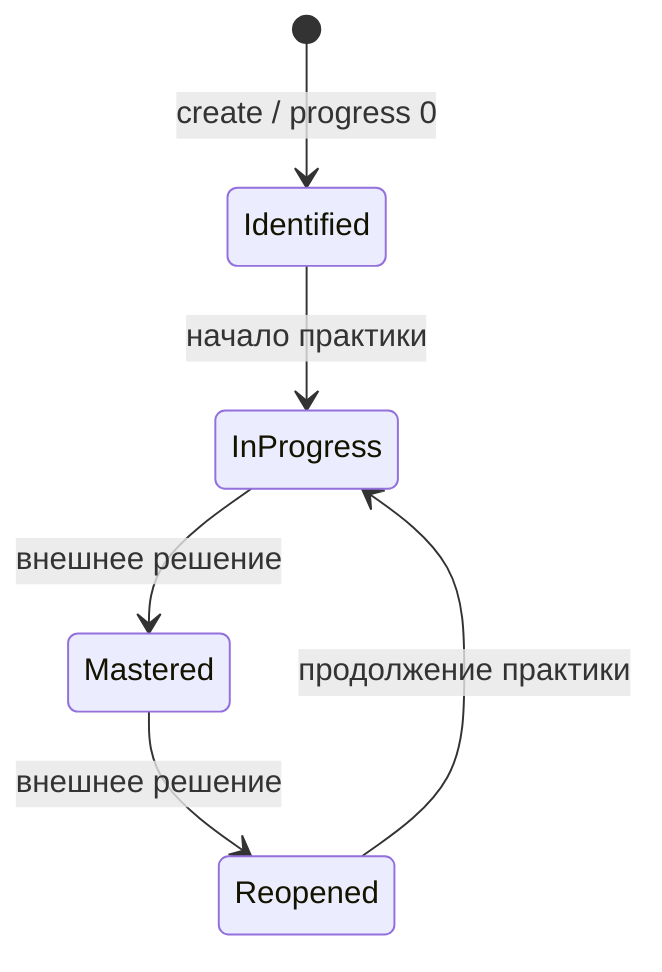

# SP-04 v5.5 — Learning Tasks и жизненный цикл

Дата: 2026-11-16. **Утверждён пользователем после интервью: «Все отлично, давай реализуем». Результат реализации и проверки — в [status.md](../status.md).**

База: `9815aedf598bb24df413d043e25b7fef693f181a` (закоммиченные SP-02/03).
Ветка: `bb/sp-04-learning-tasks-thr_8dgv8pie5x`, отдельный worktree.
Родитель: `thr_3viaq32qtq`. Параллельная SP-05: `thr_c7fehi694g`.

## 1. Цель и результат

Создать устойчивую персональную Learning Task. Она связывает цель ученика с Skill, Topic и Problem,
сохраняет состояние, внешний результат Progress и историю между уроками.
Следующие SP используют один Task ID вместо независимых представлений учебной работы.

Результат SP-04 — проверяемый foundation без AI: создать, прочитать, найти, перечислить и изменить Task.
Это не запуск нового педагогического сценария в Telegram или Mini App.

## 2. Источники и проверенная база

- [Полное ТЗ SP-04, revision 1](https://app.notion.com/p/418045c3d57681c5afa3d3a4c6ed06a4), прочитано 2026-11-16.
- [Implementation Backlog](https://app.notion.com/p/418045c3d57681e0a077f8213d2816c0), 11 волн и барьер после волны 1.
- [E2E Ownership Map](https://app.notion.com/p/419045c3d576810db38ac9d7cd7d6d45), включая уточнения Topic Knowledge и согласия на новые Tasks.
- [v5.5](../product/2026-11-14-personalized-learning-v5.5.md), особенно §6, §8, §12–13.
- [Карта документации](../README.md), [статус](../status.md), [архитектура](../../architecture.md), [AGENTS.md](../../AGENTS.md).

Сверка с кодом базы:

| Контракт | Фактическая реализация | Следствие для SP-04 |
| --- | --- | --- |
| Каталог SP-02 | LearningCatalog/Model, V48/V49; published versions, стабильные ID, Skill у Topic и Problem | Валидировать опубликованную версию и совместимость трёх ID; не добавлять prerequisites |
| Цель SP-03 | StudentLearningState пишет ревизии learning_goal; отдельного goalId нет | Ссылка через student+goalRevision; решение о перестройке маршрута принадлежит SP-08/09 |
| Topic Knowledge | Отдельные student_topic_knowledge и StudentTopicKnowledge | Task Progress и Mastered никогда не записывают Topic Knowledge |
| Доступ | Service token + student scope; новые учебные записи только operator | В SP-04 не открывать запись text/voice модели; будущие интеграции получают отдельное разрешение |
| Надёжность | FoundationService: student lock, operationId, digest, receipts, epoch | Переиспользовать общий путь, добавить expected Task revision |
| Источники | StudentLearningSources проверяет event/observation, владельца, ревизию и срок исходного текста | Не создавать фиктивные Observations; сохранять provenance без копий транскриптов |
| Privacy | StudentLearningPrivacy, FoundationMaintenance, deletion replay | Полный учебный сброс/delete включает Tasks; забывание личного факта не меняет учебную задачу |
| Learning Task | Новая сущность и API отсутствуют в проверенных исходниках | Старые SP-04 scheduling и roadmap JSON не являются реализацией этой задачи |

Это сверка исходников, не повторный запуск тестов и не подтверждение DEV/PROD.
Реальный каталог по status.md ещё ожидает содержательной приёмки/публикации.
Локальные проверки SP-04 используют явно синтетический опубликованный каталог.

## 3. Границы и зависимости

Входит: модель, PostgreSQL, операции и чтение, история, защита от дублей, Python adapter,
изоляция ученика, обработка конкуренции, privacy и регрессионные проверки.

Не входит: генерация Roadmap SP-08, алгоритм приоритета SP-09, прогноз SP-10, UI SP-11,
педагогический Plan/Stages SP-12, контент/уроки SP-13–16, producer Observations SP-17,
Problem Score SP-18, расчёт Progress и mastery SP-19, Review SP-20, Homework workflow SP-21.
Нет новых native tools, автоматического создания задач или миграции прежнего roadmap в Tasks.

SP-05 подтвердил границу 2026-11-16: пишет пользовательские поля SP-03 и согласует Trial;
не создаёт Tasks, не выставляет системный CEFR, Topic Knowledge или Progress.
SP-05 планирует отдельную ограниченную onboarding-команду, без открытия operator API модели.
Схему SP-03 параллельная задача пока менять не планирует.

Потенциально общие файлы: FoundationService.kt, FoundationRoutes.kt, foundation_client.py,
architecture.md и ai_docs/status.md. Изменения каждого SP ограничены его адаптером/dispatch.
Новые доменные файлы и тесты отдельные. Для Tasks выделена V51; SP-05 подтвердил, что миграции ему не нужны.
Общая базовая ветка не меняется; параллельную работу интегрирует родитель по отдельному поручению.

## 4. Предлагаемый контракт

### Идентичность и данные

- Устойчивый Task ID и studentId из scope, не из доверенного модели аргумента.
- Ссылка на goal revision, catalogVersion, skillId, topicId, problemId.
- Task revision, lifecycle, progress 0–100, nullable priority, nullable Plan reference, timestamps.
- Поздние связи с Plan/Action/Homework хранят тип, идентичность и при необходимости ревизию.
  Они не хранят конкурирующие статусы Homework или собственную схему Stage.
- История содержит изменение, прежнее/новое значение, время, component, operation/decision reference и доступные sources.
- Отдельные происхождение/основание и пояснение позволяют будущему UI отличить гипотезу от подтверждённого пробела.
  Новый тип Task для гипотез не вводится.

Создание допускает отсутствие Plan, Actions, Homework и priority. Lifecycle=Identified, Progress=0 задаёт backend.
Каталоговые ID должны существовать в одной опубликованной версии и принадлежать одному Skill.
Создание требует существующую непустую цель ученика; оно не придумывает цель и не меняет SP-03.
Изменение цели само по себе не меняет Tasks. Решение о перестройке маршрута и дальнейшей связи
задач с целью относится к SP-08/09; SP-04 лишь сохраняет переданные изменения и историю.

Предложение по версии каталога: Task остаётся закреплена за версией создания.
Обновление опубликованного каталога не создаёт дубль того же Topic+Problem и не сбрасывает Progress.
Смысл опубликованных ID уже защищён SP-02; старые версии доступны для чтения.

### Lifecycle и Progress

Это предлагаемый допустимый граф, а не новый алгоритм педагогических переходов.
SP-04 проверяет форму команды и переход, SP-19/20 определяют достаточность результата.
Повтор состояния без изменений не добавляет фиктивный переход. Невалидный переход возвращает явную ошибку.
Завершение урока, отказ от Homework и изменение priority ничего не сбрасывают.
Reopened само по себе не обнуляет Progress или Plan. Внешний расчёт может передать новое значение отдельно либо атомарно с переходом.
100% не переводит Task в Mastered автоматически: требуются внешний сигнал и применяющий компонент.
Точная математика и правила повторного прохождения Stage остаются SP-12/19.

### Операции и чтение

Предлагаемые имена, уточняемые инженером при реализации:

| Интерфейс | Содержимое |
| --- | --- |
| command learning.task.create | Goal/catalog references, основание; возвращает новую Task либо явный existing/conflict |
| command learning.task.update | taskId, expectedRevision, ограниченный patch: priority/goal link/plan links |
| command learning.task.transition | taskId, expectedRevision, lifecycle, внешний decision reference, optional Progress |
| command learning.task.progress | taskId, expectedRevision, готовый внешний Progress/result reference |
| GET /learning-tasks | Пагинация, фильтры Topic/Problem/lifecycle, поиск существующей Task, включая Mastered |
| GET /learning-tasks/{id} | Текущее состояние строго в student scope |
| GET /learning-tasks/{id}/history | Пагинация и последовательность ревизий |

Один student lock и транзакция сохраняют состояние, историю и receipt атомарно.
Повтор operationId с тем же вводом возвращает receipt; другой ввод даёт operation_conflict.
Параллельные updates защищает expectedRevision. Повторная команда создания той же активной задачи
не создаёт вторую запись: это защита хранения, а не новое педагогическое обнаружение.
Для ранее освоенной задачи есть поиск и Reopened по внешнему решению, как уже требует ТЗ.
Вопрос о нескольких задачах «навсегда» не вводится как дополнительный продуктовый контракт.
Чужой ID не позволяет прочитать или изменить Task.
Компонент в payload служит атрибуции, а не авторизации.

Запись в первой поставке — только доверенный operator, по аналогии с SP-03.
Будущие SP используют доменные операции из доверенного backend apply, не обходя scope/fence проверки.
Python FoundationClient предоставляет адаптеры; AI не получает их как native tools.
Полный список Tasks не добавляется без необходимости в общий prompt или старый roadmap.

### Privacy и жизненный цикл данных

- Истечение срока исходного транскрипта не удаляет Task и не снижает Progress; доступность источника отражается отдельно.
- learning.forget, student.delete, новый /start и replay deletion ledger очищают Tasks, историю и производные копии.
- Personal forget прекращает использование личного факта. Он не удаляет Task, не меняет её Progress,
  Plan или lifecycle и не создаёт сигнал обязательного пересмотра задачи.
- Если личный факт скопирован в пояснение, убирается этот текст, а не учебная работа.
- История не должна восстанавливать удалённый текст цели, пояснение или личный факт.
- Результаты операций и другие кэши входят в проверку удаления; старый scope не применяет запоздалую запись.

## 5. Этапы после утверждения

1. Получить явное утверждение исправленного плана; инженерные детали ключей и операций выбрать в рамках ТЗ.
2. Добавить Task model/validator, миграцию и отдельный repository/service с историей.
3. Подключить commands/read routes, проверки scope/version/idempotency и FoundationClient.
4. Подключить privacy/reset/deletion replay; проверить отсутствие записи Topic Knowledge и зависимости от Homework.
5. Проверить AC-01–16 на локальном PostgreSQL и реальном HTTP Python → Ktor → PostgreSQL без AI.
6. Обновить architecture.md, README.md и status.md: реализованное, ограничения, фактически выполненные проверки.
7. Передать родителю контракт, изменения общих файлов, матрицу AC и оставшиеся интеграции. Без самостоятельного merge.

## 6. Приёмка и проверки

| Проверка | Ожидаемый результат / AC |
| --- | --- |
| Создание и чтение без AI | Устойчивый ID, валидные ссылки, Identified/0, nullable поздние связи; AC-01–04,11 |
| Неверные ссылки/Skill/чужая цель/черновик каталога | Отклонение без частичной записи; AC-02,14 |
| Полный lifecycle через несколько уроков и рестарт backend | Тот же ID, все переходы и прошлое освоение в истории; AC-05,06,10 |
| Обновление priority/Plan | Не теряются Progress, история и прежние связи; AC-07 |
| Разные Problems одного Topic | Независимые Tasks; AC-08 |
| Повторы create и конкуренция двух операций | Нет скрытых дублей, повтор receipt, явные конфликты; AC-09 |
| Внешний Progress, неверные числа и устаревшие ревизии | Сохранение валидного результата; явное отклонение остальных; AC-12 |
| Homework отсутствует/пропущено, Topic Knowledge Known/Unknown | Ни штрафа, ни автоматической связи с mastery; AC-03,12,13 |
| Cross-student чтение/запись и scope roles | Нет доступа или изменения чужих данных; AC-14 |
| Внешние Plan/Action/Homework references | Одна Task ID; нет второго доменного представления; AC-11,15 |
| Каталог обновлён | История и исходные ссылки читаются, ID не дублируются; AC-02,09,16 |
| Retention, personal forget, learning.forget, /start, deletion replay | Удалённое не возвращается; независимые данные сохраняются |
| Забывание личного факта | Факт больше не используется; Task, её Progress и lifecycle не меняются |

Unit: модель, диапазоны, переходы, patch semantics. DB: constraints, rollback, concurrency, restart и privacy.
HTTP: реальные FoundationClient/Routes/DB, auth и ошибки. Fixtures не выдаются за реальную AI-интеграцию.
Команды после реализации: `pytest` из ai-service; `GRADLE_USER_HOME=$HOME/.gradle ./gradlew :server:test :server:buildFatJar detekt` из cmp;
PostgreSQL/HTTP integration suite по действующей конфигурации проекта; `git diff --check`.
Результаты выполненных проверок публикуются в status.md. DEV readiness и живая приёмка не входят в локальное доказательство.

## 7. Уточнения интервью 2026-11-16

- Пользователь отделил смену цели и решение о перестройке маршрута от SP-04. Вопрос снят из этой задачи.
- Пользователь указал, что личный факт и учебная задача независимы: факт больше не используется,
  но задача не исчезает и не требует пересмотра из-за забывания факта.
- Вопрос о «повторном обнаружении Topic+Problem» был сформулирован неясно; пользователь не выбирал вариант ответа.
  Дополнительное правило не считается согласованным. Для SP-04 достаточно действующего ТЗ:
  защита от скрытого активного дубля и возможность переоткрыть прежнюю освоенную задачу.

Семантика priority, условия Mastered/Reopened, веса Stage и UX Roadmap остаются у владельцев следующих SP.
Неразрешённых продуктовых вопросов, блокирующих foundation SP-04, не выявлено.
Пользователь явно утвердил реализацию после уточнения состава Learning Task.
Commit/push/PR/deploy требуют отдельного поручения.
