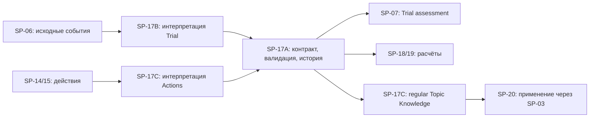

# SP-17A — Observation Contract & Core

Статус: **утверждён пользователем 2026-11-16; core реализован и проверен локально**.
Результаты проверок и границы поставки — в [status](../status.md#новый-sp-17a-observation-contract--core).
Явное утверждение: «Отлично, супер, мне нравится погнали реализовывать план».
Дата: 2026-11-16. База: `origin/bb/sp-02-05-v5-5`, `7e3800b`.
Ветка: `bb/sp-17a-observation-contract-thr_3yyacry6cr`.
Интеграцию ведёт родитель `thr_3viaq32qtq`. Commit/push/PR/deploy не входят в поручение.

## 1. Источники и цель

Прочитаны через Notion MCP:

- [SP-17A](https://app.notion.com/p/41a045c3d57681718aebc2b80ab7f696).
- [SP-17, включая уточнение ownership от 16 ноября](https://app.notion.com/p/418045c3d5768127b1dbcce526d667de).
- [Implementation Backlog](https://app.notion.com/p/418045c3d57681e0a077f8213d2816c0).
- [End-to-End Workflow & Ownership Map](https://app.notion.com/p/419045c3d576810db38ac9d7cd7d6d45).
- Полный файл `Speaky_Personalized_Learning_v5_5.md`, вложенный в [Speaky](https://app.notion.com/p/412045c3d57680fd99b8f5e49553603c), через download reference Notion MCP.

Цель: предоставить проверяемое хранилище и контракт фактических учебных наблюдений.
Потребители различают самостоятельное применение, ошибку, самокоррекцию, помощь и недостаток доказательств.
Одна попытка не становится новым доказательством из-за retry, нового анализатора или исправления классификации.
Unknown Topic/Problem не требует выдуманного каталожного ID.

## 2. Что уже есть в коде

| Компонент | Подтверждённое состояние | Следствие для SP-17A |
| --- | --- | --- |
| SP-02 | Опубликованные версии каталогов, стабильные Skill/Topic/Problem ID; проверка совместимости Skill | Переиспользовать каталог; не создавать темы автоматически |
| SP-03 | Student Learning State; sources `event/observation`; ownership, revision, retention и privacy | Добавить совместимую ссылку на новый тип Observation без изменения смысла старой revision |
| SP-04 | Learning Task, история, goal/catalog refs, lifecycle; непрозрачные Plan/Action/Homework refs | Проверять настоящую Task; не создавать Task и не менять её Progress |
| `memory_observation` | Источник, lesson transcript revision, analyzer version, pattern key, dimension, uncertainty, optional evidence | Это качественный вывод по уроку, не устойчивая попытка применения |
| `FoundationJobs.evaluate` | Проверяет user source и принадлежность уроку; уникальность по lesson/revision/analyzer/key | Новая версия анализа сейчас может создавать новую запись; нельзя использовать её как новое независимое применение |
| `TrialAnalyzer` / `LessonEvidence` | strength/difficulty/neutral, independent/prompted/unknown, проверяемая цитата; ограниченный post-call анализ | Сохранить работающий путь; не выводить отсутствующие признаки из старой записи |

Предлагается отдельное типизированное хранилище доказательств рядом с существующим качественным анализом.
Это не второй педагогический классификатор: SP-17A не вызывает модель.
Автоматический backfill старых observations не входит в работу: неизвестные попытки и самостоятельность нельзя восстановить достоверно.
SP-17B подключит существующий analysis pipeline к новому контракту; SP-17C подключит остальные источники.

## 3. Границы поставки

**Входит:** версия контракта, Kotlin/Python DTO и адаптеры, backend validation, хранение и чтение,
идемпотентность, история интерпретаций/аннулирования, provenance, проверка существующих источников,
совместимость с SP-03/04, privacy, примеры и тестируемый handoff.

**Не входит:**

- SP-17B: извлечение и классификация из реального Trial, модельные prompts и качество tagging.
- SP-17C: реальные Teaching Actions, semantic repetition detection и педагогическая переоценка Topic Knowledge regular уроков.
- SP-06: транспорт, фазы Trial, длительность, завершение и UX звонка.
- SP-12A/B: хранение/генерация Plan, выбор методов и переходы между этапами.
- SP-07: первоначальные CEFR и Topic Knowledge после Trial.
- SP-18/19: формулы, коэффициенты, Score, mastery и повторное прохождение Stage.
- SP-20: применение выводов к состоянию и перестройка следующего шага.
- Новый UI, пользовательский workflow оспаривания, изменение Notion статусов/AC, миграция данных DEV/PROD.

Уточнение ownership в конце SP-17 имеет приоритет над ранним открытым вопросом той же страницы:
SP-17C делает regular Topic Knowledge inference; SP-20 применяет готовый вывод без повторной оценки.
Недостаток evidence сохраняет прежнюю оценку. Числовые критерии Known/Not Known здесь не вводятся.

## 4. Предлагаемый контракт v1

План фиксирует объём и решения интервью. Точный реализуемый wire format — в
[Observation Contract v1](../integrations/learning-observations.md).

| Блок | Содержание и инварианты |
| --- | --- |
| Версия | `schemaVersion=1`; несовместимые версии отклоняются явно |
| Владелец | Student берётся из доверенного scope; ссылки проверяются в том же student scope |
| Событие | `observationId`, `revision`, `occurredAt`, `recordedAt`; время источника отдельно от времени анализа |
| Попытка | `attemptId`, стабильный anchor исходного действия, `evidenceSlot`; identity не зависит от outcome, Topic, версии модели |
| Источники | Один или несколько `{sourceEventId, sourceRevision, role, span?}`; основной ответ ученика и отдельно контекст вопроса/помощи |
| Контекст | `lessonId` для lesson events; `sessionId` при наличии; для будущего Homework возможен источник вне звонка без фиктивного Lesson |
| Каталог | `catalogVersion`, `skillId`, nullable `topicId`, nullable `problemId`; null означает Unknown classification, а не запись каталога `unknown` |
| Работа | nullable `taskId`, `planId`, `planRevision`, `stageId`, `actionId`; связанный Stage требует полного Plan reference |
| Повтор этапа | nullable `stageAttemptId`, отдельный от учебного `attemptId`; владелец создания — будущий SP-19 |
| Педагогический контекст | Teaching Method при наличии; Trial/regular/Homework как источник практики, а не новый Teaching Method |
| Исход | independent correct / uncorrected error / self-corrected error / hinted correct / unresolved / invalid; смешанные признаки не теряются |
| Помощь | independent / hinted / unknown; ссылки на помощь, исходный ответ и исправление; не подразумевается independent по умолчанию |
| Качество | пригодность evidence и reason codes: uncertain ASR, ambiguous interpretation, defective content, missing context, unknown support и др. |
| Confidence | Confidence производителя с происхождением и nullable значением; не подменяет ASR confidence и не вводит согласованный числовой порог |
| Provenance | component/analyzer/model/prompt version при наличии, входные revisions, время анализа, rationale; отсутствующие сведения не выдумываются |
| История | active / superseded / invalidated, reason и previous revision; потребитель получает актуальную интерпретацию и историю отдельно |
| Доступность | source availability/expiry и reference validation status; недоступность материала видна потребителю |

Outcome и помощь хранятся раздельно, чтобы ответ после подсказки не стирал факт исходной ошибки.
Пользователь выбрал сохранение исходной ошибки и результата после помощи в одной попытке;
положительного независимого успеха нет. Коэффициенты остаются SP-18/19.
Отказ ученика, технический обрыв, просмотр контента и Homework Completed не являются педагогической ошибкой или independent success.
Self-report можно сохранить как отдельный вид свидетельства, но нельзя представить как продемонстрированное применение.

### Ограничение ASR: проверено по коду, не продуктовая возможность

В текущем `trial_realtime.py` сохраняется готовый transcript от `gpt-4o-mini-transcribe`.
Ошибка transcription обрабатывается как техническая ошибка. Поиск по активному коду не обнаружил
системы проверки правильности расшифровки по аудио или использования word confidence/logprobs.
Общее предупреждение модели «ASR can be wrong» не является таким детектором.

SP-17A не создаёт детектор ошибок распознавания, повторную транскрипцию или аудиоарбитраж.
Поле неопределённости принимает только явно предоставленный сигнал с происхождением.
Отсутствие сигнала означает «качество распознавания неизвестно», а не «обнаружена ошибка» и не «точно верно».
Само отсутствие числовой ASR confidence не блокирует все наблюдения по транскрипту.
Нельзя помечать грамматически неверный текст как ошибку ASR только из-за его грамматики.
Защита при явно известной ненадёжности проверяется на fixtures; обнаружение скрытых ошибок ASR этим не доказано.
Будущая реальная интеграция таких сигналов относится к SP-17B/C и требует отдельных доказательств.

## 5. Identity, revisions и отсутствие двойного учёта

1. `operationId` защищает повтор команды; стабильная evidence identity отдельно защищает повтор под другим operationId.
2. Повтор той же identity и того же содержания возвращает существующую запись.
3. Та же identity с другим содержанием требует явной revision operation и expectedRevision; иначе conflict.
4. Исправление ASR, outcome или Topic не создаёт новую попытку. Оригинальное происхождение сохраняется.
5. Новый analyzerVersion не создаёт новое доказательство. Переанализ обязан сопоставить прежние anchors.
6. Одна попытка может давать несколько обоснованных аспектов с отдельными source spans.
   Для той же проблемы одно применение не отправляется одновременно в Problem Detection и Stage Progress.
7. Для механического повтора нужна связь с исходным evidence group. SP-17A обеспечивает контракт и исключение повторного учёта;
   распознавание смысловых повторов в речи проверяется в SP-17B/C, а не объявляется решённым уникальным SQL index.
8. API возвращает одну актуальную версию каждого evidence identity. История не является списком новых scoring events.
9. Потребитель хранит обработанную identity/revision и умеет заменить/аннулировать прежнюю интерпретацию.
   Алгоритм пересчёта уже применённого Score принадлежит SP-18/19, не SP-17A.
10. Unknown Topic/Problem не направляется в числовую оценку конкретной проблемы. Последующее уточнение — новая ревизия той же identity.

Маршрут: assessment-only / problem-detection / stage-progress / unresolved.
Это назначение доказательства, не исполнение расчёта. Одного `taskId` недостаточно, чтобы заявить проверенный Stage Progress.
Для непроверенных Plan/Stage refs хранится явный unresolved status; downstream scoring обязан их исключить.
Решение о маршруте фиксируется с контекстом на момент события и не пересчитывается молча из сегодняшнего lifecycle Task.
Полная привязка к реальному Plan/Stage resolver проверяется после объединения SP-12A.

## 6. Согласование волны 2

### SP-06 — `thr_tvbpxhm5dn`

Сосед подтвердил проект транспортного envelope:
`sourceEventId`, lesson/session, role/text/time, scoped provider item ID, final/partial,
audio refs/span/availability, playback/interruption и ASR uncertainty.

- Retry сохраняет source identity. Исправление transcript сохраняет identity и меняет revision.
- Provider item ID уникален в контексте session; reconnect не склеивается по одному provider ID.
- Unknown ASR confidence остаётся null. Фазы/lifecycle/completion идут отдельно от учебного ответа.
- SP-06 подтвердил уточнение после интервью: confidence=null означает неизвестное качество, а не invalid.
  Uncertainty передаётся только при явном сигнале с provenance. Детектор ошибок ASR, logprobs и повторная
  транскрипция не обещаны. Уточнение внесено в план SP-06; runtime соседней задачи этим не изменён.
- Provider turn/item — технический anchor. Связь ошибки, самокоррекции и подсказки определяет SP-17B по evidence.
- SP-06 не создаёт Topic/Problem/CEFR. SP-17A не меняет TrialJournal/TrialCommands/trial_realtime.
- Реальная интеграция этого envelope в Observations — SP-17B; SP-06 и SP-17A собираются независимо.

### SP-12A — `thr_kdrsx7xmdj`

Обе стороны согласовали проект `taskId + planId + planRevision + stageId`; actionId отдельно, nullable.
Student ownership берётся из scope. Plan definition revisions неизменяемы.

- stageId сохраняется при перестановке/изменении веса; новая method или numeric/binary семантика создаёт новый stageId.
- Старые ссылки разрешаются в указанной исторической revision, включая удалённые позже stages.
- Нет automatic retargeting или переноса Score. currentStageId — отдельный cursor.
- stageAttemptId зарезервирован для SP-19; SP-17A не создаёт попыток прохождения Stage.
- SP-12A предоставит historical resolver; до объединения веток SP-17A использует интерфейс и contract fixtures.
- Полное удаление учебных данных удаляет и историю Plan; privacy имеет приоритет над historical resolution.

Соседи подтвердили начало реализации после утверждения своих планов. Точный event mapping и Stage resolver
зафиксированы в [контракте](../integrations/learning-observations.md); реальная интеграция остаётся отдельной проверкой после объединения веток.

## 7. Хранение, API и совместимость

Утверждённые границы реализации:

- Новые `LearningObservationModel`, `LearningObservations`, routes и отдельные Python DTO/fixtures.
- PostgreSQL: стабильные identities, ревизии интерпретации и нормализованные ссылки на источники.
  UNIQUE constraints, student lock и optimistic revision защищают конкурентные записи.
- Родитель зарезервировал **V53** перед созданием migration. Старые миграции не менять.
- Внутренние commands record/revise/invalidate; GET current/list/history с фильтрами lesson/task/skill/topic/problem.
  Страницы ограничены; чтение не создаёт данных. Ответы явно показывают unresolved/invalid/expired.
- В SP-17A запись operator-only; подключение scoped learning job producer и fencing — отдельный интеграционный шаг SP-17B/C.
  Никакого нового native tool с произвольной записью от text/voice модели.
- В SP-03 добавить отдельный source type `learning_observation`, если не найдётся более простой совместимый вариант.
  Его revision — revision нового Observation; прежний `observation` сохраняет смысл lesson source_revision.
- Backend проверяет source ownership, lesson membership, актуальную исходную revision и допустимость spans.
  Каталожные ссылки требуют опубликованной версии и совместимого Skill. Task должна принадлежать ученику и соответствовать предмету observation.
- Не копировать raw transcript в вечную историю. Сохранять anchors/spans и контролировать свободные rationale при privacy cleanup.
- Personal forget очищает зависимые evidence и ссылки во всех ревизиях; независимые данные сохраняются.
  `learning.forget`, новый `/start`, delete и deletion ledger replay включают новые таблицы.
- Истечение retention источника не создаёт новое событие и не продлевает хранение текста.
  Сохранённые учебные выводы SP-03 остаются по существующему контракту; новый анализ без доступного источника не выдаётся за проверенный.

## 8. Порядок реализации после явного утверждения

1. Закрыть вопросы интервью, обновить этот план и получить явное утверждение.
2. Зафиксировать финальные source/Stage DTO с соседями; согласовать shared files и номер миграции с родителем.
3. Добавить schema/DTO/examples и чистую валидацию: outcomes, Unknown, quality, identity, ссылки.
4. Добавить transactional storage, revisions, idempotency, read/history и ограниченные commands.
5. Добавить FoundationClient, source resolver SP-03 и privacy/reset/retention интеграцию.
6. Проверить договорённости на PostgreSQL и HTTP через существующую цепочку источников базы SP-02–05.
7. Проверить сохранность старого post-call analysis и всех затронутых тестов.
8. Обновить architecture/status/README точечно; передать родителю diff, проверки, контракт и ограничения следующей волне.

Предполагаемые общие файлы: `FoundationService.kt`, `FoundationRoutes.kt`, `foundation_client.py`,
`StudentLearningModel.kt`, `StudentLearningSources.kt`, `StudentLearningPrivacy.kt`, maintenance/reset wiring,
`architecture.md`, `ai_docs/status.md`, `ai_docs/README.md`.
Родитель уведомлён о пересечениях. Не редактировать чужие новые файлы и не переносить незавершённые ветки.

## 9. Проверки и acceptance

| Проверка | Ожидаемый результат |
| --- | --- |
| Trial/Exercise fixtures, все четыре Teaching Methods | Один формат; наличие метода не означает успех |
| independent/error/self-corrected/hinted/unknown support | Смысл различается; нет hinted-as-independent |
| ASR uncertain / defective content / refusal | Нет уверенной ошибки или независимого успеха без основания |
| Duplicate source, replay, новый operationId, concurrent writes | Одна identity; одна текущая интерпретация; deterministic conflict при несовместимых данных |
| Исправление transcript/Topic/outcome | История сохранена; старая версия не считается второй попыткой |
| Несколько аспектов и механический повтор | Обоснованные аспекты допустимы; повтор и одна проблема не удваивают начисление |
| Unknown Topic/Problem | null принят; выдуманный/чужой/несовместимый ID отклонён |
| Чужой Student/Lesson/Source/Task | Доступ и запись отклонены |
| Historical Plan/Stage fixture | Ссылка сохраняет revision; без resolver не выдаётся за проверенный Stage Progress |
| SP-03 source compatibility | Новый source разрешается; старые refs продолжают работать; provenance не обрывается |
| Expiry/personal forget/reset/delete/replay | Нет утечки текста или восстановления удалённого evidence; независимые данные сохранены |
| Snapshot до/после Observation write | CEFR, Topic Knowledge, Task Progress и lifecycle не меняются |
| Существующий post-call анализ | Прежние вызовы, источники и качественные результаты продолжают работать |

Команды после реализации: Python `pytest` из `ai-service/`; Kotlin `:server:test :server:buildFatJar detekt`
из `cmp/` с `GRADLE_USER_HOME=$HOME/.gradle`; PostgreSQL integration и HTTP Python → Ktor → PostgreSQL;
`git diff --check`. Тесты используют отдельный временный PostgreSQL и синтетический каталог.

Contract fixtures подтверждают формат и инварианты, но не качество реального ASR/tagging или Trial → Observation.
Живая интеграция Trial остаётся SP-17B; Actions — SP-17C; реальный Score — SP-19B.
Не заявлять эти AC выполненными только на основании unit/mock тестов SP-17A.

## 10. Интервью: решения и уточнение границ

Первый раунд проведён через AskUserQuestion. Ответы пользователя:

1. **Согласовано:** ошибка → подсказка → правильный ответ сохраняются в одной попытке.
   Исходная ошибка не теряется; ответ после помощи не считается самостоятельным успехом.
2. **Согласовано:** единица доказательства — осмысленное применение с отдельным фрагментом источника.
   Несколько независимых применений в одной реплике допустимы; механические повторы не добавляют доказательств.
3. **Замечание пользователя:** сначала доказать, что система умеет обнаруживать ошибку распознавания;
   без такого механизма вопрос о поведении при обнаружении создаёт ложное представление о функциональности.
   Проверка кода не обнаружила такого механизма. В план добавлено ограничение ASR выше;
   выбор «сохранять сомнительную заметку» не считать утверждённым.
4. **Согласовано после объяснения:** исправлять наблюдение с историей. Уточнение той же попытки
   заменяет прежний вывод для дальнейшей оценки, не создаёт второе доказательство.
   Это не утверждение обязательного повторного анализа каждого звонка.

Дальнейшие вопросы задавать через конкретные случаи ученика: что произошло, что Speaky запомнит,
как это повлияет на оценку и план. Не считать просьбу об объяснении выбором рекомендованного варианта.
Повторный анализ — возможность исправить ранее сделанный вывод при уточнении того же материала,
а не утверждённый обязательный дополнительный прогон после каждого звонка.

После уточнения ASR пользователь одобрил результат этапа как журнал успехов/ошибок с источниками,
подсказками, без дублей и с историей исправлений, затем явно поручил реализацию.

## 11. Handoff следующей волне

- Версионированные DTO, словарь полей и коды отказов.
- JSON примеры: самостоятельный успех, самокоррекция, помощь, uncertain ASR, Unknown, revision, invalidation, repeat.
- Правила identity/retry/reanalysis и обязательства consumer по замене старой revision.
- Source envelope SP-06, historical Stage reference SP-12A и явные границы unresolved references.
- API/permissions, проверка PostgreSQL/HTTP и сценарии privacy.
- SP-17B/C получают core без нового классификатора; SP-07/18/19 получают evidence без готового CEFR/Score.
- Отдельный список непроверенного: живое извлечение, педагогическое качество, настоящий Plan resolver до интеграции, live scoring.

Утверждение плана: **получено 2026-11-16**. Разрешена реализация и проверка SP-17A.
Commit/push/PR/deploy не разрешены; интеграцию ведёт родитель.
