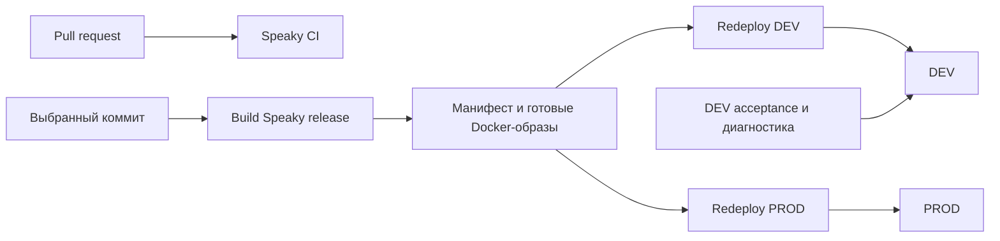

# CI/CD Speaky

Статус: архитектура и реализация в PR #58 к `dev`, 22 ноября 2026 года.
Порядок активации описан в [инструкции по эксплуатации](../integrations/operations.md#активировать-выкладку-готовых-образов).

**Redeploy DEV** и **Redeploy PROD** получают готовый релиз, выкладывают выбранные компоненты в своё окружение и подтверждают, что они работают. CI проверяет исходники. Build собирает Docker-образы. Операторские workflow запускаются отдельно. Android, iOS и Desktop исключаются из всех активных workflow.

## Что сейчас смешано

Проверены GitHub Actions, `main` на `d5f88b17` и ветка PR #58 на `b3d55d9c`.

| Сейчас | Что это означает |
| --- | --- |
| [Redeploy DEV](../../.github/workflows/redeploy.yml) содержит 167 строк на `main` и 752 строки в PR #58 | Workflow собирает и выкладывает приложение, запускает DEV-проверки и обслуживает каталог, Voice, диагностику и STT-бенчмарк. [Запуск 44953800896](https://github.com/greenblat17/1billion-dollar-startup/actions/runs/44953800896) выложил Ktor и AI. [Запуск 44952528909](https://github.com/greenblat17/1billion-dollar-startup/actions/runs/44952528909) успешно проверил доставку Roadmap без выкладки. |
| [Redeploy PROD](../../.github/workflows/redeploy-prod.yml) повторяет тестирование и упаковку Ktor и AI | И DEV, и PROD заново готовят JAR и Python runtime. [Скрипты Ktor](../../infra/server/deploy-remote.sh) и [AI](../../infra/ai-service/deploy-remote.sh) дополнительно собирают Docker-образы на серверах. PROD принимает выбранный ref. История содержит успешную [выкладку с feature-ветки](https://github.com/greenblat17/1billion-dollar-startup/actions/runs/41909802555). |
| [CMP](../../.github/workflows/cmp.yml) ведёт Ktor и три клиентские платформы | CI выполняет Android, iOS и Desktop задания, собирает клиентские пакеты и удаляет старые артефакты. Ktor сейчас нужен в продукте вместе с `cmp/core`. |
| [Mini App DEV](../../.github/workflows/deploy-mini-app.yml) имеет свой ручной вход, повторяет тесты и сборку, обновляет Caddy | В общем DEV workflow выкладка AI при выборе обоих компонентов зависит от Mini App. Ktor может выкатываться параллельно. Общего окна для согласованной выкладки трёх компонентов нет. |
| Поставка сервисов также меняет инфраструктуру | [Ktor-скрипт](../../infra/server/deploy-remote.sh) запускает обновление PostgreSQL и мониторинга. [AI-скрипт](../../infra/ai-service/deploy-remote.sh) обновляет Alloy и ограничение порта. Mini App меняет edge-конфигурацию. |
| `main` и работающий с v5.5 контур имеют разные точки входа | На `main` AI image запускает `app.main:create_app`. В ветке v5.5 он запускает `app.speaky_main:create_app`, а Ktor использует Foundation. Последний найденный [PROD run 41917061813](https://github.com/greenblat17/1billion-dollar-startup/actions/runs/41917061813) собрал Ktor и AI из `main`. Это история Actions. Состояние живых PROD-хостов в этом аудите не проверялось. |

На момент аудита GitHub API показал отсутствие правил для `main` и пустые protection rules у `deploy-dev` и `deploy-prod`. Отдельный environment `deploy` с ревьюерами не защищает задания, которые обращаются к `deploy-prod`.

В реестре Actions ещё числится активным исторический workflow [Probe chat](https://github.com/greenblat17/1billion-dollar-startup/actions/runs/36151387266). Его файла нет в деревьях проверенных веток. При переходе проверьте оставшиеся ветки и старые ручные входы.

Панель Speaky в BB отправляет `ref`, `cmp_server` и `ai_server` напрямую в Actions. Это найденный внешний потребитель текущего контракта. Панель должна выбирать готовый релиз и передавать его ID и состав.

## Выбор схемы

1. **Общие build jobs внутри каждого Redeploy.** Меньше YAML за счёт `workflow_call`, но каждый повтор выкладки снова собирает программу. У DEV и PROD могут оказаться разные образы одного коммита.
2. **Одна сборка, две независимые выкладки.** Build публикует релиз. Оба Redeploy загружают этот же набор образов по ID. Повторная выкладка и перенос проверенного релиза используют те же байты.

Выбираю второй вариант. Хранение первой версии проекта можно сделать на GitHub Actions artifacts. Существующие SSH и Docker на хостах подходят для доставки готовых образов. GHCR можно рассмотреть отдельно, если хранение и пересылка архивов станут ограничением.



## Основные workflow

| Workflow | Запуск | Ответственность |
| --- | --- | --- |
| **Speaky CI** · `ci.yml` | Pull request, стабильный итоговый check | Отдельные jobs для Ktor (`:server:test`, detekt для серверной области и `core`), Python (`pytest`), Mini App (тесты и статический HTTP smoke) и Foundation (Ktor ↔ Python ↔ PostgreSQL). Проверки конфигурации затрагивают также общие контракты, каталог, Dockerfile и сами workflow. Без deploy credentials. |
| **Build Speaky release** · `build-release.yml` | Push в `main` и ручная сборка конкретного коммита из этого репозитория для DEV | Общие CI jobs проверяют ровно SHA сборки. Workflow собирает релизные Docker-образы Ktor, AI и Mini App применимого состава. Публикация манифеста возможна только после успешных проверок и сборки всего заявленного состава. |
| **Redeploy DEV** · `redeploy.yml` | Вручную, `release_run_id` и `components` | Выкладывает готовые образы Ktor, AI и Mini App на DEV. Выбор отдельного компонента работает через ту же кнопку. Использует environment `deploy-dev`. |
| **Redeploy PROD** · `redeploy-prod.yml` | Вручную, `release_run_id` и `components` | Выкладывает готовые Ktor и AI из проверенного релиза `main`. Поддержка Mini App для PROD появляется после отдельной готовности edge и согласования вывода Mini App. Использует environment `deploy-prod`. |

Для CI и Build используются общие reusable jobs. PR-проверки и релизная сборка дают свои результаты. Запуск Redeploy только читает результат сборки. Стабильный check CI завершается и при пропуске тяжёлых jobs для не относящихся к ним изменений. Ошибка или неожиданный пропуск обязательного job блокирует успешный итог.

`cmp.yml`, `bake-client-api-url`, macOS/Kotlin Native cache и клиентские пакеты выводятся из активного CI. Серверный setup на JDK 21 и Gradle сохраняется. Репетиция исторического TutorStore import работает как отдельная ручная проверка на временных PostgreSQL и Redis, если она нужна для cutover. Существующие проверки совместимости сохраняются, пока их потребители работают.

## Контракт релиза и выкладки

```text
Release {
  schema_version, source_sha, runtime_family,
  build_run_id, build_run_attempt,
  images: { component -> artifact_id, sha256, image_id, platform }
}

Redeploy DEV  (release_run_id, components = all)
Redeploy PROD (release_run_id, components = all)
```

- `all` означает утверждённый состав релиза для окружения. Для DEV это Ktor, AI и Mini App. Для PROD на первом этапе это Ktor и AI. Обязательная компонента, которой нет в релизе, останавливает запуск до изменений на хостах.
- Redeploy проверяет репозиторий, ID разрешённого Build workflow, успешный run, попытку, исходный SHA, состав и контрольные суммы. Оператор выбирает ID сборки. Workflow и скрипты выкладки запускаются с доверенного `main`. В манифесте и runtime labels используется SHA собранного исходника. При ручной сборке он может отличаться от SHA workflow. Релиз содержит только образы и манифест. Просроченный артефакт останавливает выкладку до SSH. [GitHub Actions artifacts](https://docs.github.com/en/actions/tutorials/store-and-share-data).
- PROD принимает релиз, построенный для точного SHA прошедшего `push` в `main`. Кандидат должен пройти техническую выкладку на DEV с тем же набором образов для продвигаемых компонентов. Для частичной выкладки проверяются совместимость с остающимися версиями и семейство runtime. Если DEV использует Foundation, а PROD использует legacy, продвижение блокируется до согласованной подготовки совместимого стенда или cutover PROD.
- Build выполняет код кандидата с read-only правами и без SSH или runtime secrets. Для DEV допустим артефакт из проверенного коммита ветки этого репозитория. Проверка доверия кандидату обязательна до запуска его образов рядом с DEV-секретами. Выкладка читает SSH и конфигурацию из своего environment. Для PROD предлагаю доступ к environment только с `main` и подтверждение ревьюера. Для обоих окружений нужны pin SSH host keys и проверка доступа к защищённому `main`. При переносе секретов из repository scope убрать старую копию после миграции потребителей. [GitHub environments](https://docs.github.com/en/actions/how-tos/deploy/configure-and-manage-deployments/manage-environments).
- Preflight проверяет доступ к выбранным хостам, конфигурацию, платформу, готовность базы и совместимость состава. Сначала доставляются и проверяются все выбранные образы. Затем для Foundation базовый порядок — Ktor → AI → Mini App. Выкладка одного компонента проверяет его связи с действующими версиями остальных.
- Один lock на окружение покрывает выкладку, проверку и восстановление. Изменения тех же контейнеров или общей конфигурации из операторских workflow используют тот же lock. В GitHub используйте очередь окружения без отмены текущей выкладки. Удалённый скрипт держит блокировку на время изменений, чтобы повтор по SSH после обрыва учёл фактическое состояние. [GitHub Actions concurrency](https://docs.github.com/en/actions/how-tos/write-workflows/choose-when-workflows-run/control-workflow-concurrency).
- В Redeploy остаётся только технический smoke выкладки. Проверяются readiness, версия запущенного образа, доступ к зависимостям, авторизация Ktor ↔ AI и доступность Mini App через edge для затронутых компонентов. Проверки используют запросы без LLM, урока, платежа и сообщений в Telegram. Отчёт фиксирует старую и новую версию и результат каждого компонента.
- Перед заменой сохраняются предыдущие образы и конфигурация запуска. При сбое верните затронутые компоненты, если предыдущая версия совместима с применённой схемой PostgreSQL. Если совместимость не подтверждена, остановите дальнейшие переключения и покажите точный частичный результат. Дальнейшее восстановление следует утверждённому плану миграции. Flyway-миграции приложения остаются частью запуска приложения.

## Отдельные операторские workflow

| Workflow | Что переезжает |
| --- | --- |
| **DEV acceptance** | Текстовые сессии, Foundation-сценарии и Voice на уже работающем DEV. Указать ожидаемые ревизии, сценарий и допустимое число попыток. Controlled audio готовится в отдельном job без доступа к DEV. Проверки с оплатой запускаются явно. |
| **DEV diagnostics** | Readiness без выкладки, корреляция логов по ID и технические read-only probes. |
| **DEV speech benchmark** | Отдельный ручной замер на действующем AI. |
| **Catalog DEV release** | Использовать существующий [catalog-dev-release.yml](../../.github/workflows/catalog-dev-release.yml) для проверенного манифеста, импорта и публикации. Убрать повтор из Redeploy. |
| **DEV test config** | Ограниченное по времени включение и выключение `agent_test` и mock billing с обновлением нужной runtime-конфигурации. Обычная выкладка использует действующую конфигурацию окружения. |
| **Infrastructure maintenance** | По отдельной операции или runbook обновлять PostgreSQL, Alloy, мониторинг, edge, TLS/CA и правила порта. Redeploy сохраняет рабочие сетевые и storage mounts и проверяет инфраструктурные зависимости до замены приложения. |

Репозиторий публичный. В Actions публикуются образы без конфигурации окружений и технические итоги без персональных данных. Транскрипты, WAV и сырые диагностические данные требуют закрытого хранилища. [Доступ к артефактам GitHub Actions](https://docs.github.com/en/actions/how-tos/manage-workflow-runs/download-workflow-artifacts).

## Порядок перехода

1. Подготовить смену контракта панели Speaky в BB вместе с Redeploy. Проверить CLI и сценарии агентской приёмки, которые используют старые inputs. Вывести платформенные CI jobs. Собрать релиз и доказать, что CI и Build не используют deploy secrets. Зарегистрировать новые ручные workflow на `main` без запуска выкладки.
2. Перенести DEV acceptance, диагностику и каталог. Переключить DEV на новый Redeploy и закрыть старые ручные пути, включая второй вход для Mini App. Проверить на DEV полную и частичную поставки, повтор по тому же ID, конкурирующие запросы, отказ readiness и восстановление. Проверить совместимость при смешанных версиях и отклонение отсутствующего, просроченного или неподходящего релиза до SSH.
3. Проверить фактический PROD baseline, правила GitHub, готовность PostgreSQL, import marker, каталог, edge и совместимость предыдущей версии. Переключить механику PROD на готовые образы отдельным изменением от cutover на Foundation. До согласования cutover PROD принимает только совместимое с подтверждённым baseline семейство. Подготовить план первой выкладки без жёсткой привязки к SHA последнего исторического run.
4. После подтверждения перехода удалить заменённые workflow и параметры. Обновить [operations](../integrations/operations.md) и [агентскую приёмку](../integrations/agent-acceptance.md) по реально работающему контракту.

Критерии завершения: у DEV и PROD по одному входу для выкладки. Оба используют проверяемые образы из Build и завершаются с точным фактом о состоянии компонентов. CI и операторские проверки запускаются самостоятельно. Ни один активный workflow не собирает Android, iOS или Desktop.
