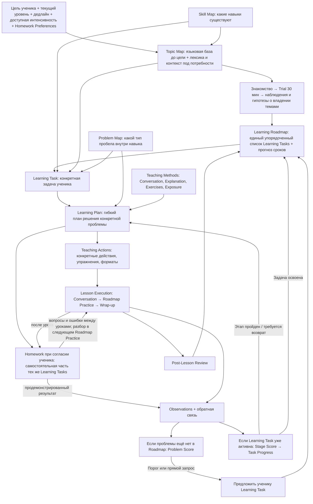
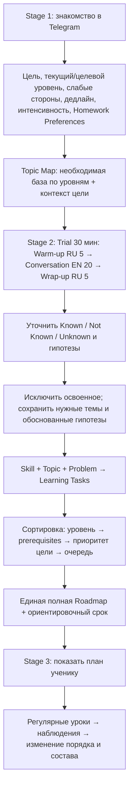
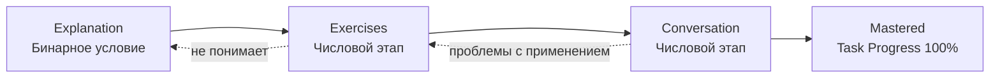
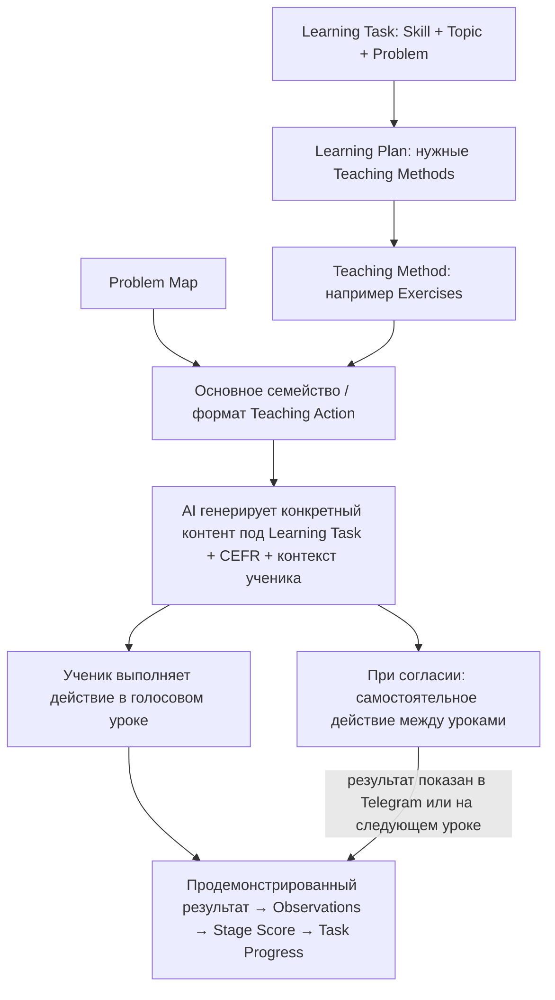
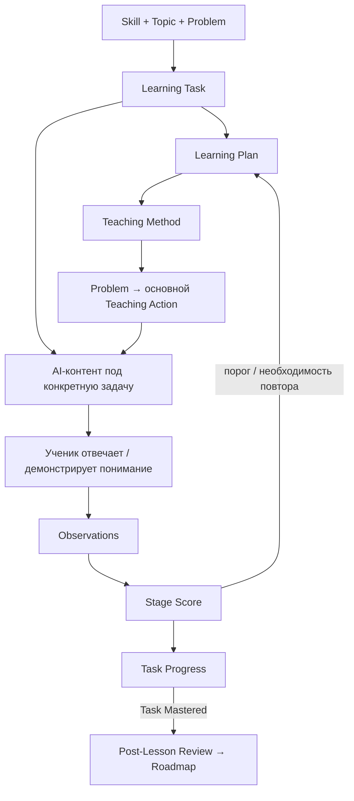
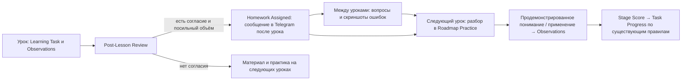

# Speaky — Personalized Learning System

**Product Specification · v5.5**

**Дата:** 14 ноября 2026

**Статус:** концептуальная архитектура, Lesson Execution (regular и trial), Learning Content, Homework и базовая логика Roadmap Generation согласованы; числовые параметры экспериментальные
**Тип:** продуктовая спецификация, без привязки к технологиям

> **Главная идея.** Speaky — AI-репетитор, который системно решает языковые проблемы ученика. Каждая учебная задача имеет понятное происхождение, метод решения, наблюдаемый результат и условия завершения. Содержание урока формируется из задач, а результаты урока изменяют дальнейший план.

---

## 1. Система целиком: всё логически связано

**Цепочка создания задачи:**

**Student Goal → Skill → Topic → Problem → Learning Task → Learning Plan → Teaching Methods → Teaching Actions → Lesson → Observations → Task Progress / Problem Detection → Roadmap Update.**

Не все элементы — последовательные «экраны» или отдельные режимы. Skill Map, Topic Map, Problem Map и Teaching Methods — общие каталоги Speaky. Roadmap и Learning Tasks — индивидуальные для ученика. Lesson использует выбранные действия, а наблюдения замыкают цикл.

### Что решает каждый компонент

| Компонент | Один ключевой вопрос | Что он передаёт дальше |
|---|---|---|
| Student Profile & Goal | Зачем человеку английский, откуда стартует, когда хочет результат? | Цель, уровень, боли, ограничения, согласие на Homework и доступный объём |
| Skill Map | Какой языковой навык развиваем? | Skill |
| Topic Map | Какую конкретную тему/способность изучаем? | Topic с уровнем CEFR |
| Problem Map | Что именно не получается с этой темой? | Тип проблемы |
| Learning Task | Какую задачу ученик должен решить? | Skill + Topic + Problem + приоритет |
| Learning Plan | Какими этапами устраним проблему? | Выбранные Teaching Methods и условия |
| Teaching Methods | Каким педагогическим способом работаем? | Conversation / Explanation / Exercises / Exposure |
| Teaching Actions | Что именно делает репетитор на уроке? | Конкретная практика/объяснение/задание |
| Homework | Какую часть Learning Plan ученик готов выполнять между уроками? | Посильные задания по тем же Learning Tasks; вопросы и ошибки к следующему уроку |
| Observations | Что реально получилось или не получилось? | Свидетельства и обратная связь |
| Problem Score | Достаточно ли оснований предложить **новую** задачу? | Предложение Learning Task |
| Stage Score | Насколько успешно выполняется текущий числовой этап? | Продолжение / следующий этап / возврат |
| Task Progress | Насколько выполнена **конкретная** учебная задача? | Прогресс 0–100%, Mastered |
| Post-Lesson Review | Что делать дальше? | Обновлённая Roadmap |

---

## 2. Продуктовый фокус и границы MVP

**Полная Skill Map:** Speaking, Listening, Grammar, Vocabulary, Reading, Writing.

**MVP:** Speaking, Listening, Grammar, Vocabulary. Ценность продукта сосредоточена на свободной разговорной речи и понимании собеседника; Grammar и Vocabulary служат её фундаментом.

- **Fluency** рассматривается внутри Speaking, не как отдельный верхнеуровневый Skill.
- **Pronunciation** пока не включено в обязательную специализацию из-за сложности качественной оценки и тренировки.
- **Reading и Writing** остаются в долгосрочной модели, но исключаются из первоначального фокуса реализации.
- Цель ученика **не меняет Skill Map**, а определяет приоритеты, контекст и необходимый материал.

### Skill Map

| Skill | Что развиваем |
|---|---|
| Speaking | Свободное самостоятельное выражение мыслей в речи |
| Listening | Понимание устного английского |
| Grammar | Знание и применение конструкций |
| Vocabulary | Понимание и самостоятельное употребление слов и выражений |
| Reading | Понимание письменного английского |
| Writing | Создание письменных высказываний и текстов |

---

## 3. Topic Map: ось Skill × ось CEFR

**Topic Map — универсальный каталог потенциальных учебных тем / способностей.** Две основные оси: **Skill** (для MVP четыре) и **уровень CEFR A1–C1**. Пересечение содержит Topics.

Topic — **не** Learning Task. Одна и та же тема может породить разные задачи в зависимости от Problem (например, не знает Present Perfect / знает, но ошибается).

### Предварительный каркас Topic Map для MVP

| Level | Grammar | Vocabulary | Speaking | Listening |
|---|---|---|---|---|
| **A1** | *to be*, Present Simple, простые вопросы и отрицания, базовый Present Continuous | семья, повседневные действия, еда, базовые глаголы | представиться, ответить на простые вопросы, описать знакомое | простые фразы, медленные инструкции |
| **A2** | Past Simple, Past Continuous, будущие формы, сравнения, базовое знакомство с Present Perfect | путешествия, покупки, работа — основы, бытовые выражения | рассказ о прошлом, планы, короткий диалог | короткие бытовые диалоги и истории |
| **B1** | Present Perfect vs Past Simple, условные предложения, relative clauses, базовый passive | общение на работе, phrasal verbs, collocations, мнения | неподготовленный разговор, рассказ, выражение мнения | основная мысль связной речи |
| **B2** | Past Perfect, Reported Speech, advanced passive, conditionals | абстрактная и профессиональная лексика, идиомы, устойчивые выражения | аргументация, продолжительное обсуждение | естественный темп, сложные объяснения |
| **C1** | inversion, cleft sentences, advanced modality | оттенки значений, стиль, сложные collocations | точное и гибкое выражение сложных мыслей | беглая речь, неявный смысл, вариативность акцентов |

**Важные границы:** это **первичный каркас Speaky**, а не нормативный список CEFR. CEFR прежде всего описывает наблюдаемые языковые способности, а не обязательный точный набор слов и грамматических тем. Тема может встречаться на нескольких уровнях с разной глубиной.

**Подтемы не обязательны.** Большой Topic, например Work Communication, может охватывать несколько занятий. Не требуется автоматически создавать отдельную Topic или Task для каждого слова/упражнения. Конкретный учебный материал выбирается на уровне Learning Content / Teaching Actions.

### Состояние Topic у ученика

- **Known** — есть основания считать тему освоенной.
- **Not Known** — есть основания считать, что тема требует изучения.
- **Unknown** — данных недостаточно.
- **Presumed Not Known** — рабочая гипотеза по текущему уровню и траектории обучения, **не доказанный пробел**.

**Релевантность цели** определяется отдельно от владения темой: ученик может не знать тему, которая сейчас ему не нужна. При цели «B2 для работы» Speaky подбирает необходимую общую языковую базу до B2 и делает упор на рабочую лексику, контексты и практику; это не означает обучение только узким рабочим темам. Непроверенные темы не выдаются за подтверждённые проблемы.

---

## 4. Problem Map: тип проблемы определяет педагогический путь

**Правило:** делим проблемы на категории, если это меняет процесс обучения; не создаём искусственные подкатегории ради детализации.

| Skill | Problem | Суть |
|---|---|---|
| Speaking | Языковой барьер | Не хватает самостоятельной свободной разговорной практики, уверенности, автоматизма |
| Listening | Недостаточное понимание устной речи | Трудно понимать обращённую речь |
| Grammar | Не знает конструкцию | Требуются объяснение и начальное освоение |
| Grammar | Знает, но ошибается в применении | Требуется закрепление / перенос в свободное использование |
| Vocabulary | Недостаточный пассивный словарь | Не узнаёт и не понимает нужную лексику |
| Vocabulary | Недостаточный активный словарь | Знакомые слова не извлекаются и не применяются самостоятельно |
| Reading | Недостаточное понимание текста | Плохо извлекает смысл письменного материала |
| Writing | Сложности с предложениями | Трудно самостоятельно формулировать мысли письменно |
| Writing | Сложности со связным текстом | Трудно строить последовательный текст |

**Девять рабочих категорий**, четыре Skill в MVP. Не дублируем грамматическую проблему внутри Speaking только потому, что она проявляется в разговоре.

---

## 5. Teaching Methods → Teaching Actions

**Четыре метода верхнего уровня** — инструменты обучения, а не отдельные постоянные режимы урока.

| Teaching Method | Функция | Teaching Actions — примеры |
|---|---|---|
| **Conversation** | Естественное применение языка | Free Conversation, Guided Conversation, Role Play, исправления в контексте |
| **Explanation** | Объяснение нового или непонятного | Разбор правила, значения слова, ошибки; примеры, уточняющие вопросы |
| **Exercises** | Целенаправленное закрепление | Sentence Construction, Sentence Transformation, Sentence Correction, Word Recall, Meaning Recognition, Listening Reconstruction и другие голосовые форматы |
| **Exposure** | Восприятие языка в контексте | Прослушивание диалога/истории, чтение, знакомство с выражениями в контексте |

*Corrective Feedback, Adaptive Difficulty и Context Awareness* действуют сквозным образом, а не считаются самостоятельными основными методами.

**Teaching Action** — конкретное действие, выбранное внутри метода. Не нужно заранее закреплять все Actions на месяцы: их можно выбирать при подготовке урока или адаптации внутри занятия.

---

## 6. Learning Roadmap: полный упорядоченный путь до цели

**Roadmap — индивидуальная, динамическая программа от текущей точки до цели в виде единого упорядоченного списка Learning Tasks.** Не создаём отдельных типов сущностей «предварительная задача» и «активная задача». Задачи могут находиться дальше или ближе в очереди, получать приоритеты и менять состояние по уже согласованному жизненному циклу.

Она включает:
1. **Learning Goal** — долгосрочную цель ученика.
2. **Полный предполагаемый путь** — темы и Learning Tasks, необходимые для достижения целевого уровня с учётом заявленной практической цели.
3. **Порядок и приоритет каждой задачи** — какие темы нужны раньше и почему.
4. **Прогноз срока** — ориентир с учётом текущего/целевого уровня, интенсивности и доступного времени.
5. **Историю** — освоенные, отложенные и возвращённые в работу задачи.

**Единый список не означает, что все Tasks изучаются одновременно.** Репетитор выбирает следующую подходящую задачу из Roadmap в порядке приоритетов и необходимых предпосылок; при необходимости несколько задач могут развиваться параллельно (например, постоянная практика Speaking и одна тема Grammar). Для этого не нужна дополнительная классификация задач на «предварительные» и «активные».

Roadmap не является застывшим календарём: наблюдения с уроков позволяют исключать уже освоенное, добавлять выявленные пробелы и пересматривать порядок. Непроверенное нельзя представлять как достоверно незнакомое ученику.

Цели и необходимые Learning Tasks не меняются из-за выбора Homework. Меняется распределение работы между уроком и самостоятельной практикой: без Homework весь необходимый материал, объяснения и упражнения проходят на занятиях. Поэтому согласие на самостоятельную работу и доступное время учитываются при оценке сроков, а не превращаются в условие доступа к Roadmap или прогрессу.

### Шесть принципов

| Принцип | Значение |
|---|---|
| **Goal-driven** | Следуем целям и потребностям ученика |
| **Prerequisite-aware** | Учитываем базовые знания, без которых задача не имеет смысла |
| **Evidence-driven** | Опираемся на реальные уроки и обратную связь |
| **Adaptive** | Меняем приоритеты и план при новых данных |
| **Iterative** | Возвращаем ранее освоенные темы при повторных проблемах |
| **Effectiveness-driven** | Меняем способ преподавания, если ученик не достигает ожидаемого результата |

### Правила выбора и сортировки Topics / Learning Tasks

1. **Берём текущий и целевой CEFR** и составляем предполагаемый набор необходимых тем между ними для Grammar, Vocabulary, Speaking и Listening. Не требуется проходить каждую возможную тему из каталога: выбираем необходимую языковую базу для целевого уровня.
2. **Учитываем реальную цель:** например, для B2 на работе нужна общая компетенция B2, а Vocabulary и учебные ситуации имеют профессиональный фокус. Цель влияет на контент и приоритеты, не заменяя базовое обучение узкой специализацией.
3. **Сверяем владение:** явно освоенные Topics пропускаем; подтверждённые пробелы включаем; по необходимым, но ещё не проверенным Topics допускаются гипотезы в полном маршруте — не выдаём их за подтверждённую диагностику.
4. **Сортируем от базового к сложному:** темы текущего/ближайшего уровня раньше следующих, необходимые предпосылки — раньше зависящих от них тем. Если обнаружен пробел более раннего уровня, он может подняться в приоритете.
5. **Учитываем приоритет цели** внутри уровня. При равных приоритетах последовательно идём по списку; не требуется отдельный сложный механизм «активации».
6. **Уточняем в ходе занятий:** после уроков корректируем список, порядок и состояния задач на основании Observations и обратной связи.

Это согласованная **продуктовая логика**, а не утверждение, что мы уже заполнили полный каталог Topics и всех prerequisite-связей.

### Приоритеты и сроки

Приоритет определяется уровнем, необходимыми предпосылками, потребностями ученика и влиянием темы на цель. Внутри одинакового приоритета можно идти последовательно. **Дедлайн меняет интенсивность, очередность и реалистичный прогноз, но не гарантирует достижение уровня за произвольный срок.**

Roadmap показывает весь предполагаемый путь и ориентировочную дату достижения цели. Если ученик хочет достичь результата раньше прогноза, Speaky наглядно показывает разницу и рекомендует возможное изменение интенсивности без обещания гарантии.

Ориентиры времени первоначально можно брать из обоснованных справочных диапазонов учебных часов между уровнями, уточняя их позже на реальном темпе ученика. Прогноз учитывает частоту и длительность уроков и согласованный объём самостоятельной работы. При отказе от Homework прогноз пересчитывается с учётом времени, которое потребуется на те же этапы Learning Plan во время уроков; фиксированного коэффициента ускорения или замедления нет.

---

## 7. Roadmap Initialization: знакомство → пробный урок → персональный план

### Знакомство

Узнать:
- **зачем** английский (работа, переезд, учёба, путешествия, для себя и др.);
- **самооценку текущего уровня** A1–C1 (или «не знаю») и **целевой уровень/результат**; что страдает — Speaking / Listening / Grammar / Vocabulary;
- **дедлайн**, если он есть;
- **доступную интенсивность** — сколько и как часто ученик может заниматься;
- **готовность заниматься самостоятельно между уроками** и **посильный объём Homework**.

Самооценка — гипотеза, а не факт. Отказ от Homework допустим: учитель не назначает самостоятельную работу вопреки выбору, а переносит материал в уроки и учитывает это в прогнозе.

### Пробный урок (Trial Lesson) и оценка Topics

**Trial Lesson — самостоятельный пользовательский сценарий, отличный от регулярного урока.** Его цель — создать комфортный первый опыт общения с репетитором, увидеть английский ученика в реальной речи и собрать наблюдения для первоначальной Roadmap. Это **не экзамен**, не формальный тест и не очередное анкетирование.

**Продолжительность Trial — 30 минут**, ориентировочно:

| Время | Блок | Что происходит |
|---|---|---|
| **0–5 мин** | **Warm-up · русский** | Дружелюбное непринуждённое начало. Репетитор использует известные из Telegram цели, интересы, самооценку и трудности как точки соприкосновения. Кратко синхронизируется, но **не повторяет онбординг** |
| **5–25 мин** | **Conversation · английский** | Примерно **20 минут** живого разговора: рассказ о себе, интересах, работе, планах и естественные встречные вопросы. Репетитор мягко переводит разговор на английский, адаптирует сложность, поддерживает при языковом барьере |
| **25–30 мин** | **Wrap-up · русский** | Благодарит за общение, делится лишь **качественными первыми наблюдениями**, объясняет ценность и порядок получения персональной Roadmap. Без объявления CEFR, числовых оценок и конкретных сроков |

**Временные границы мягкие:** не нужно механически прерывать удачный разговор по секундомеру или затягивать русскоязычный warm-up, если ученик уже готов говорить.

#### Warm-up: контакт, а не диагностика через вопросы

Репетитор знает контекст Telegram-переписки; вместо «Расскажи, зачем тебе английский?» естественно отталкивается от уже сказанного: «Ты рассказывал, что хочешь увереннее общаться на работе — правильно помню?». Может обсудить близкую ученику тему и снять напряжение. Не задаёт без необходимости повторные вопросы о цели и уровне.

#### Conversation: естественный источник Observations

Репетитор предлагает немного поговорить по-английски и даёт ученику возможность рассказать о себе. Затем развивает диалог вопросами и собственными репликами, подстраивается под фактическую способность отвечать. Если ученик боится начать, можно упростить вопрос, предложить короткую реплику и временно разрешить смешивать русский и английский.

Наблюдаем **Speaking, Grammar и Vocabulary** в той мере, в какой они проявились в разговоре. **Listening — отдельный навык; во время Trial его не оцениваем и Listening Observations не создаём.** Понимание реплик репетитора служит контекстом разговора, но не диагностикой Listening. Для этого навыка нужна отдельная проверка позже. **Не проводим список тестовых заданий или проверку всех времён.**

#### Wrap-up: без преждевременных оценок и давления

В конце репетитор делится поддерживающими, но основанными на реальных наблюдениях замечаниями (например, что получается в разговоре и чему стоило бы уделить внимание). **Не называет CEFR, Task Progress, Problem Score, сроки достижения уровня и другие ещё не рассчитанные показатели.**

Объясняет: **после завершения урока Speaky проанализирует общение, составит и отправит в Telegram персональную Learning Roadmap**, которая покажет предполагаемый путь к цели, даже если ученик решит заниматься самостоятельно. Возможность регулярных занятий упоминается естественно, без необходимости принимать решение во время звонка.

#### После Trial: Roadmap и дальнейшие занятия

1. **Post-Trial Review** анализирует фактические Observations и пользовательский контекст; уточняет предполагаемые знания и пробелы по Topic Map.
2. Формируется **полная первоначальная Roadmap** по согласованным правилам Skill + Topic + Problem → Learning Tasks, с порядком тем, гипотезами и ориентировочным прогнозом.
3. **Roadmap отправляется в Telegram независимо от решения ученика продолжать занятия.**
4. **Согласование регулярного расписания происходит в Telegram после отправки плана**, без давления на ученика во время Trial.

За одно занятие нельзя проверить все Topics. Поэтому сохраняем согласованные состояния:
- **Known:** есть основания считать тему освоенной;
- **Not Known:** подтверждён пробел;
- **Presumed Not Known:** по уровню и траектории есть обоснованная гипотеза;
- **Unknown:** данных недостаточно.

Гипотезы не выдаются за подтверждённые проблемы. Эти категории описывают знания о Topic, а не разные виды Learning Tasks.

### Пример выбора тем

Ученик: **A2 → B2, свободно общаться на работе**.

Speaky планирует необходимую языковую основу от текущего уровня до B2 в Grammar, Vocabulary, Speaking и Listening. Для **Vocabulary** делает акцент на рабочих словах и выражениях; для Conversation и Listening — на релевантных рабочих контекстах. Сначала идут необходимые базовые темы, затем зависящие от них более сложные. Известные ученику темы пропускаются, обнаруженные пробелы добавляются; неопределённость не скрывается.

Это **не** выбор «либо полноценный английский, либо английский только для работы»: целевой уровень описывает общую языковую способность, а практическая цель задаёт фокус содержания.

### Результат и маркетинговое обещание

**После пробного урока ученик получает полную персонализированную Roadmap**, даже если не продолжит обучение со Speaky. План включает упорядоченные Learning Tasks и ориентир по времени до целевого результата, а также указание, что предположения будут уточняться на следующих уроках.

Speaky показывает разницу между прогнозным сроком и желаемым дедлайном, если они не совпадают. Homework влияет на распределение практики и прогноз времени, но не меняет саму цель.

---

## 8. Learning Task: центральная персональная единица обучения

Каждая Task имеет:

| Атрибут | Назначение |
|---|---|
| Learning Goal | К какой долгосрочной цели относится |
| Skill | Какой навык затрагивает |
| Topic | Какую тему / способность |
| Problem | Какую конкретную педагогическую проблему решаем |
| Priority | Насколько важна сейчас |
| Learning Plan | Какие Teaching Methods и в какой гибкой последовательности нужны |
| Teaching Actions | Конкретные действия для текущего урока, выбираемые по мере необходимости |
| Homework | Назначенные при согласии ученика действия по этой же Task; отдельный статус выполнения и материалы |
| Task Progress | 0–100% выполнения именно этой задачи |
| History | Наблюдения, переходы между этапами, результаты |
| Lifecycle | Identified → In Progress → Mastered; возможен Reopened |

**Каждая новая Learning Task начинается с Task Progress = 0%.** Это не значит, что ученик ничего не знает; это значит, что **текущий персональный план решения выявленной проблемы ещё не выполнен**.

Пример:

- Task: **научиться правильно применять Present Perfect**.
- Skill: **Grammar**.
- Topic: **Present Perfect**.
- Problem: **знает правило, но ошибается**.
- Learning Plan: **Exercises → Conversation**.
- Teaching Actions: **Sentence Construction, Guided Conversation**.
- Task Progress: **изменяется по результатам реальных действий**.

Один и тот же Topic при другом Problem порождает другой план: если тему не знает вообще — может потребоваться **Explanation → Exercises → Conversation**.

---

## 9. Lesson Execution — согласованная модель поведения AI-репетитора

**Важное разграничение:** раздел 9 описывает **регулярные полноценные уроки** (Conversation → Roadmap Practice → Wrap-up). **Trial Lesson** — отдельный 30-минутный сценарий из раздела 7: **Warm-up RU → Conversation EN → Wrap-up RU**, без Roadmap Practice; первоначальная Roadmap генерируется **после** Trial.

**Назначение:** преобразовать приоритетные Learning Tasks и Learning Plan в естественный, целенаправленный урок. Здесь описываются **общие правила поведения репетитора**. Подробные сценарии упражнений и аудиоматериалов описаны в Learning Content, а самостоятельная практика — в разделе 17 Homework.

### 9.A. Lesson Structure — структура занятия

Для MVP **минимальная продолжительность полноценного урока — 30 минут**. Базовая конфигурация:

| Блок | Ориентир для 30-минутного урока | Суть |
|---|---:|---|
| **1. Conversation** | **15 минут**, всегда первая | Естественная разговорная практика на интересные ученику темы, наблюдение и краткие исправления |
| **2. Roadmap Practice** | **около 13 минут**, после Conversation | Работа над актуальными Learning Tasks: Explanation, Exercises, Exposure и/или целевая Conversation; краткий разбор предыдущего Homework при его наличии |
| **3. Lesson Wrap-up** | **около 2 минут**, в конце | Краткий итог, конкретные успехи, обратная связь, следующее занятие, прощание |

**Conversation — минимум 15 минут по умолчанию**, а не абсолютный запрет на адаптацию. Если ученик явно просит изменить ход занятия или возникла существенная необходимость, репетитор может отступить от базового распределения времени.

**Старт:** короткое естественное приветствие и переход сразу к Conversation; не нужен отдельный затянутый Introduction.

**Conversation → Roadmap Practice:** переход происходит через естественную реплику репетитора, без смены «режима приложения» ради самого перехода. Например: «Мы хорошо поговорили. Давай теперь немного потренируем то, что запланировали на сегодня».

**15/13/2 — продуктовый ориентир для 30-минутного урока**, не универсальная математическая пропорция для всех длительностей. Конкретный состав второго блока зависит от Learning Roadmap.

Если Homework назначался, репетитор возвращается к нему в Roadmap Practice: уточняет выполнение, вопросы, ошибки и проверяет усвоение способом, подходящим заданию. Разбор не отнимает базовые 15 минут Conversation и не превращается в отдельный экзамен. Если нужно больше времени, репетитор адаптирует содержание Roadmap Practice и переносит незавершённое; общие правила добровольной адаптации урока остаются в силе.

**При вопросах внутри Conversation:** репетитор кратко отвечает и может исправить ошибку. Большие теоретические разборы и упражнения преимущественно переносятся в Roadmap Practice. **Явное желание ученика изменить план имеет приоритет**.

### 9.B. Conversation Rules — как ведём разговор

| Ситуация | Согласованное поведение |
|---|---|
| Выбор темы | Репетитор предлагает тему, опираясь на интересы, цели и предыдущие разговоры. Ученик может выбрать свою |
| Грамматическая или лексическая ошибка | **Не перебивать** посреди мысли; дождаться её завершения. Кратко исправлять прежде всего ошибки, мешающие пониманию, и повторяющиеся ошибки |
| Ошибок много | Не разбирать все подряд и не превращать Conversation в Grammar Lesson. Остальные значимые наблюдения сохраняются для анализа |
| Ученик не знает, что сказать | Помочь естественной реакцией, уточняющим вопросом, подсказкой по смыслу или упрощением темы, без ощущения «допроса» |
| Ученик не понимает репетитора | Переформулировать проще; при необходимости кратко объяснить по-русски |
| Ученик отвечает односложно | Добавлять содержательные собственные реплики, поддерживать диалог, задавать уместные открытые вопросы |

**Главная цель Conversation:** ученик действительно говорит и получает опыт естественного общения. Репетитор не должен прерывать поток речи ради каждой мелкой ошибки.

### 9.C. Teaching Methods — общие правила внутри урока

| Метод | Согласованная логика |
|---|---|
| **Explanation** | AI объясняет простым человеческим языком, приводит примеры, отвечает на вопросы, при непонимании объясняет иначе; естественно проверяет понимание просьбой объяснить своими словами или привести пример |
| **Exercises** | AI проводит подходящее голосовое упражнение под Learning Task. Ответ оценивается с учётом допустимых вариантов; значимые успешные и ошибочные действия влияют на Stage Score. Подсказка — только если она действительно полезна |
| **Exposure** | Для Listening работаем с короткими аудиофрагментами: слушаем, восстанавливаем услышанное, объясняем смысл, разбираем трудности, продолжаем. Повторное прослушивание допускается |
| **Conversation** | Используем правила из 9.B; Guided Conversation и Role Play могут быть направлены на конкретную Learning Task |

Подробная механика, связь с Problem Map и правила генерации контента описаны **в разделе 16 (Learning Content)**.

### 9.D. Student Interactions — реакция на ученика

| Ситуация | Согласованное поведение |
|---|---|
| **1. Ученик задаёт вопрос** | Ответить сразу; если нужен длинный разбор, можно предложить перенести его во вторую часть урока |
| **2. Ученик не понимает материал** | Объяснить иначе, упростить, привести другой пример; не игнорировать прямую обратную связь |
| **3. Хочет сменить тему** | Учесть запрос и адаптировать занятие, даже если новая тема не предусмотрена планом |
| **4. Отказывается от задания** | Без давления выяснить причину, предложить альтернативу или другую активность |
| **5. Испытывает трудности** | Поддержать, снизить сложность, помочь продолжить, не превращая занятие в экзамен |
| **6. Хочет завершить раньше** | Уважить решение, кратко завершить занятие, сохранить незаконченные учебные задачи |

**Принцип:** Learning Plan направляет обучение, но **не ограничивает волю ученика**. Если разговор случайно ушёл в сторону, репетитор может мягко вернуть его к цели; если ученик осознанно меняет запрос — адаптируется.

### 9.E. Adaptive Teaching — только три общих правила

1. **Stage Score управляет переходами между этапами Learning Plan.** Экспериментальные пороги: **S ≥ 85** — переход вперёд, **S ≤ 15** — сигнал пересмотреть подход и при необходимости вернуться назад. Между порогами продолжаем текущий этап.
2. **Успехи и ошибки обновляют Stage Score.** Внутри Teaching Method продолжаем соответствующую практику; детали следующего действия определяются его конкретным Teaching Action, а не дополнительной глобальной системой субъективных правил.
3. **Прямой запрос ученика приоритетнее текущего плана.** Можно изменить активность, тему или порядок занятия.

Не вводим вторую параллельную шкалу «слишком сложно / слишком легко», отдельный Teaching Effectiveness Score или автоматическую смену метода после каждой ошибки. **Долгосрочная Roadmap обновляется после урока**, хотя поведение репетитора адаптируется немедленно.

### 9.F. Lesson Completion — завершение урока

**Во время последних примерно двух минут:**

1. Кратко напомнить, что изучили и отработали.
2. Подчеркнуть **реально наблюдаемые** успехи — без выдуманных достижений и без озвучивания внутренних математических баллов.
3. Получить обратную связь: понравился ли урок, что хотелось бы изменить.
4. Подтвердить время следующего занятия, если оно уже запланировано.
5. Естественно попрощаться.

**После завершения звонка — Post-Lesson Review**, описанный ниже: Observations, Problem List, Stage Score, Task Progress, статусы задач, приоритеты и фокус следующего урока.

**Homework входит в систему обучения Speaky как ожидаемая регулярная часть процесса для ученика, который согласился на самостоятельную работу.** Отказ допустим: необходимые действия тогда проходят на уроках. Назначение, форматы, статусы и разбор определены в разделе 17. Homework связан с Learning Tasks и не является обязательным условием их завершения.

### 9.G. Границы согласования Lesson Execution

- **Согласовано:** блоки и порядок урока, общие правила Conversation, Explanation, шесть Student Interactions, три правила Adaptive Teaching, Lesson Wrap-up и постурочный анализ.
- **Разработано позднее в Learning Content (раздел 16):** общие голосовые форматы Exercises, соответствие проблемам, проведение, Listening Exposure, способы Explanation, источники и генерация контента. Создание конкретных библиотек материалов остаётся последующей работой.
- **Связь с Homework (раздел 17):** послеурочная отправка, вопросы между уроками и разбор в следующем Roadmap Practice; правила Conversation и Wrap-up сохраняются.

## 10. Observations: что реально узнаём на уроке

Источником наблюдений может быть **любой Teaching Method**:

- Conversation: самостоятельная речь, корректность конструкций, активные слова, понимание собеседника;
- Exercises: корректность и самостоятельность выполнения;
- Exposure: проявленное понимание материала (сам факт прослушивания не доказывает понимания);
- Explanation: вопросы, заявленное понимание, способность объяснить материал.

Одно осмысленное самостоятельное применение — потенциальное наблюдение. Механическое повторение одинаковой фразы не должно искусственно создавать независимые доказательства.

Важны не только ошибки, но и **корректные применения**, а также **самокоррекция** и **прямой фидбэк**.

Результат самостоятельной работы тоже может стать Observation, если ученик **показывает понимание или самостоятельное применение**: использует выученное слово, объясняет правило на примере, распознаёт и понимает фрагмент. Отметка «сделал», просмотр видео, открытая ссылка и скриншот ошибки сами по себе фиксируют ход Homework, но не являются доказательством освоения. Разбор ошибки на уроке даёт Observation по фактическому ответу и исправлению ученика.

---

## 11. Problem Detection: только для тем, ещё не взятых в Roadmap

**Problem Score (0–100)** — накопительная сила свидетельств, что с конкретной потенциальной проблемой нужно отдельно поработать. Начинается с **0 = пока не подтверждена**, а не «точно нет проблемы».

- При ошибке Problem Score растёт.
- При правильном применении снижается.
- Самокоррекция даёт более слабый негативный сигнал.
- Частота ошибок понимается **относительно подходящих возможностей применения**, а не по календарной частоте появления темы.
- Влияние проблемы на цель влияет на её приоритет; не нужно путать это с количеством ошибок.

### Формулы Problem Score

При ошибке:

\[
P_{new}=P+(100-P)k
\]

При правильном самостоятельном применении:

\[
P_{new}=P(1-k)
\]

**Экспериментальные параметры MVP**:

| Наблюдение | k |
|---|---:|
| Ошибка без самостоятельного исправления | 0.15 |
| Ошибка с самостоятельной коррекцией | 0.07 |
| Правильное самостоятельное применение | 0.10 |
| Порог для предложения задачи | **80/100** |

Эти коэффициенты — стартовая гипотеза, **не статистически откалиброванная модель**. Порог и величины k вместе определяют чувствительность; отдельное универсальное правило «минимум N ошибок» не согласовано.

**Важно:** при достижении порога репетитор **предлагает** добавить задачу в план (ученик может отказаться). Прямой запрос ученика позволяет добавить задачу без ожидания порога.

**После включения проблемы в активную Learning Task** её изучение отслеживается через Task Progress, а не через параллельно растущий Problem Score. Повторная ранее освоенная проблема может привести к Reopened.

---

## 12. Learning Plan: гибкая последовательность этапов

**Learning Plan — выбранные для одной Learning Task методы и критерии продвижения по ним.** Это не ещё одна глобальная Map.

Пример для новой грамматической темы:

- План **гибкий**, не железная последовательность.
- Можно повторять, менять конкретный Teaching Action, возвращаться к предыдущим этапам или пропускать ненужные.
- В разговорно-ориентированных задачах Grammar и активного Vocabulary **Conversation — ключевое подтверждение переноса в реальную речь**.
- Для Listening и пассивного Vocabulary ожидаемым итогом может быть понимание, а не произнесение конструкции вслух.

**Teaching Effectiveness** для MVP не требует независимого рейтинга методов. Если выбранный этап не приводит к результату, репетитор адаптирует Learning Plan на основании Observations и Stage Score.

---

## 13. Математика: Stage Score → нормализация → Task Progress

Это **согласованная модель B**. Здесь две разные величины, которые нельзя смешивать:

- **Stage Score**: накопительная оценка успешности **числового этапа** от 0 до 100, **старт = 50**.
- **Task Progress**: процент выполнения **Learning Task** от 0 до 100%, **старт = 0**.

### 13.1 Binary и Numeric Teaching Methods

- **Binary requirement:** условие выполнено / не выполнено. Например, Explanation — репетитор объяснил материал и ученик подтвердил понимание. Это не равно доказанной способности применять тему.
- **Numeric stage:** оценка от значимых наблюдений; например, Exercises или Conversation.
- Binary conditions **не добавляют произвольные проценты** и не входят во взвешенную сумму. Для завершения задачи необходимые binary conditions должны быть выполнены.
- Необязательный метод **не считается проваленным**: он просто не включён в конкретный Learning Plan.

### 13.2 Обновление Stage Score

Для текущего числового этапа с оценкой \(S\):

При **самостоятельном успехе**:

\[
S_{new}=S+(100-S)k
\]

При **ошибке**:

\[
S_{new}=S(1-k)
\]

Старт каждого нового числового этапа: **S = 50**.

**Экспериментальные k:**

| Наблюдение | k |
|---|---:|
| Самостоятельное правильное действие | 0.12 |
| Ошибка с самостоятельной коррекцией | 0.04 (снижение) |
| Ошибка без исправления | 0.10 (снижение) |

**Правильный ответ после подсказки не считается самостоятельным успехом** и не получает отдельного положительного коэффициента.

### 13.3 Два порога этапа

Для MVP пока предлагаются:

- **S ≥ 85** → этап пройден, нормализованный вклад = 100%.
- **S ≤ 15** → нижний порог, сигнал пересмотреть текущий подход / вернуться к предыдущему этапу.
- **15 < S < 85** → продолжаем этап и обновляем S.

Это **экспериментальные пороги**. Они позволяют не ждать математически недостижимых 0 или 100 при k между 0 и 1.

### 13.4 Нормализация, которая устраняет стартовое противоречие

При стартовом **S=50** вклад этапа должен быть **нулевым**, иначе новая Learning Task показывала бы прогресс до первого действия.

Для числового этапа:

\[
N(S)=\operatorname{clamp}\left(\frac{S-50}{85-50},0,1\right)
\]

Где `clamp(x,0,1)` ограничивает число диапазоном от 0 до 1.

| Stage Score S | Нормализованный вклад N(S) |
|---:|---:|
| 15 | 0% |
| 50 — старт | 0% |
| 67.5 | 50% |
| 70 | 57.14% |
| 85 или выше | 100% |

**Следствие:** все числовые этапы стартуют с S=50 и N(S)=0; незапущенные этапы дают 0. Поэтому **Task Progress новой задачи = 0%**, даже при старте Stage Score с 50.

### 13.5 Взвешенный Task Progress

Для задач с числовыми этапами:

\[
TaskProgress = 100 \times \sum_{i=1}^{n} w_i N(S_i)
\]

где сумма весов \(w_i\) равна 1.

Для примера Grammar:
- Exercises — **30%**;
- Conversation — **70%**;
- Explanation — **binary requirement**, не участвует в сумме.

\[
TaskProgress = 100(0.30N(S_{ex})+0.70N(S_{conv}))
\]

**Веса 30/70 — примерная конфигурация задачи, а не универсальный норматив для всех навыков.**

### 13.6 Проверенный арифметический пример

| Ситуация | Exercises S | Conversation S | Task Progress |
|---|---:|---:|---:|
| Задача только создана | 50 | не начат | **0%** |
| Exercises S=70 | 70 | не начат | **17.14%** |
| Exercises завершён | 85 | не начат | **30%** |
| Conversation S=70 | 85 | 70 | **70%** |
| Conversation упал до 50 | 85 | 50 | **30%** |
| Conversation упал до 15 | 85 | 15 | **30%** |
| Exercises действительно открыт заново с S=50 | 50 | 15 | **0%** |
| Оба числовых этапа пройдены | 85+ | 85+ | **100%** |

**Пояснение ключевого момента:** если Conversation провален, это само по себе **не стирает** освоенные Exercises — прежние 30% сохраняются. Если принято отдельное решение **переоткрыть** Exercises для полноценного нового прохождения, текущий вклад этого этапа может снова начаться с 0 (Stage Score 50). История предыдущего прохождения сохраняется. Такой пересмотр — не автоматическое последствие одной ошибки.

### 13.7 Возвраты и повторные попытки

- Stage Score определяет необходимость перехода или возврата.
- Нижний порог **сигнализирует** о проблеме, но не делает выбор Teaching Action автоматически.
- При возврате репетитор может повторить упражнения, изменить их формат или пересмотреть объяснение.
- Если этап полностью **переоткрывается**, старт новой попытки — **S=50**; прошлые попытки остаются в истории.
- **Не вводим автоматические старты 75, 87.5, ...**, так как они могли бы засчитывать новый этап без новых успехов.
- Не вводим отдельные самостоятельные метрики **Stage Readiness** или **Teaching Effectiveness Score**.

### 13.8 Завершение задачи

Task становится **Mastered**, когда:
1. необходимые binary requirements выполнены;
2. числовые этапы достигли своих критериев (порог успешного этапа);
3. общий Task Progress достиг **100%**.

**100% = текущий Learning Plan выполнен**, а не «ученик больше никогда не совершит ошибку». При устойчивом возврате проблемы задача может стать **Reopened**.

Статус Homework (Assigned / Completed / Missed) не входит в формулу Task Progress и не служит binary requirement. Невыполнение задания само по себе не снижает Stage Score и не блокирует Mastered. Stage Score меняют только значимые Observations о демонстрируемом навыке по правилам выше.

---

## 14. Post-Lesson Review и адаптация

В течение урока AI адаптирует сложность, объяснения, примеры и упражнения, но не обязан переписывать долгосрочную Roadmap при каждом событии.

**После урока** Speaky:
1. подводит учебный итог и получает обратную связь;
2. обновляет Observations;
3. пересчитывает нужные Problem Scores для ещё не включённых проблем;
4. обновляет Stage Scores и Task Progress активных Tasks;
5. завершает / переоткрывает / уточняет задачи;
6. предлагает новые Learning Tasks при подтверждённых проблемах;
7. пересматривает приоритеты и подготавливает фокус следующего урока.

8. при согласии ученика на Homework выбирает посильную самостоятельную часть тех же Learning Tasks и отправляет её после урока в Telegram; без согласия планирует необходимые объяснения и практику на уроках.

Если ученик говорит «я не понимаю Present Perfect», репетитор **помогает сейчас**, не требуя доказательств. Если на многих занятиях выявляется повторяющаяся ошибка, она влияет на Roadmap в рамках согласованного цикла.

### Teaching Effectiveness как поведение, не отдельный рейтинг

- Explanation не помогло → объяснить иначе.
- Exercises дают систематические ошибки → разобраться, упростить, при необходимости вернуться к Explanation.
- Conversation не даёт самостоятельного переноса → продолжить адаптированную практику либо вернуться к Exercises.
- Работающий подход продолжается, неработающий пересматривается.

Отдельная метрика эффективности каждого Teaching Action **не утверждена и для MVP не требуется**. Общие правила поведения внутри Lesson Execution приведены в разделе 9.

---

## 15. Полный пример: от знакомства до закрытия Task

**Цель:** ученик хочет свободно говорить на английском для работы, текущая самооценка A2, целевой уровень B1.

1. **Stage 1:** Speaky узнаёт цель, самооценку, проблемы, дедлайн, интенсивность, согласие на Homework и доступный объём.
2. **Topic Map:** для выбранной траектории обнаруживаются необходимые Grammar, Vocabulary, Speaking и Listening Topics.
3. **Trial:** естественный разговор уточняет уровень и первые гипотезы. Невыясненные темы не объявляются подтверждёнными пробелами.
4. **Roadmap:** строится единый полный упорядоченный путь A2 → B1; задачи сортируются по уровню, предпосылкам и приоритетам. Ученик получает документируемый план и ориентир времени.
5. **Task:** «Научиться самостоятельно использовать Present Perfect в разговоре»; Skill=Grammar, Topic=Present Perfect, Problem=знает правило, но ошибается.
6. **Learning Plan:** Exercises (30%) → Conversation (70%). Explanation не включено, так как не требуется.
7. **Первый урок:** не менее 15 минут Conversation + Roadmap Practice; используются конкретные Exercises / Guided Conversation.
8. **Stage Score:** каждый числовой этап стартует с 50, затем изменяется по успешным применениям и ошибкам.
9. **Task Progress:** нормализованная взвешенная сумма. При 85+ по обоим нужным этапам = 100%.
10. **Mastered:** задача закрыта; при будущих повторяющихся ошибках возможно Reopened.
11. **Post-Lesson Review:** Roadmap обновляется, следующие задачи подбираются по целям и приоритетам. Если ученик согласился на Homework, Speaky отправляет после урока посильное задание по активной Task. На следующем уроке вопросы и результат разбираются в Roadmap Practice; только продемонстрированное освоение может изменить Stage Score. Если ученик отказался, ту же учебную работу проводят на уроках, а ориентир срока учитывает отсутствие самостоятельной практики.

---

## 16. Learning Content — согласованная продуктовая концепция

**Learning Content отвечает за наполнение Teaching Methods**, а не за самостоятельный выбор образовательной цели. Его входы уже определены цепочкой:

**Педагогический выбор не случайный:** Problem задаёт основной формат Teaching Action, Learning Task определяет точное содержание, AI генерирует конкретное задание. Дополнительные форматы доступны при необходимости, но не выбираются «из всего каталога» наугад.

**Ограничение MVP:** учебные упражнения и Listening Exposure проводятся **голосом**, без обязательного демонстрирования экрана, рисования, чтения длинных текстов или нажатий кнопок.

### 16.1. Explanation — объяснение материала

AI сам формирует понятное объяснение с учётом Topic, Problem, CEFR и текущих вопросов ученика.

Три **варианта одного Teaching Method**, не три новых метода:

1. **Прямое объяснение:** что означает правило или выражение, простые примеры.
2. **Сравнение:** чем отличаются близкие конструкции и варианты употребления.
3. **Разбор примера ученика:** показать, что именно было неправильно, и как выразить мысль корректно.

Объяснение интерактивно: при непонимании репетитор меняет формулировку или пример. **Проверка понимания:** естественно просит объяснить принцип своими словами либо привести собственный пример. Устное «да, понятно» полезно как обратная связь, но само по себе не доказывает способность применять тему.

В Learning Plan Explanation может быть **бинарным условием** (проведено и ученик продемонстрировал достаточное понимание). Если объяснение не требуется, оно не включается в условия задачи. Числовую долю Task Progress Explanation не получает автоматически.

### 16.2. Exercises — библиотека голосовых Teaching Actions

**Возможные форматы:**

| Формат | Что делает ученик голосом |
|---|---|
| **Sentence Construction** | Составляет предложение по заданной ситуации или условию |
| **Sentence Transformation** | Преобразует фразу: вопрос, отрицание, время, форма |
| **Sentence Correction** | Находит и исправляет ошибку в услышанном предложении |
| **Translation** | Переводит короткую русскую фразу на английский |
| **Word Recall** | Сам вспоминает нужное слово по смыслу или контексту |
| **Meaning Recognition** | Объясняет значение услышанного английского слова или выражения |
| **Meaning Matching** | Соотносит услышанное слово/выражение с подходящим значением (без длинного перечня вариантов) |
| **Listening Reconstruction** | Восстанавливает услышанную короткую фразу |
| **Listening Comprehension** | Демонстрирует понимание услышанного |
| **Rapid Response** | Быстро отвечает на короткие вопросы; вспомогательная отработка для Speaking |
| **Sentence Expansion / Paraphrasing** | Дополняет или перефразирует предложение, сохраняя смысл |

**Multiple Choice** и длинные варианты ответов — не приоритет для voice-first UX. **Fill in the Blank** возможен, но не выбран в качестве основного из-за неудобства обозначения пропуска на слух. Каталог разрешает дополнять/сокращать форматы по результатам MVP.

#### 16.2.1. Предварительная матрица Problem → основной Exercises → альтернативы

| Problem (MVP) | Основной формат | Дополнительные форматы |
|---|---|---|
| Grammar: не знает конструкцию | **Sentence Construction** | Sentence Transformation |
| Grammar: знает, но ошибается | **Sentence Transformation** | Sentence Correction |
| Vocabulary: недостаточный пассивный запас | **Meaning Recognition** | Meaning Matching |
| Vocabulary: недостаточный активный запас | **Word Recall** | Sentence Construction |
| Speaking: языковой барьер | **Rapid Response** (дополнительно) | Sentence Expansion; **главный метод — Conversation** |
| Listening: недостаточное понимание | **Listening Reconstruction** | Listening Comprehension; основа — **Exposure** |

Это **основные соответствия для MVP**, не требование выполнять каждое упражнение и не запрет заменить формат по педагогической необходимости. Для Grammar и Vocabulary дополнительные форматы помогают закрепить материал по-разному.

#### 16.2.2. Как выбирается и генерируется упражнение

1. **Learning Task:** выбран Skill, Topic, Problem и конкретная учебная цель.
2. **Learning Plan:** для задачи предусмотрен Teaching Method **Exercises**.
3. **Problem:** определяет основное семейство и формат по умолчанию.
4. **Learning Task + Topic:** уточняют *что именно* требуется отработать; **не создаём новые Topics ради частных ошибок**.
5. **AI:** генерирует одно конкретное голосовое задание соответствующей сложности; в случае необходимости выбирает заранее допустимый дополнительный формат.

Пример:

- Skill: **Grammar**.
- Topic: **Present Perfect**.
- Problem: **знает, но ошибается при применении**.
- Learning Task: **научиться самостоятельно использовать Present Perfect в разговоре**.
- Method: **Exercises**.
- Action по умолчанию: **Sentence Transformation**.
- Контент: сгенерированная короткая фраза для корректного преобразования.

**Выбор упражнения и генерация его содержания — разные решения.** Не требуется создавать детальную иерархию подтем или свой формат для каждой темы.

#### 16.2.3. Exercise Execution — общий голосовой цикл

**Задание → голосовой ответ → проверка → обратная связь → Observation / Stage Score → следующее действие либо переход по Learning Plan.**

- Репетитор даёт понятное короткое задание.
- Проверяет **фактическую корректность**, признавая несколько равноценных правильных формулировок, а не единственный эталонный текст.
- При ошибке корректно её отмечает и объясняет; **подсказка не обязательна** и уместна только если действительно помогает, а не выдаёт готовый ответ.
- Ошибка / самостоятельный успех обновляет **Stage Score** по согласованным формулам и экспериментальным коэффициентам. Правильный ответ после подсказки **не получает отдельного бонуса за самостоятельный успех**.
- Следующее задание или переход на другой этап определяется Learning Plan и Stage Score. Не нужно зацикливать ученика на десятках однотипных упражнений.
- Ученик вправе спросить объяснение, поменять активность или отказаться от упражнения согласно Student Interactions.

**Exercise Execution — общий процесс.** Узкоспециальные правила каждого формата можно детализировать при реализации; они не создают новые глобальные сущности.

### 16.3. Listening Exposure — фрагментная работа с аудио

**Главная цель:** не только уловить общий смысл, но и научиться **точно распознавать слова и выражения на слух** при уровне сложности, соответствующем ученику.

Основная последовательность:

1. **Listen** — проиграть короткий адаптивный аудиофрагмент (не весь длинный текст сразу).
2. **Reconstruct** — ученик старается **восстановить услышанное предложение** на английском, насколько возможно точно.
3. **Translate / Explain** — передаёт смысл по-русски, чтобы продемонстрировать понимание.
4. **Clarify** — репетитор разбирает нераспознанные слова, сокращения, непонятные выражения, повторяет фрагмент при необходимости.
5. **Continue** — перейти к следующему короткому фрагменту.

**Критерий успешности:** ученик самостоятельно распознаёт **практически все слова** подходящего по сложности фрагмента и понимает смысл. Точный допустимый процент ошибок пока **не установлен**.

**Важные ограничения:**
- Не требуем безошибочно повторять слишком длинную фразу с первой попытки: иначе измеряем рабочую память вместо Listening.
- Длина, сложность, темп фрагментов адаптируются к уровню ученика.
- Повторное прослушивание допустимо.
- **Shadowing** может использоваться после разбора как дополнительная практика ритма и произношения, **не обязательная метрика Listening**.
- Материалы преимущественно **AI-generated**: тематические истории и диалоги, а не случайные бессвязные предложения.
- Собственная библиотека аудио возможна; загруженные учеником материалы — перспективная опция, но не обязательна для MVP.
- Фильмы/сериалы могут служить тематическим ориентиром, но чужие защищённые фрагменты **не используются без соответствующих прав**.

**Reading Exposure:** похожий принцип «абзац → предложения → разбор → понимание → продолжение», с возможностью чтения вслух и обсуждения. Reading — **вне MVP**, поэтому детальный сценарий пока не утверждаем.

### 16.4. Conversation Content — откуда темы разговора

Три источника:

| Тип | Как выбирается контент |
|---|---|
| **Personalized Conversation** | Интересы, цели, события жизни и прошлые разговоры ученика |
| **Situational Conversation / Role Play** | Реальные задачи ученика — собеседование, рабочая встреча, поездка; по возможности согласовать, что ему интересно |
| **Topic-driven / Guided Conversation** | Разговор с естественными поводами применить слова или конструкции из текущей Learning Task |

Репетитор учитывает предпочтения ученика, не навязывает сценарий и не превращает беседу в механический опрос. Общие Conversation Rules остаются в **разделе 9.B**.

### 16.5. Content Generation — откуда берётся конкретный материал

**AI генерирует контент по выбранному Teaching Action**, используя контекст конкретной Learning Task и примеры качественных заданий соответствующего формата.

Минимальный набор условий генерации:

| Вход | Для чего нужен |
|---|---|
| **Skill / Topic / Problem** | Определяет предмет и характер практики |
| **Learning Task** | Конкретизирует ожидаемый результат |
| **Teaching Method / Action** | Определяет способ взаимодействия |
| **CEFR / Student Context** | Адаптирует сложность, лексику, темы и длину |
| **Expected outcomes / evaluation criteria** | Позволяет проверить результат, принимая все корректные допустимые варианты |

**Проверка ответа не должна сводиться к буквальному совпадению с одним эталоном.** В языке возможны несколько правильных переводов и формулировок.

Собственные материалы и сторонние источники возможны при наличии прав; AI-генерация — базовый способ создания персонализированных Explanation, Exercises и Listening Content. Для Homework допускаются ссылки и задания из проверяемой библиотеки, в том числе видео по грамматике, связанное с конкретным Topic; правила отбора и применения изложены в разделе 17.

### 16.6. Как Learning Content возвращается в общую архитектуру

**Таким образом, Learning Content не является отдельным хаотичным генератором заданий.** Он получает конкретную задачу и формат, создаёт соответствующий материал для урока или согласованной самостоятельной практики, собирает наблюдаемые результаты и возвращает их в уже согласованную математическую модель обучения. Само выполнение Homework без демонстрации освоения в эту модель не входит.

### 16.7. Граница завершённости Learning Content

**Концептуально согласовано:** Explanation (три способа), голосовые форматы Exercises, выбор по Problem с конкретизацией через Learning Task, общий Exercise Execution, Listening Exposure по коротким фрагментам, типы Conversation Content, принципы AI Content Generation и критерии корректной оценки.

**Остаётся в продуктовой реализации:** конкретная библиотека качественных материалов и шаблонов, дополнительные специализированные правила каждого Exercise Action, удобство озвучивания и повторного воспроизведения, качество генерации и проверки ответов.

**Homework** использует эти же Teaching Methods и Learning Tasks вне урока; согласованные правила самостоятельной работы приведены в разделе 17. Конкретное наполнение библиотеки и проверка качества материалов остаются задачами реализации.

---

## 17. Homework — самостоятельная часть персонального обучения

### 17.1. Роль и выбор ученика

Homework — **часть практики по Learning Roadmap**, которая при согласии ученика выполняется между уроками. Это не пятый Teaching Method, не отдельная учебная цель и не самостоятельный источник «баллов за старание». Каждое задание привязано к конкретной Learning Task, Topic, текущему этапу Learning Plan и одному или нескольким уже согласованным Teaching Methods / Actions.

В Stage 1 репетитор выясняет **согласие на домашние задания** и **посильный объём самостоятельной работы**. Если ученик согласен, Homework ожидаемо и регулярно включается в процесс как договорённость с репетитором. Это не обещание назначать одинаковое задание после абсолютно каждого урока: объём и содержание зависят от актуальной задачи, времени ученика и следующего занятия. Нагрузка может быть лёгкой, умеренной или интенсивной по словам ученика; ориентиры вроде 5–10, 15–20 и 30+ минут служат примерами для разговора, не фиксированными нормами.

Ученик может отказаться или позже изменить предпочтение. Тогда Speaky не отправляет Homework и переносит необходимое объяснение, упражнения и практику в занятия. Learning Goal, Topic Map и критерии освоения задачи при этом сохраняются. Изменение доступного времени влияет на распределение Learning Plan и прогноз срока Roadmap; точный эффект определяется реальным темпом, а не заданным коэффициентом.

### 17.2. Подбор задания и материалов

После урока Post-Lesson Review выбирает небольшой, понятный набор действий, который помогает активным Learning Tasks. Каждое действие должно иметь учебную цель, материал или ссылку, ожидаемое действие ученика и ориентир выполнения **до следующего занятия**, если другое время не согласовано. Суммарная нагрузка укладывается в предпочтение ученика; при нехватке времени репетитор сокращает или переносит работу, сохраняя приоритетное.

| Формат самостоятельной работы | Связь с Teaching Methods и Task | Что ученик делает |
|---|---|---|
| Видео по грамматике | Explanation / Exposure для Grammar Topic и Learning Task | Смотрит короткое объяснение, отмечает непонятное, пробует привести пример |
| Самостоятельное изучение лексики | Exposure / Exercises для Vocabulary Topic и Learning Task | Знакомится со словами или выражениями в контексте, вспоминает и пробует применить их |
| Упражнения и ссылки | Exercises для конкретного этапа Learning Plan | Выполняет посильные задания, сохраняет вопросы и ошибки |
| Listening | Exposure и при необходимости Exercises для Listening Task | Слушает подходящий материал, отмечает трудные фрагменты и смысл |
| Задание в Telegram | Подходящий существующий Teaching Action, выбранный по Task | Отвечает или выполняет короткую самостоятельную практику в переписке |

**Видео по грамматике выбирается из проверяемой библиотеки, связанной с Topic**, а не из случайного поиска в момент отправки. Для каждого материала нужны как минимум Topic, релевантный уровень/сложность, язык и длительность, источник и ссылка, а также проверка содержательной корректности, доступности ссылки и права на использование. Библиотека может содержать внешние материалы; конкретные видео и правила периодической перепроверки относятся к наполнению и реализации. AI может подбирать материал из подходящих проверенных вариантов и генерировать персональные упражнения; он не должен выдавать непроверенное внешнее видео за одобренное.

Для ученика без Homework тот же Topic и нужные Teaching Actions реализуются на уроках: репетитор объясняет правило, знакомит с лексикой, проводит Exercises и Listening Exposure. Внешнее видео не является обязательным условием освоения.

### 17.3. Цикл Telegram → следующий урок

1. **После урока:** Speaky отправляет в Telegram конкретные задания, ссылки/материалы, примерную нагрузку и ориентир «до следующего занятия». Сообщение отражает текущую Roadmap, а не случайный набор упражнений.
2. **Между уроками:** ученик занимается самостоятельно; может прислать вопрос или скриншот ошибки. Репетитор сохраняет их в контексте активной Task и может кратко помочь в Telegram, не требуя обязательной формальной проверки каждого шага в переписке.
3. **На следующем уроке:** в Roadmap Practice репетитор возвращается к назначенному заданию, выясняет, что получилось, отвечает на вопросы и при необходимости разбирает присланные ошибки. Проверка естественная и краткая; базовые 15 минут Conversation сохраняются для разговора.
4. **После проверки:** наблюдаемый учебный результат поступает в Observations и, если он значим для числового этапа, обновляет соответствующий Stage Score. Learning Plan и Roadmap адаптируются в обычном цикле.

Способ обсуждения зависит от содержания: лексику просят вспомнить и применить в речи; после видео спрашивают, что понятно, что осталось неясным, и при необходимости просят собственный пример; ошибки из Exercises разбирают по скриншотам и вопросам; Listening обсуждают по распознанным словам, смыслу и трудным фрагментам. Репетитор не устраивает отдельный длинный экзамен и не обязан проверять каждое упражнение целиком.

### 17.4. Статус выполнения и оценка освоения

У Homework есть **операционный статус договорённости**, отдельный от педагогического прогресса:

| Статус | Значение |
|---|---|
| **Assigned** | Задание отправлено и ожидается до согласованного срока |
| **Completed** | Ученик сообщил о выполнении или оно видно из его действий; это фиксирует выполнение, а не освоение |
| **Missed** | К следующему занятию задание не выполнено или ученик сообщил, что не успел |

Статус можно уточнить после разговора с учеником. Если выполнение неизвестно, Speaky сначала спрашивает, а не объявляет пропуск по отсутствию сообщения. Для отказавшегося от Homework статус задания не создаётся. При изменении предпочтения новые задания соответствуют новой договорённости; прежние статусы остаются в истории без штрафа.

**Completed ≠ Mastered.** Просмотр видео, переход по ссылке, факт выполненного упражнения или фраза «я сделал» не повышают Task Progress сами по себе. Положительное Observation появляется при продемонстрированном самостоятельном применении или понимании; ошибка и самостоятельная коррекция также оцениваются по существующим правилам. Скриншот ошибки помогает выбрать разбор, но не даёт автоматического отрицательного балла без контекста. Никаких новых коэффициентов Homework, весов или обязательного binary requirement в формулу раздела 13 не добавляется.

**Missed не блокирует Learning Task.** Репетитор спокойно выясняет, что помешало, помогает выбрать более посильный объём или формат и при необходимости переносит материал на урок. Повторяющиеся пропуски — повод обновить Homework Preferences и прогноз, а не наказать ученика или искусственно снизить Stage Score. Если навык продемонстрирован на уроках и критерии Learning Plan достигнуты, Task может стать Mastered независимо от статуса Homework.

### 17.5. Граница согласования

Концептуально согласованы добровольное включение Homework, регулярность после согласия, индивидуальная нагрузка, связь с Learning Tasks и Teaching Methods, отправка после урока, вопросы и скриншоты между уроками, разбор в следующем Roadmap Practice, отдельный статус выполнения и оценка только продемонстрированного результата. Конкретные материалы, UX выбора и изменения нагрузки, техническое хранение, обработка ссылок и точная доля Roadmap Practice для разбора определяются при реализации без изменения этих принципов.

---

## 18. Статусы решений и оставшиеся вопросы

### Зафиксировано концептуально

- **Lesson Execution A–F:** Conversation → Roadmap Practice → Wrap-up; Conversation Rules; общие принципы Explanation; шесть Student Interactions; три правила Adaptive Teaching; завершение и Post-Lesson Review.
- **Learning Content:** Explanation, голосовые Exercises, Listening Exposure, Conversation Content и их связь с Learning Task → Observations → Stage Score согласованы.
- **Homework:** при согласии ученика — ожидаемая регулярная самостоятельная часть тех же Learning Tasks; без согласия необходимый материал проходит на уроках. Объём индивидуален, выполнение имеет отдельный статус, а Task Progress зависит от продемонстрированного освоения.

- Speaky — AI-репетитор с персонализированными уроками.
- Общая цепочка **Goal → Skill → Topic → Problem → Learning Task → Learning Plan → Teaching Methods → Teaching Actions → Lesson → Observations → Roadmap Update**.
- Полная Skill Map из шести навыков; MVP-фокус на четырёх.
- Topic Map как **Skill × CEFR A1–C1**, без обязательной иерархии подтем.
- Problem Map из девяти рабочих типов.
- Четыре Teaching Methods и библиотека Teaching Actions.
- Roadmap показывает **полный упорядоченный список Learning Tasks** от текущей точки до цели + приоритеты + ориентировочные сроки; отдельных типов «предварительных» / «активных» задач нет.
- **Trial Lesson согласован:** 30 минут (Warm-up RU ~5 → Conversation EN ~20 → Wrap-up RU ~5), не экзамен; CEFR и Roadmap только после анализа. План отправляется в Telegram каждому ученику независимо от дальнейших занятий; расписание обсуждается после отправки.
- Roadmap формируется на основе знакомства и уточняется пробным уроком; ученик получает её после trial.
- В Stage 1 выясняются согласие на Homework и доступный объём; выбор учитывается в распределении практики и прогнозе сроков.
- Новая Learning Task имеет **Task Progress 0%**, даже если ученик частично знает тему.
- **Problem Score** применяется к проблемам, ещё не вошедшим в активную Roadmap; **Task Progress** — к активным Learning Tasks.
- Stage Score стартует с 50; **нормализация B** приводит нулевую стартовую работу по этапу к нулевому Task Progress.
- Binary conditions не входят в числовую взвешенную сумму.
- Learning Plan гибкий; возвраты и изменение Teaching Actions допускаются.
- Teaching Effectiveness встроена в адаптацию плана, без отдельного рейтинга.
- Урок MVP от 30 минут с минимум 15 минутами Conversation.
- Предыдущее Homework обсуждается в Roadmap Practice, а не за счёт базовых 15 минут Conversation.
- Долгосрочную Roadmap пересматриваем **после** урока.

### Экспериментальные числа — требуют проверки на MVP

| Настройка | Стартовое значение |
|---|---:|
| Problem Score: ошибка | k=0.15 |
| Problem Score: самокоррекция | k=0.07 |
| Problem Score: успех | k=0.10 |
| Problem Detection threshold | 80 |
| Stage Score: самостоятельный успех | k=0.12 |
| Stage Score: ошибка с самокоррекцией | k=0.04 (снижение) |
| Stage Score: ошибка без исправления | k=0.10 (снижение) |
| Stage Score start | 50 |
| Stage Score upper / lower | 85 / 15 |
| Grammar sample: Exercises / Conversation weights | 30% / 70% |

Эти значения — **продуктовые гипотезы**, а не подтверждённые психометрические оценки.

### Реальные открытые продуктовые вопросы

1. **Наполнение Topic Map и реализация Roadmap Generation:** полный набор Topics, их уровни и prerequisite-связи; применение уже согласованных правил отбора и сортировки, проверка качества предварительных гипотез и справочных оценок сроков с учётом Homework.
2. **Качество Observations:** как различать значимые и механически повторные применения, как надёжно определять Topic/Problem по реальному разговору и разбору Homework.
3. **Калибровка математики:** проверить коэффициенты, нормализацию и пороги на реальных кейсах; при необходимости отдельно согласовать изменения. До этого действуют экспериментальные значения разделов 11 и 13.
4. **Условия возврата:** когда прежний этап сохраняет зачтённый вклад, а когда открывается новая попытка — без автоматического сброса за единичную ошибку.
5. **UX итоговой Roadmap:** как показать полный маршрут, предварительность гипотез, прогресс, влияние выбранной самостоятельной нагрузки на прогноз и несоответствие дедлайну.

### Задачи наполнения и реализации без изменения согласованных правил

- Создать и проверить конкретные материалы Learning Content: голосовые упражнения, аудио, объяснения и качество оценки.
- Наполнить проверяемую библиотеку Homework видео и другими материалами с привязкой к Topic; определить ответственных за содержательную и ссылочную проверку, права и периодичность перепроверки.
- Реализовать удобную отправку заданий и обработку вопросов и скриншотов в Telegram, хранение статусов и передачу контекста в следующий Roadmap Practice.

### Финальный аудит согласованности v5.3

| Проверка | Итог |
|---|---|
| «Homework обязателен» в v5.1–v5.2 vs выбор ученика | Текущая норма уточнена: обязательное место в продуктовой модели, но назначение только по согласию; исторические формулировки в журналах изменений помечены как прежнее состояние |
| Регулярный Homework vs право отказаться или пропустить | Регулярность действует после согласия; отказ прекращает назначения, пропуск обсуждается без давления и без штрафа |
| Homework vs 15 минут Conversation | Разбор проходит в Roadmap Practice; базовое время Conversation и порядок урока сохранены |
| Completed vs Stage Score / Task Progress | Статус выполнения отделён от свидетельств освоения; формулы, веса и пороги не меняются |
| Отказ от Homework vs полный Learning Roadmap | Цели и критерии сохраняются; необходимая работа переходит на уроки, прогноз сроков уточняется |
| Внешнее видео vs качество Learning Content | Для грамматики требуется проверяемая библиотека с привязкой к Topic; конкретное наполнение и обслуживание остаются задачами реализации |

Новых противоречий между согласованными принципами Homework, Lesson Execution, Learning Content и математикой после этих уточнений не выявлено. Открытые вопросы выше не считаются уже решёнными.

---

## 19. Главная формулировка v5.5

**В Speaky нет «просто бесконечных разговоров».**

Есть конкретная **цель ученика**. Для неё определяется нужный **Skill**, выбираются релевантные **Topics**, выявляются соответствующие **Problems**, создаются **Learning Tasks**. Для каждой Task строится гибкий **Learning Plan** из **Teaching Methods**, которые исполняются через конкретные **Teaching Actions** на уроках.

**Observations** показывают реальные успехи и ошибки. Пока проблема ещё не включена в план, работает **Problem Score**. После создания задачи — **Stage Score и Task Progress**. Итоги уроков обновляют Roadmap и определяют последующую работу.

**Всё связано: от цели ученика до конкретного действия репетитора и измеримого результата.**

При согласии ученика часть того же Learning Plan выполняется как Homework между уроками и обсуждается на следующем занятии. Без согласия необходимый материал проходит на уроках; маршрут сохраняется, а прогноз сроков адаптируется. Статус выполнения задания не подменяет наблюдаемое освоение навыка.

---

## 20. Изменения в v5.1

- Полностью детализирован и согласован концептуальный **Lesson Execution (разделы A–F)**.
- Уточнён 30-минутный сценарий **15 минут Conversation → ~13 минут Roadmap Practice → ~2 минуты Wrap-up**.
- Добавлены правила ведения разговора, исправлений, реагирования на вопросы и отказ, адаптации и завершения урока.
- **Exercises и Exposure** оставлены для самостоятельного проектирования в Learning Content; не смешиваем общие правила урока с деталями учебного контента.
- **Историческое состояние v5.1:** Homework считался обязательным компонентом, но его механика ещё не была согласована. Решение v5.3 о выборе ученика и индивидуальной нагрузке уточняет эту формулировку.
- Все ранее согласованные структуры, формулы Problem Score и Stage Score, нормализация и Task Progress сохранены без изменений.

---

## 21. Изменения в v5.2

- Добавлена полная концепция **Learning Content** (раздел 16) без удаления согласованных разделов v5.1.
- Зафиксированы Explanation, матрица **Problem → основные и дополнительные голосовые Exercises**, выбор Teaching Action через Learning Task и его проведение.
- Зафиксирована механика **Listening Exposure: Listen → Reconstruct → Translate/Explain → Clarify → Continue**, повторное прослушивание и опциональный Shadowing.
- Добавлены **Personalized / Situational / Topic-driven Conversation**, условия AI-генерации контента и принципы проверки ответов.
- Показана явная связь **Skill → Topic → Problem → Learning Task → Method → Action → Content → Observation → Stage Score → Task Progress**.
- **Историческое состояние v5.2:** Homework оставался следующей отдельной темой. Раздел 17 версии v5.3 заменяет этот открытый пункт; математическая модель сохранена.

---

## 22. Изменения в v5.3

- В Stage 1 добавлены согласие на Homework и посильный объём; отказ допустим и влияет на распределение обучения и прогноз сроков.
- Homework привязан к существующим Learning Tasks, Learning Plan и Teaching Methods; задания и ссылки отправляются в Telegram после урока, вопросы и скриншоты ошибок обсуждаются в следующем Roadmap Practice.
- Зафиксированы проверяемая Topic-linked библиотека грамматических видео, самостоятельная лексика, Exercises, Listening и короткие задания в Telegram.
- Разделены статус выполнения Assigned / Completed / Missed и наблюдаемое освоение; пропуск не блокирует Task Progress и не снижает Stage Score сам по себе.
- Исходные формулы, коэффициенты, пороги и диаграммы v5.2 сохранены; две диаграммы дополнены веткой Homework и добавлена отдельная схема его цикла.

---

## 23. Изменения в v5.4 — Roadmap Generation

- Уточнена и закреплена логика **Topic Selection**: необходимая языковая база до целевого CEFR с персонализированными Vocabulary и контекстом практики под цель ученика.
- Roadmap определена как **единый упорядоченный список Learning Tasks** с приоритетами, без дополнительных типов сущностей «предварительные / активные задачи».
- Сортировка: **текущий уровень → последующие уровни → необходимые предпосылки → влияние на цель**; при равенстве приоритета — последовательное прохождение.
- Уточнены **Known / Not Known / Presumed Not Known / Unknown** как характеристики уверенности о владении Topic, а не категории Tasks; освоенное пропускается, подтверждённые пробелы включаются, гипотезы могут быть в полном плане с явной неопределённостью.
- Обновлены диаграмма Roadmap Initialization и примеры. Сохранены без изменений формулы Problem Score, Stage Score, Task Progress и решения Lesson Execution, Learning Content, Homework.
- Реальные оставшиеся задачи — заполнение Topic Map и проверка решений на учениках, а не создание новой архитектуры.

---

## 24. Изменения в v5.5 — Trial Lesson

- Полностью согласован самостоятельный сценарий **Trial Lesson (30 минут)**: **0–5 мин Warm-up по-русски, 5–25 мин естественный разговор на английском, 25–30 мин Wrap-up по-русски**; границы времени ориентировочные.
- Warm-up основан на уже известном Telegram-контексте, без повторного онбординга; его цель — комфортный контакт, а не проверка ученика.
- Английский разговор — основной источник первоначальных Observations по **Speaking, Grammar и Vocabulary**; Listening остаётся отдельным навыком без оценки и Observations во время Trial. Никакого скрытого экзамена или попытки оценить все Topics за один Trial.
- **CEFR, числовые оценки, прогноз сроков и итоговая Roadmap не озвучиваются во время звонка.** Только качественные предварительные замечания.
- После Trial формируется полная персональная Roadmap и отправляется в Telegram **независимо от того, продолжит ли ученик занятия**.
- Регулярное расписание обсуждается в Telegram **после отправки Roadmap**, а не продаётся во время звонка.
- Сохранён отдельный сценарий **regular Lesson**: минимум 30 минут, Conversation ~15 + Roadmap Practice ~13 + Wrap-up ~2.
- Остальная архитектура v5.4, математические формулы, Learning Content и Homework не изменены.

## Уточнение SP-02 от 2026-11-15

Решение пользователя заменяет требования к зависимостям Topic Map: каталог содержит только целевые Topics,
сгруппированные по CEFR A1–C1 и Skill, с названием и ожидаемой способностью.
Prerequisites, предшествующие Topics и обязательный Curriculum Order в каталог не входят.
Зависимости и индивидуальную последовательность определяет будущая Roadmap Generation.
Skill Map и Problem Map сохраняются.

## Уточнение SP-05 от 2026-11-16

Решения интервью заменяют прежний состав Stage 1: Telegram-знакомство выясняет практическую цель,
текущий и желаемый общий CEFR A1–C1, трудности и желательно дедлайн. Репетитор коротко объясняет
уровни и помогает выбрать; если выбрать не получается, сохраняются описание и Unknown.
Отдельный опрос об истории обучения не нужен. Частота, длительность занятий и Homework обсуждаются
на Trial в SP-06, а не при знакомстве. Это предпочтения нагрузки, не создание регулярного расписания.
После понимания цели, уровней и трудностей репетитор предлагает Trial. Неизвестное и отказ отвечать
допустимы; прямой запрос Trial выполняется сразу. После записи разговор завершается до инициативы ученика.
Не отказывать по уровню или экзаменационной цели; объяснять возможности без гарантий результата.
Целевые 30 минут сохраняются в v5.5, но переход длительности и всех обещаний принадлежит SP-06;
SP-05 сохраняет действующие 15 минут. Системный CEFR, Topic Knowledge, Tasks и Roadmap не входят в SP-05.
