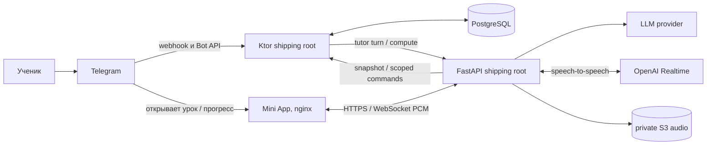
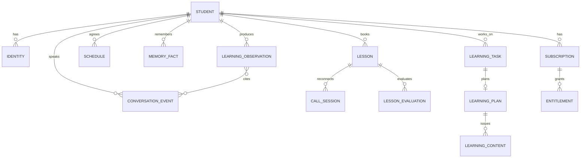

# Speaky: подробная архитектура текущего проекта

**Срез:** рабочее дерево `d0b343c` на 2026-11-20. Этот документ — навигационный снимок реализации. [architecture.md](../../architecture.md) остаётся основным описанием реализованной архитектуры; [status.md](../status.md) — источником статуса поставки и приёмки. Целевой продукт — [v5.5](../product/2026-11-14-personalized-learning-v5.5.md). Файл не утверждает новую архитектуру и не приписывает локальному коду статус PROD.

**Как читать статусы:** «реализовано» означает наличие пути в этом checkout; «проверено» означает только названную проверку; «цель» означает утверждённое продуктовое поведение. Текущая ветка отстаёт от `origin/bb/sp-02-05-v5-5` на 19 коммитов. Дальнейшие изменения в других ветках в этот снимок не входят.

## 1. System Architecture

### 1.1. Граница и топология

В активной системе три поставляемых компонента: Ktor, FastAPI и статический Mini App. PostgreSQL — единственный владелец изменяемого состояния ученика. AI-service не открывает отдельную изменяемую базу профиля. Redis, старые calls, clips и CMP-клиент остаются в репозитории, но shipping roots их не подключают. Сервисы Text Tutor, Context Builder и Learning Engine — логические модули, а не отдельные процессы.

| Узел | Технология и вход | Владеет | Не владеет |
| --- | --- | --- | --- |
| Ktor | Kotlin/Ktor, `Application.kt` → `SpeakyApplication.kt` | PostgreSQL-модель, Telegram intake, авторизация, команды, jobs, worker, доставка | Формулировка реплик и provider audio |
| AI | Python/FastAPI, `app.speaky_main:create_app` | Вычисление следующего хода, педагогические предложения, Realtime relay | Истина о Student, Lesson, оплате и правах |
| Mini App | JavaScript/Web Audio, отдельный nginx | Микрофон, playback, UI, локальная интерполяция таймера | Доступ к уроку, проверенный прогресс, provider key |
| PostgreSQL | Flyway schema V26–V65 в этом дереве | Студенты, история, уроки, учебное состояние, receipts, jobs | Генерация текста и звука |
| Private S3 | `TrialAudioStore` | Архив PCM фрагментов | Учебная интерпретация и авторизация |

Ktor требует `DATABASE_URL` и завершённый import marker. AI требует адрес foundation, внутренний токен и provider key. `/health` есть у обоих сервисов; это проверка процесса, а не качества урока. Конфигурация и процедура cutover описаны в [operations](../integrations/operations.md#sp-00-новый-runtime-и-перенос-текущего-чата).

### 1.2. Контракты и доверие

- **Ktor → AI:** `POST /internal/foundation/tutor/turn` для текстового хода; `POST /internal/foundation/compute` для фонового расчёта.
- **AI → Ktor:** `/internal/foundation/v1` для snapshot, commands, jobs, diagnostics и профильных read endpoints. `X-Internal-Token` подтверждает сервис; `X-Execution-Scope` ограничивает ученика, роль, урок/job, epoch и срок.
- **Публичная граница:** Telegram webhook проверяет секрет. Mini App передаёт подписанный Telegram `initData` в AI; AI спрашивает Ktor `TrialAccess` перед admission. Browser не получает provider key или право исполнять внутренний command.
- **Запись:** command envelope v1 содержит `operationId`, `action`, `args`. Ktor сверяет scope, ownership, версию и digest операции; результат хранит `foundation_operation`. Повтор с тем же ID возвращает receipt, конфликт входа отклоняется.
- **Compute:** AI работает вне DB-транзакции. Backend повторно проверяет epoch, источники и ревизии перед apply. Ошибка БД не переключает активный путь на Redis/in-memory.

Важная цена архитектуры — двусторонний HTTP между Ktor и AI. Он упрощает ownership, но требует согласованного контракта и различения «операция отклонена» от «результат записи неизвестен». `FoundationClient` при transport error сохраняет исходный operation ID для восстановления.

### 1.3. Основные потоки

**Текст:** Telegram private update → durable inbox и `conversation_event` → per-student run/lease → AI `FoundationTutor` → `ContextBuilder` snapshot → LLM/native tool → scoped Ktor command и receipt → сохранённый reply → Telegram send и delivery receipt. HTTP ACK webhook означает сохранённый вход, не готовый ответ. Неизвестную внешнюю доставку нельзя слепо повторить без риска дубля.

**Голос:** Mini App открывается по кнопке Telegram → `initData`/Lesson admission → `Call Session` и voice scope → WebSocket Mini App ↔ AI ↔ Realtime. Relay сохраняет входной и выходной PCM в private S3 и подтверждает metadata в PostgreSQL до пересылки. Транскрипт и события урока попадают в историю; после завершения отдельные jobs строят Observations, Assessment, Roadmap, Review.

**Подготовка урока:** изменение цели/памяти/анализа увеличивает ревизию и делает будущую подготовку устаревшей. PostgreSQL job получает lease/fence; AI рассчитывает план вне транзакции; Ktor применяет его только при совпадении источников. Для regular первый admission требует актуальный обязательный план и завершённый предыдущий анализ. `execution_snapshot` защищает уже начатый урок от изменения будущих планов.

### 1.4. Legacy и прототипы

`ai-service/app/main.py` и прежний Kotlin wiring сохранены для legacy/import. Новый root не монтирует calls, clips, Vocabulary Builder, reminders, dashboards и старый mobile API. CMP в `cmp/app/` — прототип Android/iOS/Desktop, отдельный от веб Mini App в `mini-app/`. Их наличие в репозитории нельзя трактовать как функции нового runtime. Миграции и legacy-данные нельзя удалять только на основании неиспользуемого route.

## 2. Domain & Data Architecture

### 2.1. Владелец, агрегаты и связи

Диаграмма упрощает кардинальность: отдельные исторические ревизии и source refs перечислены ниже. Таблицы задаёт `V26__speaky_foundation.sql` плюс последующие Flyway-миграции. JSONB используется для версионированных документов; FK/unique/check поддерживают основные инварианты, а Kotlin проверяет смысл и разрешения.

| Домен | Текущая модель и жизненный цикл | Главные ограничения |
| --- | --- | --- |
| **Tutor** | `tutor_identity` фиксирует `sasha`, версию и `kora_h`; `student` ссылается на версию персонажа | Персонаж и prompt не дают модели прав на состояние |
| **Student** | `student` + `student_identity` для Telegram; `data_epoch`, `learning_revision`, `deleted_at` | Новый `/start` атомарно сбрасывает профиль и создаёт нового Student; replay команды не повторяет сброс |
| **Conversation** | `tutor_conversation`, упорядоченный `conversation_event`, `tutor_inbox`, `tutor_delivery` | Уникальные source/sequence, lease/fence, retention сырого текста, явный `unknown` delivery |
| **Lesson** | `trial`/`regular`; `scheduled → in_progress → completed/missed/cancelled`; отдельные `call_session` попытки | Один активный trial на Student, одна connected Call Session на Lesson; reconnect не создаёт новый Lesson |
| **Schedule** | `schedule` с timezone/agreement, материализация regular Lesson на горизонте 14 дней | `occurrence_key` и `schedule_exception` защищают перенос/отмену от повторного создания; DST требует уточнения |
| **Subscription** | `subscription`, `payment_receipt`, `entitlement`, checkout/billing events | Доступ regular проверяется при первом admission; mock checkout не является реальным платежом |
| **Memory** | `memory_fact`, candidates, history, observations/reviews и политики упоминания | Факты привязаны к источнику; AI candidate не становится подтверждённым фактом сам |
| **Learning State** | `student_learning_state`, `learning_goal`, `student_topic_knowledge` с ревизиями | Self-assessment и Speaky assessment разделены; неизвестный уровень допустим; Topic status не равен Task progress |
| **Roadmap** | Старые `roadmap/roadmap_revision/step` и новый `learning_roadmap/history` v5.5 | Цель, catalogVersion, learningRevision и knowledge digest фиксируют источник; новая публикация каталога не переписывает прошлое |
| **Learning Task** | `learning_task/history`: Identified → In Progress → Mastered → Reopened → In Progress | Одна активная Student+Topic+Problem; progress 100 сам не переводит Task в Mastered |
| **Plan/Content** | `learning_plan/revision/history`, `learning_content/revision` на Task/Stage | Исторический StageRef остаётся точным; выданное задание фиксируется content revision |
| **Observation/Assessment** | `learning_observation/revision/source`, `lesson_evaluation`, `learning_score_stage/event`, `post_lesson_review` | Источник, попытка и ревизия сохраняются; Observation не равен CEFR и не меняет Score сам |

### 2.2. Урок, звонок и расписание

`Lesson` хранит `kind`, `status`, `starts_at`, длительность, timezone, `launch_mode`, версию, `transcript_revision`, `execution_snapshot`, причину исхода. `Call Session` — конкретное подключение с `attempt_id`, временем, статусом и provider reference. Нестабильная сеть создаёт новую Call Session в том же Lesson. Voice lease/scope не разрешает параллельную активную сессию.

Trial v5.5 длится 30 подключённых минут, фазы `warmup → conversation → wrapup`. Время объединяется по подключениям, а не по отдельным словам. Reconnect допускается до конца исходного слота; уже вернувшийся ученик может использовать остаток времени. Кнопка End завершает Lesson; после истечения слота worker закрывает отключённый Lesson. Regular Lesson поддерживает длительность 15–60 минут в старом контракте; целевая v5.5 модель обычного урока — не менее 30 минут. Это разные слои контракта, не доказательство живого соблюдения тайминга.

Schedule хранит правило и пояс. Worker материализует executable уроки на 14 дней, обновляет напоминания и no-show. Перенос/отмена создают exception на occurrence. `lesson.next` читает сохранённую будущую встречу. Старая placeholder-встреча не становится executable сама.

### 2.3. Учебная модель v5.5

Опубликованный каталог содержит Skill, Problem и Topic с постоянными ID, CEFR и версией. На снимке документирована версия из 163 Topic; публикация проверяется отдельно от импорта. Student Learning State хранит текущие/целевые уровни, цель, интенсивность и Homework consent. `onboarding.update` в text scope может менять только разрешённые учеником поля и требует цитату текущего входа; голосовой `trial.preferences` меняет только нагрузку/Homework на основании user source этого урока.

Task привязана к Student, ревизии цели, catalogVersion, Skill/Topic/Problem. Plan содержит до четырёх Stage методов Conversation, Explanation, Exercises, Exposure; numeric веса суммируются в 1, binary Stage не имеет веса. Definition revision и cursor stateRevision независимы. `StageRef = taskId + planId + planRevision + stageId` сохраняет смысл даже после правки Plan. Content revision фиксирует реально выданное условие; `prepared/issued/defective` не означают качество ответа ученика.

Observation отделяет источник (`conversation_event`, lesson, transcript revision, span) от интерпретации и учебного результата. Исправление делает новую revision той же Observation; исчезнувший источник инвалидирует её. Trial extractor создаёт доказательства по Speaking, Grammar и Vocabulary; Listening остаётся Unknown без данных. Assessment после Observations даёт предварительный CEFR; Roadmap строит задачи и приоритеты. Для Stage Score используются экспериментальные параметры SP-19, не шкала CEFR. Post-Lesson Review читает сохранённые Observations/Score и может перевести Task в Mastered только с пригодным evidence. Детальная математика — в [learning-score](../integrations/learning-score.md).

### 2.4. Транзакции, ревизии и privacy

- Ktor обрабатывает команду в PostgreSQL-транзакции после `lockStudent`. Scope повторно проверяется после ожидания lock: `data_epoch` защищает от поздней записи после forget/reset.
- `expectedRevision` защищает профиль, Task, Plan и другие меняемые объекты. `operationId` и digest дают идемпотентность, receipt хранит результат. Job имеет lease/fence, dedup key и ограниченное число попыток.
- Долгий LLM/Realtime вызов не выполняется внутри DB-транзакции. Apply сравнивает версии и источники. Технический retry не должен превращать одну реплику или Observation во вторую учебную попытку.
- Forget личного факта очищает зависимые данные по всем ревизиям источника и отзывает epoch; независимые факты остаются. `learning.forget`, delete и новый `/start` — отдельные более широкие операции. Restore требует внешний deletion ledger.
- Сырой текст новой истории хранится 30 дней; истёкший текст не превращается в вечную цитату через JSON-копии. Ссылки на источник могут оставаться с признаком `sourceContentExpired`. Архив аудио удаляется по 30-дневному правилу приложения; S3 lifecycle/backup и восстановление требуют отдельной проверки.

## 3. AI Architecture

### 3.1. Текстовый агент

`FoundationTutor` получает сохранённый backend input через `run.claim`; он не доверяет повторной копии тела запроса. `ContextBuilder` собирает snapshot, ограниченную историю, память, Learning State и режим текста. `text_tutor_policy.py` задаёт постоянный диалог Саши, `kora_personality.py` — характер, `trial_tools.py`/`memory_tools.py`/`subscription_tools.py` — модели инструментов. LLM формулирует ответ и выбирает tool, а Ktor проверяет и исполняет действие.

Режим знакомства спрашивает цель, трудности и самооценку без анкеты. Уже известное не переспрашивается. Прямое поручение записать Trial не требует заполненного профиля или второго подтверждения. Новый `/start` обрабатывается durable Telegram-последовательностью без model call; последующие сообщения идут через обычный agent run. Обычное voice message в Telegram не запускает voice pipeline.

Tool loop ограничен, а результаты операций возвращаются в модель. FoundationTutor отслеживает подтверждённые записи отдельно от слов модели; при восстановлении `committed` операций берёт backend receipts. Ошибка tool может быть объяснена в ответе, но ответ не заменяет факт успешной записи. Контракт текста и ограничений — в [tutor-chat](../integrations/tutor-chat.md).

### 3.2. Голосовой агент и управление уроком

`RealtimeTrialSession` в `trial_realtime.py` управляет provider WebSocket, аудио, VAD, playback, инструментами и lifecycle. Сервер конфигурирует OpenAI Realtime (`gpt-realtime-2.1`, голос Marin в текущей архитектуре), `semantic_vad` с `eagerness=medium`. Text transcript используется для истории и последующего анализа, а не как вход текстового генератора ответа в этом speech-to-speech пути.

Для Trial v5.5 `trial_v55.py` задаёт RU warm-up, EN conversation, RU wrap-up. Native tools `set_trial_phase`, `get_trial_preferences`, `update_trial_preferences`, `finish_after_reply` проходят backend-проверки. Cues по времени мягкие: наличие инструкции не доказывает фактический язык, качество или правильное завершение. Regular использует подготовленные objective/topic/strategy, Plan/Content и Teaching Actions, если они готовы; иначе остаётся разговорным по описанному статусу волн.

### 3.3. Контекст, учебные решения и evaluation

`ContextBuilder` читает одну backend-проекцию для text/voice/learning, а `MemorySelector` ограничивает объём. Core-факты и запреты упоминания не исчезают из-за relevance-фильтра. Частичный контекст помечается `contextPartial`; отсутствие Topic в сокращённой выборке не означает Unknown. Начатый Lesson использует execution snapshot, а будущая подготовка отзывается при изменении входных ревизий.

Педагогический расчёт разбит на стадии: сохранённая реплика/аудио → evidence Observation → предварительная Assessment или оценка Teaching Action → Stage Score/Task Progress → Post-Lesson Review → следующий Plan/Roadmap. `LearningEngine` выбирает вычислитель по job; Ktor применяет результат. `PedagogicalPlanner` использует утверждённые шаблоны Skill+Problem и проверенный каталог, а не свободный выбор весов моделью. `LearningContent` хранит форму задания; SP-13B занимается генерацией и смысловой проверкой до выдачи. Одна локальная проверка формы не доказывает педагогическую пригодность материала.

Evaluation имеет два уровня: программная проверка схем, источников, ревизий и формул; живая проверка диалога, голоса и учебного вывода. В статусе есть реальные сбои ASR и provider HTTP 400: ошибочное распознавание снижало Score, а отказ провайдера оставлял Observation/Review незавершёнными. Причина общего 400 не установлена. Синтетический playback не является доказательством того, что ученик услышал ответ.

## 4. Realtime & Client Architecture

### 4.1. Telegram и Mini App

Telegram — постоянный текстовый канал и доставка кнопок Trial, Roadmap, reminders, progress. Ktor отвечает за webhook, порядок сообщений, receipts и Bot API. `TutorBookingDelivery` сохраняет версию карточки; перенос/отмена обновляют ту же встречу. Telegram `initData` в Mini App проверяется сервером, а урок дополнительно проходит backend admission и entitlement/plan gates. Progress view читает состояние без запуска урока и микрофона.

Mini App — самостоятельный frontend `mini-app/src/app.js`, `capture.js`, HTML/CSS. В browser он получает микрофон, кодирует/передаёт PCM, проигрывает фрагменты Web Audio, показывает таймер, mute, состояние подключения и ошибки. Caddy направляет статические файлы в nginx, `/miniapp/api`, `/miniapp/diagnostics`, `/miniapp/voice` — в AI. В frontend нет provider key или прямой связи с PostgreSQL.

### 4.2. Аудио, прерывания и reconnect

Browser audio → AI relay → Realtime, и обратный звук Realtime → AI archive → Browser. Архив записи обоих направлений подтверждается до передачи. Это увеличивает RTT и зависит от S3/DB; реальная задержка требует отдельного измерения.

На speech-start playback останавливается. Browser сообщает `playedMs`/`complete`; сервер согласует `conversation.item.truncate`, сохраняет фактически подтверждённую часть или partial placeholder. Отчёт клиента описывает playback, но не доказывает слуховое восприятие. `mute` может принудительно commit входной буфер. Heartbeat продлевает voice lease и обновляет серверное подключённое время.

При обрыве Mini App показывает возможность переподключения. Новая provider session и `Call Session` открываются в том же Lesson, если backend admission ещё разрешён. Trial сохраняет фазу и оставшееся подключённое время; regular сохраняет execution snapshot. Provider session имеет отдельный транспортный лимит 50 минут: смена транспорта не завершает Lesson. Бесшовность такого перехода остаётся предметом живой проверки.

### 4.3. Синхронизация и ошибки

Источник истины для Lesson, фазы, времени, Plan, Score и admission — backend. Локальный таймер Mini App интерполирует между `trialExecution.connectedSeconds` из admission/heartbeat; он не заменяет серверный счётчик. Client reconnect не должен повторно создавать Task/Observation. Backend receipts и стабильные source IDs отделяют повтор транспорта от новой педагогической попытки.

Mini App различает исправимые ошибки микрофона/сети и terminal errors доступа, просроченного Lesson, неподготовленного плана и pending Observation. Серверный `X-Error-ID` отображается как поисковый код. Unknown outcome записи требует восстановления с тем же operation ID; после ограниченной попытки урок останавливается с явным кодом, а подтверждённая история сохраняется.

## 5. Reliability & Testing

### 5.1. Наблюдаемость и восстановление

Ktor/AI используют общий диагностический контракт: `trace_id`, `request_id`, `error_id` и контекст Lesson/Call Session/job без сырого текста и аудиопакетов в логах. Путь поиска: UI-код ошибки → HTTP/WebSocket событие → provider/backend command → job apply и receipt. Интервальные счётчики отражают поток аудио; успешный archive, provider receipt и слышимый ответ — разные события. Защищённые `/diagnostics` и `/jobs` требуют внутренний token и operator scope.

Доставка Telegram и внешний provider не дают общей exactly-once транзакции с PostgreSQL. Система предпочитает известные receipts, стабильные operation IDs, lease/fence и явный `unknown`. Рабочая стратегия восстановления: проверить подтверждённый исход, затем повторить ту же логическую операцию или остановить сценарий с кодом. Data epoch отсекает поздние jobs после reset/forget. S3 archive и backup/restore должны проверяться отдельно от наличия файла.

### 5.2. Проверки и CI/CD

| Уровень | Что есть в репозитории | Что этим не доказано |
| --- | --- | --- |
| Unit | `pytest` в `ai-service/`, `:server:test`, Mini App `npm test` | Живой LLM, Telegram, WebView, ASR и слышимый звук |
| DB/HTTP integration | `scripts/test-foundation.sh`, PostgreSQL, Flyway, real Python → Ktor HTTP harness, Redis import rehearsal | Семантическое качество модели и provider/S3 в сети |
| Build/static | `:server:buildFatJar`, `detekt`, Mini App build, CI workflows | PROD readiness |
| DEV acceptance | Отдельные текстовые, Telegram, Trial и regular прогоны в `ai_docs/acceptance/` | Автоматическое принятие всех AC и корректность на PROD |
| PROD | Отдельная поставка и наблюдение нужны по [status.md](../status.md) | Успех локальных тестов не означает поставку |

CI разделён по AI, foundation integration, Mini App и CMP. Deploy workflow поставляет компоненты раздельно; вместе меняющиеся контракты требуют совместимой очередности. На срезе 2026-11-18 [status.md](../status.md) сообщает о PR #58 к `dev`, отдельных DEV-ревизиях сервисов и незакрытой живой приёмке. Здесь не выполнялись новые runtime-тесты и не проверялось текущее состояние серверов.

### 5.3. Критерии готовности функции

Для каждой функции фиксировать пять независимых результатов:

1. **Контракт:** понятные владелец состояния, входы, выходы, инварианты, privacy и ошибка/retry.
2. **Локально:** unit + PostgreSQL/HTTP там, где меняются транзакции или межсервисный контракт; build/static checks.
3. **Поставка:** точные ревизии Ktor, AI, Mini App, миграции и конфигурация на нужном окружении.
4. **Живой путь:** Telegram/WebView/голос/LLM проходят заявленный сценарий с наблюдаемым состоянием и сохранённым evidence.
5. **Качество решения:** реплика, Observation, Assessment, Score и следующий шаг соответствуют продуктовой v5.5, включая исправление ошибочного ASR и отказ провайдера.

AC отмечается `pass`, `fail` или `blocked` с конкретным наблюдением и следующим действием. Смежный успешный этап не заменяет проверку недостающего. Сейчас особенно важны живое завершение regular урока, точность ASR/negative verdict, Review, доставка Roadmap, WebView playback/reconnect и проверка архива/восстановления. Подробная матрица — в [DEV acceptance](../acceptance/dev-waves-1-9-matrix.md) и [MVP readiness](../acceptance/mvp-readiness-2026-11-17.md).

## Карта исходников для дальнейшего чтения

| Тема | Точка входа / основной код |
| --- | --- |
| Ktor composition | `cmp/server/src/main/kotlin/com/eliteteam/speakingcoach/SpeakyApplication.kt` |
| API и транзакции | `foundation/FoundationRoutes.kt`, `FoundationService.kt`, `FoundationDatabase.kt`, `FoundationJobs.kt` |
| Telegram | `telegram/`, `foundation/TelegramTextIntake.kt`, `FoundationChat.kt`, `ConversationRuns.kt` |
| Уроки и доступ | `foundation/LessonManagement.kt`, `TrialAccess.kt`, `TrialCommands.kt`, `TrialSchedule.kt` |
| Learning v5.5 | `foundation/LearningState.kt`, `LearningTasks.kt`, `LearningPlans.kt`, `LearningObservations.kt`, `LearningScores.kt` |
| Миграции | `cmp/server/src/main/resources/db/migration/V26__speaky_foundation.sql`, V39–V65 |
| AI composition | `ai-service/app/speaky_main.py`, `foundation_client.py`, `foundation_tutor.py`, `context_builder.py` |
| AI learning | `learning_engine.py`, `trial_observations.py`, `trial_assessment.py`, `regular_lesson.py`, `pedagogical_plan.py` |
| Realtime | `trial_api.py`, `trial_realtime.py`, `trial_audio.py`, `trial_v55.py` |
| Frontend | `mini-app/src/app.js`, `capture.js`, `style.css` |
| Проверки и поставка | `ai-service/tests/`, `ai-service/integration/`, `cmp/server/src/test/`, `mini-app/tests/`, `.github/workflows/` |

**Граница снимка:** это архитектурный обзор по исходникам, миграциям и действующим документам. Он не заменяет подробные API-контракты в `ai_docs/integrations/`, не является планом рефакторинга и не подтверждает незапущенные live-сценарии.
