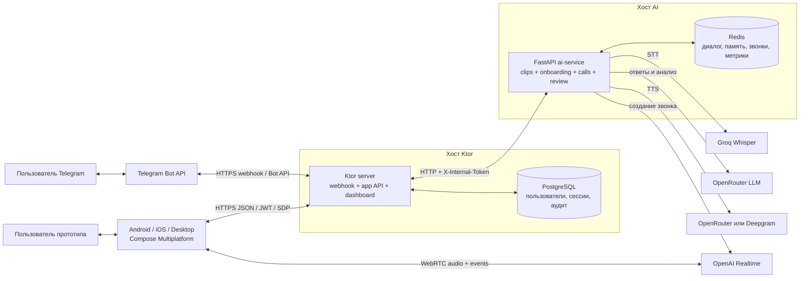
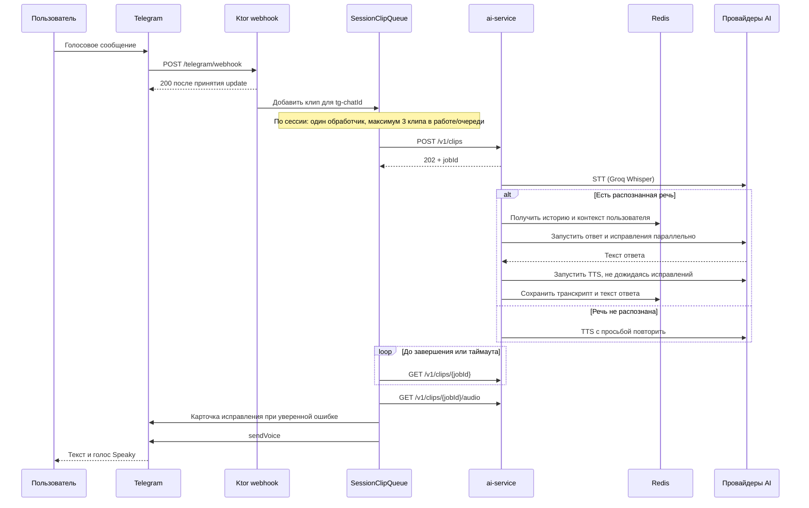
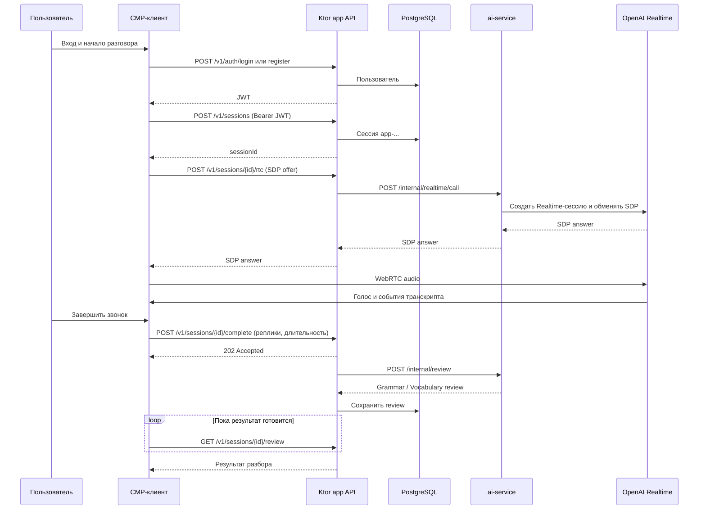

# Архитектура Speaking Coach

Этот документ описывает **компоненты и потоки, реализованные в текущем коде репозитория**. Он не подтверждает версию, работающую на конкретном сервере. Продуктовая цель описана отдельно в [product.md](ai_docs/product.md); инструкции по окружениям и развертыванию — в [deploy.md](ai_docs/deploy.md).

## Общая схема

Основной пользовательский путь — Telegram-бот **Speaky**. Репозиторий также содержит прототип приложения на Compose Multiplatform (CMP). Часть его пути подключена к API, но значительная часть UI и данных ещё демонстрационная. Оба пути используют один Ktor-сервер и один FastAPI AI-сервис, но разные способы разговора и хранения сессий.

Стрелка WebRTC означает прямой медиаканал приложения с OpenAI после согласования SDP через Ktor и AI-сервис. Голосовые сообщения Telegram идут другим путём: Telegram передаёт файл боту, а AI-сервис обрабатывает его как асинхронный clip job.

## Компоненты и ответственность

| Компонент | Расположение | Ответственность |
| --- | --- | --- |
| Telegram adapter | `cmp/server/.../telegram/`, `speaking/` | Приём webhook, команды и кнопки, очередь клипов по чату, отправка текста и голоса, Telegram-аналитика |
| Ktor app API | `cmp/server/.../app/` | Регистрация и вход, JWT, сессии приложения, SDP-посредник, сохранение и выдача review |
| Общий Ktor процесс | `cmp/server/.../Application.kt` | TLS, маршруты, подключение к AI-сервису, dashboard и health |
| AI-сервис | `ai-service/app/` | STT → ответ и исправления → TTS, Telegram-онбординг и звонки, персональная память, OpenAI Realtime и анализ звонка приложения |
| Прототип CMP-клиента | `cmp/app/shared/`, платформенные host-модули | UI, локальное состояние, запросы к Ktor, WebRTC-соединение и сбор реплик звонка |
| PostgreSQL | на хосте Ktor | Пользователи и сессии приложения, результаты review, журнал взаимодействий Telegram и часть аналитики |
| Redis | на хосте AI | История Telegram-диалогов, онбординг, память пользователя, звонки, напоминания и агрегаты метрик |

`cmp/core/` содержит общий Kotlin-код. CMP-клиент **не** вызывает `/v1/clips` AI-сервиса, а Telegram-бот **не** использует WebRTC-путь приложения. Публичного прокси для clip API на Ktor нет.

## Путь Telegram: голосовое сообщение

Webhook проверяет `X-Telegram-Bot-Api-Secret-Token`. Ktor отвечает Telegram после принятия update и обрабатывает его в отдельном scope; дальше Telegram не повторит уже подтверждённое сообщение. Сессия чата имеет id `tg-<chatId>`. `HttpClipClient` опрашивает job с интервалом 300 мс до 90 секунд; очередь ограничена тремя клипами на сессию. Для обычного хода AI-сервис параллельно запускает ответ и исправления; синтез голоса начинается после готовности текста ответа. В историю диалога сохраняется текст ответа, а аудио остаётся в памяти clip job. Исправления имеют отдельный дедлайн **10 секунд** и при неудаче могут быть опущены без потери голосового ответа. Извлечение персональных фактов может идти дополнительной параллельной задачей.

Новые пользователи проходят голосовое знакомство и оценку, затем могут выбрать ежедневную цель и начинать практические звонки. Состояние онбординга, открытого звонка, ходы и память сохраняются в Redis. Карточка исправления показывает короткий контекст: ошибочные слова зачёркнуты, замена выделена жирным. Политика намеренно пропускает сомнительные исправления. Подробности: [Telegram UX](ai_docs/integrations/2026-09-18-telegram.md), [звонки](ai_docs/integrations/2026-09-30-telegram-calls.md), [исправления](ai_docs/integrations/2026-09-30-spoken-corrections.md), [clip API](ai_docs/integrations/2026-09-18-clip-session-api.md).

## Путь приложения: звонок и разбор

Общий UI расположен в `cmp/app/shared/`: Welcome → Auth → Home → Call → Review, а Profile открывается с Home. Состояние экранов организовано через ViewModel и Navigation 3. Ktor Client посылает только запросы к Ktor; ключ OpenAI Realtime остаётся на AI-сервисе. После SDP-обмена звук и события звонка идут напрямую между клиентом и OpenAI, минуя наши серверы. Клиент передаёт собранные реплики Ktor при завершении; Ktor запускает разбор и сохраняет результат.

В текущем срезе разбор приложения содержит **Grammar и Vocabulary**. Карточка последнего разговора и часть показателей Home/Profile используют локальные или демонстрационные данные; целевая диагностика произношения и беглости из [product.md](ai_docs/product.md) ещё не является частью этого review. Контракт экранов и API: [mobile API](ai_docs/integrations/2026-09-18-mobile-api.md), архитектура WebRTC-клиента: [WebRTC](ai_docs/architecture/2026-09-20-webrtc-client.md).

## Данные и жизненный цикл

| Данные | Где хранятся | Важная особенность |
| --- | --- | --- |
| Пользователи, сессии и review приложения | PostgreSQL через Ktor `AppStore` | Flyway управляет схемой; при отсутствии `DATABASE_URL` локальный app API может использовать in-memory store |
| Диалог Telegram | Redis, `session:{id}` | До 40 сообщений; код ограничивает срок хранения сообщений и TTL ключа семью днями, даже если `DIALOGUE_TTL_SECONDS` выше. Без Redis есть in-memory реализация для локальной разработки |
| Онбординг, профиль, звонки Telegram | Redis | Отдельные ключи `onboarding:*`, `learner:*`, `call:*`; переживают рестарт AI-процесса при сохранении Redis |
| Clip jobs и аудио результата | Память процесса AI-сервиса | По умолчанию TTL 10 минут; незавершённые jobs теряются при рестарте |
| Журнал взаимодействий Telegram | PostgreSQL и аудиофайлы на хосте Ktor | Работает при настроенном `DATABASE_URL`; используется для истории и диагностики |
| Метрики и dashboard | Ktor + AI-сервис, PostgreSQL/Redis | Административные страницы начинаются с `/admin/metrics`; источники метрик разделены между сервисами |

PostgreSQL находится рядом с Ktor и доступен на loopback, Redis — рядом с AI-сервисом и не публикуется наружу. Два хоста могут быть у разных провайдеров. Подробная схема сети, контейнеров и сохранения томов — в [deploy.md](ai_docs/deploy.md).

## Технологии и внешние зависимости

| Область | Технологии в коде |
| --- | --- |
| Backend | Kotlin, Ktor/Netty, coroutines, kotlinx.serialization, tgbotapi |
| Данные Ktor | PostgreSQL, HikariCP, Flyway, JWT |
| Клиент | Kotlin Multiplatform, Compose Multiplatform Material 3, Koin, Navigation 3, Ktor Client, WebRTC |
| AI-сервис | Python, FastAPI, Uvicorn, `redis.asyncio`, `httpx`, OpenAI-compatible SDK |
| Речь и модели | Groq Whisper для STT; OpenRouter для ответа/исправлений и TTS по умолчанию; прямой Deepgram TTS по настройке; OpenAI Realtime для звонка приложения |
| Поставка | Gradle, Docker, GitHub Actions; отдельные workflow Redeploy DEV и Redeploy PROD |

Модели и провайдеры задаются конфигурацией AI-сервиса, поэтому здесь перечислены роли, а не обещаны неизменные версии моделей. Версии библиотек закреплены в [`cmp/gradle/libs.versions.toml`](cmp/gradle/libs.versions.toml) и [`ai-service/requirements.txt`](ai-service/requirements.txt).

## Границы доступа и развертывание

- Telegram webhook доступен по HTTPS и проверяет секретный заголовок Telegram. Ktor регистрирует webhook только в режиме с `TELEGRAM_WEBHOOK_URL`; локальный запуск без него поднимает HTTP-сервер без бота.
- Запросы приложения к защищённым маршрутам Ktor используют Bearer JWT. Внутренние запросы Ktor → AI-сервис используют `X-Internal-Token`; `/health` AI-сервиса доступен без него.
- AI-сервис слушает порт 8090. Скрипт на AI-хосте ограничивает внешний доступ к нему списком разрешённых адресов Ktor. Redis доступен только на AI-хосте; PostgreSQL — только на Ktor-хосте.
- Push и pull request запускают проверки и сборку, но не развертывание. Поставка DEV/PROD запускается вручную и может обновить Ktor и AI-сервис независимо. Рестарт сервисов не должен удалять тома Redis и PostgreSQL.

В документации указаны только **имена** переменных и секретов. Значения ключей, токенов и содержимое `.env` здесь не хранятся. Детали окружений, CI и действий оператора: [deploy.md](ai_docs/deploy.md) и [run-and-ci](ai_docs/integrations/2026-09-18-run-and-ci.md).

## Где менять код

| Задача | Основные файлы |
| --- | --- |
| Telegram-команды, кнопки, карточки и очередь | `cmp/server/.../telegram/`, `cmp/server/.../speaking/` |
| App API, авторизация и хранение сессий | `cmp/server/.../app/` |
| Ktor TLS, маршруты и конфигурация | `cmp/server/.../Application.kt`, `AppConfig.kt` |
| Контракт Ktor → AI-сервис | `cmp/server/.../ai/`, `app/HttpInternalAi.kt`, `ai-service/app/main.py` |
| STT, LLM, TTS, онбординг и память | `ai-service/app/` |
| CMP UI, навигация и WebRTC | `cmp/app/shared/` и платформенные `cmp/app/*App/` |
| Контейнеры, сети и CI | `infra/`, `.github/workflows/` |

Перед изменением поведения сверяйте эту общую карту с соответствующим документом из [`ai_docs/README.md`](ai_docs/README.md) и с текущим кодом. Исследовательский документ `ai_docs/researches/2026-09-14-stt-llm-tts-ai-service.md` описывает более раннюю схему и не является описанием текущей реализации.
