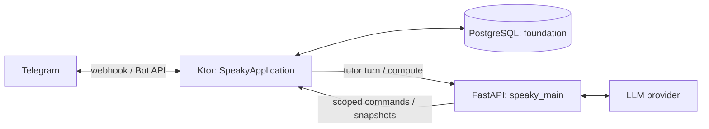
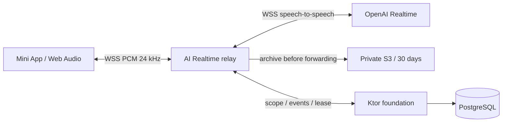

# Архитектура Speaky

Единственный справочник **реализованной архитектуры SP-00–SP-08**: компоненты, данные, потоки и причины решений.
Он описывает код рабочего дерева. SP-03/SP-04 объединены и поставлены на DEV; живая приёмка остаётся открытой.
Результаты локальных проверок и границы готовности — в [статусе](ai_docs/status.md),
команды оператора — в [эксплуатации](ai_docs/integrations/operations.md#sp-00-новый-runtime-и-перенос-текущего-чата).

## Компоненты и границы

Два процесса: Ktor и FastAPI. Foundation, Text Tutor, Context Builder и Learning Engine — модули этих процессов.
Отдельных сервисов для каждого логического блока нет. Redis не входит в новый runtime.

| Компонент | Ответственность |
| --- | --- |
| Ktor / foundation | Единственный владелец состояния ученика, бизнес-операций, истории, фоновых задач и контроля доступа |
| PostgreSQL | Student/identity, profile/goal/memory, Lesson/Call Session, Schedule, payment/entitlement, Roadmap, Plan/Evaluation, history, jobs и receipts |
| Telegram adapter | Проверка webhook, сохранение private-text входа, запуск хода, отправка ответа и учёт результата доставки |
| Python FoundationTutor | Диалог Саши и native tools; все изменения выполняются через Ktor |
| Python ContextBuilder | Ограниченные проекции общего состояния для text, voice и learning; чтение не меняет профиль |
| Python LearningEngine | Вычисление результатов фоновой работы; применение результата контролирует backend |
| LLM | Формулировка ответа, выбор tools и интерпретация контекста; не владелец состояния и прав доступа |

### Точки входа

- Kotlin [`Application.kt`](cmp/server/src/main/kotlin/com/eliteteam/speakingcoach/Application.kt) вызывает
  [`SpeakyApplication.kt`](cmp/server/src/main/kotlin/com/eliteteam/speakingcoach/SpeakyApplication.kt).
  Он подключает foundation, worker, `/health` и Telegram webhook при соответствующей конфигурации.
- AI Docker запускает [`app.speaky_main:create_app`](ai-service/app/speaky_main.py).
  Этот root создаёт FoundationClient, ContextBuilder, FoundationTutor и LearningEngine.
- Ktor требует PostgreSQL и завершённый import marker. Без marker новый backend не стартует.
  Это защищает существующий чат от случайного запуска с пустым профилем.

## Ход текстового диалога

1. Webhook проверяет секрет Telegram. Private-text update сохраняется до HTTP ACK.
2. Backend связывает Telegram identity с Student и обрабатывает входы по порядку.
   Lease/fence защищают обработку от конкурирующего или просроченного исполнителя.
3. Ktor создаёт ограниченный execution scope и вызывает AI tutor turn.
4. ContextBuilder читает backend snapshot. Модель получает общий профиль, цель и ограниченную историю.
5. Native tools вызывают backend commands. Backend проверяет владельца, scope, источник, версии и idempotency.
6. Результат операции и reply сохраняются. После сбоя используется сохранённый результат;
   уже выполненная запись не становится новой операцией.
7. Telegram adapter отправляет ответ и фиксирует исход. Неизвестная доставка не повторяется вслепую.

Успешный ACK означает сохранённый вход, а не готовый ответ. Успех tool подтверждается backend receipt,
а не фразой модели. Внешняя доставка Telegram не имеет гарантии exactly-once.
Правила беседы и trial остаются в [продуктовом поведении SP-01](ai_docs/plans/2026-11-09-sp01-text-onboarding.md).

## Данные, память и общий контекст

Общий профиль принадлежит Ktor/PostgreSQL. Python не поддерживает вторую изменяемую копию профиля.
Text, Voice и Learning используют одну идентичность и проекции одного состояния через ContextBuilder.
Эта связь реализована и проверена локально; готового голосового урока из неё не следует.

- Заявленные пользователем факты, самооценка и учебные observations разделены.
  Observations сохраняют источник, версию анализа и неопределённость.
- Личные факты, предложенные AI, остаются скрытыми candidates до подтверждения источником пользователя.
- Контекст ограничен бюджетами; модель не получает всю историю без ограничений.
- Новая сырая история хранится 30 дней. Копирование не продлевает срок источника.
  Импортированная история TutorStore сохраняет прежние семидневные deadlines.
- Forget/delete очищают данные нового пути и отзывают старые scopes/jobs через epoch.
  Forget консервативно очищает raw history и производные копии, включая прежние значения цели;
  другие подтверждённые факты сохраняются.
- После восстановления backup до запуска применяется свежий внешний deletion ledger.
  Очистка сохранённых legacy-хранилищ этим механизмом не обещается.

## Фоновая работа и граница урока

FoundationJobs хранит очередь в PostgreSQL. Worker получает lease и fence, вычисляет результат вне DB-транзакции,
затем backend применяет его после проверки источника, epoch, зависимостей и версий.
Просроченный worker не может перезаписать актуальное состояние. Retry и диагностика доступны оператору.

Lesson/Call Session, Schedule, entitlement, Roadmap, Plan/Evaluation имеют backend-модель и операции.
LessonVoice получает общий контекст только после backend admission. Отсутствующий или устаревший обязательный план блокирует вход.

Shipping root использует `LessonPlanner` из `regular_lesson.py`: модель готовит для regular
отдельные objective/topic/strategy; trial сохраняет briefing. Backend применяет план с проверкой
версий и завершённости предыдущих анализов. Неверный ответ модели не заменяется фиктивным планом.
`TrialAnalyzer` сохраняет качественные наблюдения с источниками. `TrialWorker` материализует
расписание и отправляет уведомления через durable outbox. Настоящая оплата не реализована; персональный roadmap описан в SP-06 ниже.

## Внутренние API и доверие

| Направление | Интерфейс |
| --- | --- |
| Ktor → AI | `POST /internal/foundation/tutor/turn`, `POST /internal/foundation/compute` |
| AI → Ktor | `/internal/foundation/v1`: `POST /commands`, `GET /snapshot`, `/operations/{id}`, `/jobs`, `/diagnostics` |
| Проверка процесса | `/health` каждого сервиса |

Внутренние запросы используют `X-Internal-Token`; операции дополнительно связаны с `X-Execution-Scope`.
Scope выдаёт backend, а не модель. Service token сам по себе не разрешает произвольную запись за другого ученика.
Версии и receipts делают конфликт или повтор явным. Ошибка хранилища не переключает работу на in-memory или Redis.
Конфигурация, сетевые адреса и секреты перечислены только в [operations](ai_docs/integrations/operations.md).

## Почему устроено так

| Решение | Причина |
| --- | --- |
| Единый владелец данных в backend | У чата, голоса и learning одна цель и память; нет двусторонней синхронизации отдельных профилей |
| LLM выбирает tools, backend исполняет | Сохраняется свободный диалог; ownership, версии и успех операции не зависят от ответа модели |
| Durable inbox, runs и receipts | Перезапуск не теряет подтверждённый вход и не повторяет уже выполненную бизнес-операцию |
| Compute вне транзакции | Медленный AI-вызов не удерживает DB-транзакцию; актуальность проверяется при apply |
| Structured Memory и bounded context | Факты имеют источник; embeddings и семантический поиск не обязательны для текущего этапа |
| Отдельные shipping roots | Legacy не запускает скрытые routes/workers и не возвращает Redis-зависимость новому пути |
| Import marker до запуска | Переход выполняется только после сверки перенесённого TutorStore |

## Изоляция legacy и CMP

`app.main`, прежний Kotlin wiring, calls, clips, Vocabulary Builder, reminders, dashboards и app API
сохранены в исходниках, но не подключены к новым shipping roots. Старые HTTP adapters используются в test harness,
который не входит в fat JAR. Промежуточные legacy PG adapters также не являются активным владельцем данных.

Переносится только текущий TutorStore. Legacy Redis namespaces не мигрируют в рамках SP-00.
Серверные Redis/PG данные и применённые Flyway-миграции сохраняются.
Порядок freeze/export/import/reconciliation описан один раз в [runbook](ai_docs/integrations/operations.md#sp-00-новый-runtime-и-перенос-текущего-чата).

CMP Android/iOS/Desktop остаётся отдельным прототипом. Его app API не монтируется новым runtime.
Устройство клиента, WebRTC и прежний HTTP-контракт собраны в [справочнике CMP](ai_docs/integrations/mobile-api.md).
Справочники voice/practice/analytics описывают сохранённый код и не являются перечнем активных маршрутов SP-00.

## Карта исходников

Пути Kotlin ниже относительны к `cmp/server/src/main/kotlin/com/eliteteam/speakingcoach/`.

| Задача | Файлы |
| --- | --- |
| Запуск, маршруты и доступ | `SpeakyApplication.kt`, `foundation/FoundationRoutes.kt`, `FoundationIdentity.kt`; `ai-service/app/speaky_main.py`, `foundation_api.py` |
| Бизнес-операции и данные | `foundation/FoundationService.kt`, `FoundationDatabase.kt`, `LessonManagement.kt`, `LearningState.kt` |
| Сохранение входа и восстановление хода | `foundation/TelegramTextIntake.kt`, `ConversationRuns.kt`, `FoundationChat.kt`; `ai/TutorClient.kt` |
| Диалог и native tools | `ai-service/app/foundation_tutor.py`, `tutor.py`, `foundation_client.py` |
| Общая память и контекст | `foundation/StructuredMemory.kt`, `ConversationHistory.kt`, `TutorContextOperations.kt`; `ai-service/app/context_builder.py` |
| Фоновые вычисления | `foundation/FoundationJobs.kt`, `FoundationWorker.kt`, `BackgroundContracts.kt`; `ai-service/app/learning_engine.py`, `lesson_voice.py` |
| Импорт, очистка и восстановление | `foundation/TutorStateImport.kt`, `FoundationImportCli.kt`, `FoundationMaintenance.kt`, `FoundationMaintenanceCli.kt`; `ai-service/scripts/export_tutor_state.py` |
| Клиент и поставка | `cmp/app/`, `infra/`, `.github/workflows/` |

[Исходная архитектура MVP v1](ai_docs/architecture/speaky-mvp-high-level-architecture-v1.md) задаёт целевые обязанности будущего MVP.
Она не описывает текущий runtime. [План SP-00](ai_docs/plans/2026-11-10-sp00-foundation.md) фиксирует объём задачи,
[статус](ai_docs/status.md) — доказательства проверок и ограничения.
Архитектурные изменения следует отражать здесь, не создавать параллельную system map.

## SP-02: пробный голосовой урок

Mini App — самостоятельный frontend в `mini-app/src`, со своей сборкой, CI и DEV deploy.
Контейнер `mini-app` раздаёт `mini-app/dist` через nginx; AI не содержит UI. CMP-прототип остаётся в `cmp/app`.
Публичный HTTPS edge открывает только `/miniapp`, его assets/API и `/miniapp/voice` WebSocket.
`trial_api.py` передаёт подписанное Telegram initData в Ktor `TrialRoutes`; клиент не задаёт Student.
`TelegramMiniAuth` проверяет подпись, свежесть и identity. `TrialAccess` выдаёт ограниченный lesson scope,
защищает время/ownership/epoch и единственный активный Call Session. Lease обновляется heartbeat;
отключение освобождает транспорт, но in_progress Lesson остаётся доступным для возврата без временного окна.

`RealtimeTrialSession` в `trial_realtime.py` соединяет браузер с OpenAI Realtime `gpt-realtime-2.1`, голос Marin.
Педагогика и характер Kora H остаются в `REALTIME_VOICE_POLICY`; ContextBuilder передаёт общую память
и историю прежних эпизодов. Старые `TrialSession`/STT/TTS сохранены для регрессий, но shipping root их не создаёт.

WebRTC рассмотрен первым. Direct browser→provider не выбран: серверный архив обоих потоков через sideband
не подтверждён, а browser upload не гарантирует сохранность при закрытии WebView. Relay получает оба потока,
сохраняет PCM в S3 и подтверждает metadata в PostgreSQL **до** пересылки. Вход группируется по 100 ms;
выход сохраняется по provider delta. Цена решения — дополнительные RTT и много небольших объектов/операций.
Это проверяемый компромисс, не обещание более низкой latency. Сбой архива закрывает эпизод как технический.
После crash возможны reserved-объекты и потеря ещё не переданных буферов; уже пересланное аудио имеет stored receipt.
Backup/долговечность диска остаются отдельными эксплуатационными гарантиями.

`semantic_vad` с `eagerness=low` определяет ход. Provider speech-start останавливает browser playback;
сервер ждёт bounded playback report и подтверждение `conversation.item.truncate` перед новым ответом.
При отсутствии отчёта история консервативна: truncate до 0, без полного текста. Отчёт клиента не доказывает,
что человек услышал звук. Полный assistant transcript сохраняется только после audio.done и полного playback report;
для частичного звука сохраняется маркер неопределённости. Входная ASR транскрипция идёт параллельно и нужна
для history/analyzer, не для генерации ответа. Provider event_id/item_id и tool call_id дедуплицируются.

Модель получает только `finish_after_reply`: подготовить последнюю реплику. Урок завершается после её архива,
provider response.done, playback report и ожидаемых входных транскриптов. Клиент не получает ключ, scope,
право изменять provider session или выполнять tools. End button и disconnect различаются; heartbeat проверяет
серверный lease/epoch. Reconnect открывает новый provider session в прежнем Lesson с сохранённым контекстом.
Mute завершает уже начатую фразу; микрофон включён при каждом подключении. Лимит транспорта 50 минут
освобождает ресурсы как technical_disconnect, не отмечает урок пройденным. Плановое завершение около 15 минут —
инструкция модели и мягкое напоминание; обычный урок не обрывается таймером.

`TrialCommands` хранит события в общей history, завершает урок идемпотентно, ставит evaluation и notice.
`TrialPlanner` делает briefing, `TrialAnalyzer` — качественные наблюдения с источниками, без roadmap/числового экзамена.
`TrialWorker` отправляет контекстный follow-up через durable outbox; проверяет reconnect, новые сообщения и epoch.
Неопределённую Telegram-доставку не повторяет вслепую. Реальная работа отправки в этой задаче не запускалась.

V39 добавляет lease/scope к Call Session, `trial_audio`, `trial_notice`, `trial_demo_receipt`.
Аудио лежит в приватном S3; метаданные и ownership — в PostgreSQL. Ссылки действуют 60 секунд;
cleanup удаляет исходное аудио, все версии объектов и transcript metadata через 30 дней или после удаления данных.
Учебные выводы хранятся отдельно по foundation retention. `TrialSchedule` сохраняет предварительное расписание
и 14 дней неисполняемых regular placeholders. Demo-оплата не вызывает реальные payment/entitlement операции.
Legacy calls/Redis не используются. Конфигурация и включение описаны в
[operations](ai_docs/integrations/operations.md#sp-02-mini-app-и-пробный-голосовой-урок).

## Регулярные уроки и расписание SP-03/SP-04

`schedule.agree` сохраняет явно согласованные дни, локальное время, IANA timezone,
длительность 15–60 минут и первую дату. Создаёт executable regular Lesson на 14-дневном
горизонте; worker продлевает его. Старый `trial.schedule` остаётся предварительным:
существующие placeholders не активируются без нового согласования.
Переносы и отмены сохраняют occurrence key и исключения, поэтому материализация не воскрешает их.
Все изменения и admission сериализованы `lockStudent`; версии и receipts защищают повторы.
`lesson.next` возвращает собственную будущую исполняемую встречу, исключая текущую, либо null.
Read receipts не участвуют в восстановлении мутаций диалога.

Первый вход в regular требует актуального готового плана, завершённых прошлых анализов
и времени между началом и плановым концом. Admission фиксирует execution_snapshot.
Reconnect сохраняет принятый план, историю и исходное время окончания. Голосовые инструкции
задают Guided Conversation и устное завершение с feedback; дату следующего занятия читает backend.
После 50 минут provider-сессия меняется в безопасной паузе через освобождение транспорта
и повторный admission; бесшовность 60-минутного звонка требует живой проверки.
Обычное завершение regular не отправляет trial followup; ранний выход может вызвать один
контекстный вопрос. Пустой ответ AI подавляет уведомление.

V40 добавляет `schedule_time_issue` и `trial_notice.lesson_version`.
При DST gap/fold согласование требует уточнения; позднее неоднозначное вхождение сохраняется
как pending с одним запросом уточнить время. Оно не пропускается и не получает случайный UTC.
`schedule.resolve_time` задаёт явно согласованное время этого вхождения.
Уведомления учитывают версии, перенос, reconnect и неопределённую доставку; exactly-once Telegram не обещается.
Напоминание доступно за 15 минут, приглашение — в первые 5 минут, затем no-show сообщение.
Неначатый урок становится missed в плановый конец, без штрафа.

Контракты и ограничения: [SP-03](ai_docs/plans/2026-11-12-sp03-regular-lessons.md),
[SP-04](ai_docs/plans/2026-11-12-sp04-scheduling.md).

## Подписка SP-05

`SubscriptionBilling` использует существующие subscription/payment_receipt/entitlement.
V41 добавляет сроки и автопродление подписки, immutable checkout terms, billing_event и ссылку
первого admission на entitlement. Native `subscription.get/checkout/cancel_renewal` сохраняют
scope/evidence/version/receipt контракты; read исключён из recovery мутаций.
FoundationChat отправляет backend-карточку с условиями до оплаты через прежний Telegram adapter.
LLM получает актуальное состояние через ContextBuilder, но не подтверждает оплату.

Единственный текущий провайдер — opt-in mock: защищённый Telegram callback проверяет owner,
затем атомарно сохраняет событие, receipt и период доступа. `MockPaymentAdapter` использует
тот же путь при автоматическом тестовом продлении. Student lock и уникальные event/charge IDs
сохраняют идемпотентность. Неизвестная доставка карточки не повторяется автоматически.
Regular `TrialAccess.open` проверяет entitlement, фиксирует его для начатого Lesson и разрешает
его reconnect после истечения. Trial не требует подписки; Schedule/Lesson не отменяются.
Настоящая платёжная интеграция и live acceptance не выполнены; [контракт SP-05](ai_docs/plans/2026-11-12-sp05-subscription.md).

## Roadmap и подготовка SP-06

`roadmap.prepare` дополняет прежний FoundationJobs/LearningEngine. После trial evaluation и
изменения наблюдений/памяти backend ставит versioned job; `RoadmapPlanner` вычисляет содержание
вне транзакции. `RoadmapPreparation` проверяет версии/источники и вызывает прежний `LearningState.roadmap`.
Первый маршрут сразу активен по согласованной цели. Адаптация сохраняет outcomes и требует
новых подтверждающих источников из нескольких уроков; это не автоматическая оценка mastery.
V42 сохраняет review result в foundation_job; forget/delete очищают его вместе с остальными копиями.

ContextBuilder передаёт одну актуальную проекцию Text/Voice/Learning. Planner SP03 использует
roadmap и память; новый pipeline планирования уроков не создаётся. Plan хранит roadmap revision,
job — lesson/goal/learning/roadmap versions. Исправления памяти и перенос отзывают будущую подготовку;
первый admission фиксирует execution_snapshot, reconnect его сохраняет.
`lesson.next.preparedTopic` относится только к следующей реальной встрече с актуальным планом.
Telegram объясняет сохранённый маршрут; trial follow-up ограниченно ждёт learning jobs.

Terminal preparation failures передаются в admission/Mini App и lesson.list. AI compute имеет
120-секундный предел, HTTP 140, worker 150; worker продлевает lease каждые 20 секунд.
Платные retry после budget exhaustion не запускаются. Старые DEV jobs не восстанавливаются автоматически.
[Контракт и границы SP-06](ai_docs/plans/2026-11-12-sp06-roadmap.md).

## Память репетитора SP-07

Четыре уровня — роли общей системы, не четыре хранилища: онтология Student/Goal/Lesson/
Memory/Source; долговременные personal/learning записи; динамический Core/Session/On-demand;
краткосрочные события разговора и эпизоды Lesson. Владельцы Schedule/Subscription/Roadmap не меняются.

V43 добавляет `mention_policy`, `valid_until` и `memory_observation_review`. `MemoryOperations`
предоставляет scoped search, отдельный поиск candidates для обсуждения, ограничения упоминания,
оспаривание наблюдений и пользовательское забывание. Native tools общие для Telegram и Realtime;
голос получает sourceId только после durable append транскрипта. Проверяются ownership, evidence,
версии и порядок источников между каналами. Повторные операции используют receipts.

`TrialAnalyzer` анализирует trial/regular по частям (до 40 событий/100000 символов на часть),
включая ранние реплики и контекст ответов репетитора. Backend выдаёт до 1000 событий анализа;
превышение явно блокирует анализ, вместо молчаливой потери начала урока. Результат содержит
учебные наблюдения, прямые личные факты и скрытые личные candidates. `LessonMemory` проверяет
принадлежность источников уроку; поздний анализ не перезаписывает новые исправления.
Цель и self-assessment анализатор не изменяет. Цитаты personal evidence не копируются в Evaluation.
Повторяемость показывается по semantic key и уникальным источникам/урокам; это не оценка mastery.
Спорный вывод сохраняет объяснение ученика, а planner получает правило сначала перепроверить его.

`MemorySelector` использует ту же модельную инфраструктуру: bounded каталог (120 фактов/200 наблюдений),
задача и недавний контекст → проверенные индексы выбранных записей. Core и ограничения упоминания
сохраняются независимо от выборки. Результат сообщает о неполноте; дополнительное чтение имеет
пагинацию по 20 записей и исключает candidates. При ошибке selector остаётся Core с явной отметкой;
402 передаётся вызывающему коду без повторного платного вызова. Embeddings не добавлены.

Единая `MEMORY_POLICY` применяется в text/voice/planner/roadmap. Значимое событие можно ненавязчиво
вспомнить, включая чувствительную тему; личную догадку обсуждают только при естественном поводе.
`context_only` допускает подготовку, но запрещает прямое упоминание и очевидную утечку через пример.
Обычная правка факта не снимает запрет. Истёкшие факты исключаются из обычной выборки.

Forget использует прежнее консервативное очищение истории и производных копий SP00. Несколько
выбранных фактов удаляются атомарно. Epoch отзывает активные контексты; Telegram получает сохранённое
подтверждение, voice закрывает provider и показывает сообщение в Mini App. Незавершённый урок
возвращается на подготовку; удалённый execution snapshot не используется. Это исключение из frozen
plan необходимо для удаления данных. Другие исправления сохраняют план уже начатого урока.
Новый прямой рассказ после удаления может создать свежую запись, не восстанавливая прежний текст.

[План, решения и границы SP-07](ai_docs/plans/2026-11-12-sp07-memory.md).

## Прогресс SP-08

Послезанятийный TrialAnalyzer остаётся общим для trial/regular: новые наблюдения содержат
тип свидетельства, успешность, помощь и речевую ситуацию; notes описывают темы, навык,
сильные стороны, трудности, фидбек и рекомендации. Backend проверяет источники урока и цитаты;
цитаты evidence не копируются в долговременную оценку. Старые evaluations остаются совместимыми.

Существующий `roadmap.prepare` также оценивает качественную динамику пяти измерений и перенос
навыков этапов. `LearningProgress` читает канонические observations вне relevance-выборки;
неполнота блокирует подтверждение. V44 добавляет metadata и `progress_review` с версиями
и ссылками на observations. Повтор не добавляет доказательств. Проверки SP06 защищают поздний apply.

Backend вычисляет completed/current/upcoming/needs_review по сохранённым решениям и актуальным
источникам. Смена transcript revision и review SP07 отзывает подтверждение. Новое подтверждение
требует практики после уточнения; забывание очищает производные записи. Адаптация сохраняет
id/outcome и достижения; смена цели отделяет старый маршрут. Fluency пока всегда имеет недостаток
достоверных данных; Confidence требует self-report. Смысловой перенос оценивает модель,
а не количество уроков. Контракт и границы — [SP-08](ai_docs/plans/2026-11-12-sp08-progress.md).

Одна проекция читается ContextBuilder и `TrialAccess` action=progress через прежнюю initData auth.
Просмотр не требует Lesson/entitlement и не запускает jobs. Telegram reply keyboard My Progress
открывает `mini-app/?view=progress`; новый экран использует Warm Editorial. UI показывает цель
и этапы без пяти числовых графиков; пустое состояние не выдаёт отсутствие job за подготовку.
